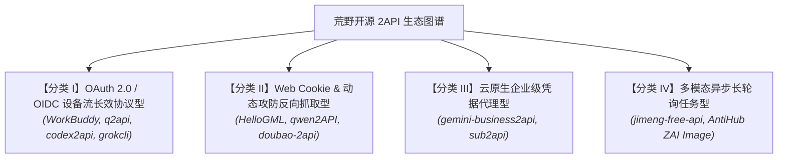
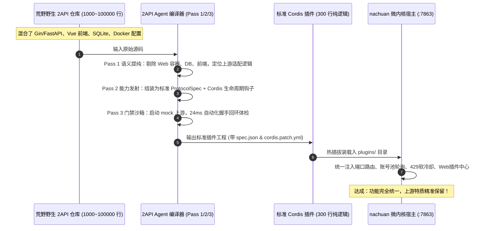

# 荒野 2API 全景架构图谱、共性解剖与分类归一化方案 (Master Taxonomy & Synthesis)

> **核心思想：该统一的统一，该保留的保留。**  
> 消除开源社区各野生 2API 重复造轮子（自建 Web 服务器、自建数据库、自建前端、重型 Docker 堆叠）的结构性浪费，通过 **2API Agent 编译器** 剥离实体、提纯逻辑，将其编译为功能统一、生命周期完整、能力自足的标准微内核插件。

---

## 1. 调研样本全景实证矩阵 (Top 10 Empirical Matrix)

我们对克隆至本地 `research/wild_repos/` 的 10 款 GitHub 活跃/代表性 2API 开源仓库进行了全源码深度解剖：

| # | 目标项目 | 主语言栈 | 源码体量 (SLOC) | 原始架构过度工程化实体 | 逆向上游目标 | 核心逆向技术点 | 架构深度解剖报告链接 |
|:---:|---|---|---:|---|---|---|:---:|
| **1** | **`sub2api`** | Go (Gin, Ent) + Vue 3 | 1,301,343 | PostgreSQL + Redis + Ent ORM + 支付系统 + Vue 前端 | Claude / OpenAI / Grok | 多租户 RBAC、多上游聚合 | [查看详细解剖报告](file://<LEGACY_WORKSPACE>/research/reports/01_sub2api_architecture_report.md) |
| **2** | **`codex2api`** | Go (Gin) + React + SQLite | 475,026 | SQLite + Redis + React 前端 + Docker Compose | OpenAI Codex / Copilot | WebSocket 全双工流、macOS CBOR 硬件认证 | [查看详细解剖报告](file://<LEGACY_WORKSPACE>/research/reports/02_codex2api_architecture_report.md) |
| **3** | **`gemini-business2api`** | Python (FastAPI) + React | 17,059 | FastAPI + Uvicorn + Docker + React 前端 | Google Gemini Business | Google SA JWT 签名、XSrf 嗅探、widgetStreamAssist | [查看详细解剖报告](file://<LEGACY_WORKSPACE>/research/reports/03_gemini_business2api_architecture_report.md) |
| **4** | **`qwen2API`** | Go (Gin) + React | 19,341 | Gin 路由 + React 前端 + Docker | 阿里通义千问 Web | QNML/XML 工具调用状态机、Web Cookie 逆向 | [查看详细解剖报告](file://<LEGACY_WORKSPACE>/research/reports/04_qwen2api_architecture_report.md) |
| **5** | **`jimeng-free-api`** | TypeScript (Express) | 7,087 | Node.js 运行时 + Express + 独立端口 | 字节跳动即梦 Web | 文生图/生视频多模态、异步长轮询状态机 | [查看详细解剖报告](file://<LEGACY_WORKSPACE>/research/reports/05_jimeng_free_api_architecture_report.md) |
| **6** | **`grokcli-2api`** | Go + Python (复合双语言) | 147,782 | Go + Python 双进程 + PostgreSQL + Redis + Docker | xAI Grok (CLI & Web) | Cloudflare Turnstile 求解、SSO 会话提取 | [查看详细解剖报告](file://<LEGACY_WORKSPACE>/research/reports/06_grokcli_2api_architecture_report.md) |
| **7** | **`AntiHub-ALL`** | Python + Next.js + Tauri (Rust) | 47,608 | Next.js 前端 + FastAPI 后端 + PostgreSQL + Redis + Tauri | Copilot / AWS Kiro / Gemini | AWS EventStream 二进制拆包、思维链解析 | [查看详细解剖报告](file://<LEGACY_WORKSPACE>/research/reports/07_antihub_all_architecture_report.md) |
| **8** | **`HelloGML`** | TypeScript (Cloudflare Worker) | 3,265 | Cloudflare Worker 依赖 + 简易 Admin 面板 | 智谱清言 Web | Refresh Token 自动置换、Assistant Stream 映射 | [查看详细解剖报告](file://<LEGACY_WORKSPACE>/research/reports/08_hellogml_architecture_report.md) |
| **9** | **`doubao-2api`** | Python (FastAPI, Playwright) | 776 | Playwright 无头浏览器 + FastAPI + Nginx + Docker | 字节跳动豆包 Web | 动态 msToken 嗅探、出站 Cookie 签名更新 | [查看详细解剖报告](file://<LEGACY_WORKSPACE>/research/reports/09_doubao_2api_architecture_report.md) |
| **10** | **`q2api`** | Python (FastAPI) + SQLite | 5,357 | FastAPI + SQLite + 独立 Account Feeder 容器 | Amazon Q Developer | AWS OIDC Device Flow、Claude 格式转译 | [查看详细解剖报告](file://<LEGACY_WORKSPACE>/research/reports/10_q2api_architecture_report.md) |
| *基线* | *`workbuddy2api`* | Go 原生 | 28,310 | 历史 Docker 镜像与容器绑定 | 腾讯 WorkBuddy / CodeBuddy | OAuth 设备流、WorkBuddy 三段式 UA、纯 API 成长任务 | [查看代码分析报告](file://<LEGACY_WORKSPACE>/PROJECT_ANALYSIS.md) |

---

## 2. 荒野 2API 的四大结构分类 (The 4 Structural Archetypes)

通过解剖这 10 个项目，可以发现开源社区所有 2API 在底层结构上并非杂乱无章，而是严格收敛为**四大结构原型**：

### 分类 I：OAuth 2.0 / OIDC 设备流长效协议型
- **代表项目**：`workbuddy2api`（腾讯）、`q2api`（亚马逊）、`codex2api`（微软/OpenAI）、`grokcli-2api`（xAI）
- **特征**：上游提供正规或半开放的命令行客户端（CLI）。通过标准 OAuth 2.0 Device Authorization Flow 获取 Client Token 与 Refresh Token。
- **稳定性**：★★★★★（极高，长效 Token 寿命可达数天至数周，几乎不触发图形验证码）。
- **统一难点**：设备授权轮询状态机、用户在浏览器中的核验 URL 引导。

### 分类 II：Web Cookie & 动态攻防反向抓取型
- **代表项目**：`HelloGML`（智谱清言）、`qwen2API`（通义千问）、`doubao-2api`（字节豆包）
- **特征**：直接逆向网页版的前端接口。依赖用户的 Web Cookie、CSRF Token、动态签名（如字节 `msToken` / `a_bogus`）。
- **稳定性**：★★★☆☆（中等，受网页端前端发版和 WAF 风控策略调整影响较大）。
- **统一难点**：动态 Token 定时刷新嗅探、伪装浏览器的动态 Header 组装。

### 分类 III：云原生企业级凭据代理型
- **代表项目**：`gemini-business2api`（Google Cloud）、`sub2api`（混合多供应商）
- **特征**：依赖企业级服务账号证书（Service Account JSON）或公有云 IAM 私钥自签名生成短效 Access Token。
- **稳定性**：★★★★☆（高，调用的是企业云平台内部网关，并发容量大）。
- **统一难点**：RSA/ECDSA 私钥签名算法、租户凭证与多端点路由映射。

### 分类 IV：多模态异步长轮询任务型
- **代表项目**：`jimeng-free-api`（字节即梦）、`AntiHub-ALL`（Z.AI 图像）
- **特征**：上游不提供同步阻塞式返回，而是“提交任务 (Submit) -> 轮询状态 (Polling) -> 提取结果 (Fetch Asset)”。
- **稳定性**：★★★☆☆（受上游算力排队时间与 CDN 链接时效性限制）。
- **统一难点**：需要把异步的长轮询状态机无缝包装为符合 OpenAI `/v1/images` 或 `/v1/chat/completions` 的单次调用语义。

---

## 3. “该统一的统一，该保留的保留” 架构实施矩阵

针对上述 4 类原型，`nachuan` 确立了清晰的**职责划分红线**：

```mermaid
flowchart LR
    subgraph UnifiedHost["【该统一的】nachuan 宿主微内核统一承载 (The Invariants)"]
        U1["统一监听单一端口 (:7863)，消除端口冲突"]
        U2["统一多账号池调度 (加权轮询 / 租约互斥 / 429软冷 / 402硬冷)"]
        U3["统一本地自足持久化 (零 DB / 零 Redis / auths + data 目录原子管理)"]
        U4["统一内嵌 Web 控制台 (账号总览 / 插件中心 / 用量统计 / 热重载)"]
        U5["统一协议流式修复状态机 (强制 SSE 补齐 [DONE] / DSML 原生工具修复 / 思维链提取)"]
        U6["统一测试打桩沙箱 (httptest 假上游回环体检)"]
    end

    subgraph PreservedPlugin["【该保留的】Cordis 插件专用契约保留 (The Variants)"]
        P1["上游特有的鉴权生命周期 (OAuth 设备流 / RSA 签名 / Cookie 刷新)"]
        P2["上游特有的反爬指纹伪装 (特定 UA 白名单 / Referer / Turnstile / msToken)"]
        P3["上游特有的请求体组装 (Claude context / Gemini parts / Qwen 附件)"]
        P4["上游专有流式解复用 (AWS EventStream 二进制拆包 / WS 帧重构 / QNML 过滤)"]
        P5["上游特有的专属运维任务 (每日签到 / 成长任务 API / 旅行 / 代金券)"]
    end

    UnifiedHost <===>|标准 Context 注入与事件总线| PreservedPlugin
```

### 详细决策对照清单

| 关注点 | 传统野生 2API 的做法 | nachuan 微内核统一做法 | 决策理由 |
|---|---|---|---|
| **网络监听** | 每个项目自开一个 Gin/FastAPI 端口（如 :8000, :3000, :8080） | **【统一】** 全部由 `nachuan` 统一在 `:7863`（支持自定义）对外暴露 | 根治同时开多个 2API 时的端口冲突与反向代理繁琐配置 |
| **持久化存储** | 重度引入 MySQL / PostgreSQL / Redis / SQLite，配一套迁移脚本 | **【统一】** 彻底剔除外部数据库，统一以本地原子 JSON 文件持久化在 `auths/` 与 `data/` | 零运维成本，单二进制运行，整机备份只需 2 秒打包文件夹 |
| **账号池治理** | 各写各的 Round-Robin，很多项目甚至只支持单账号，429 直接报错 | **【统一】** 统一步入 `internal/pool`，享受 Top-5 免费优先、在途租约限流、智能软硬冷却与会话粘性 | 集中解决账号封锁与多并发打穿 WAF 的共性痛点 |
| **Web 控制台** | 动辄引入 Vue 3 / React / Vite，产生几百 MB node_modules 与复杂构建 | **【统一】** 统一在内嵌面板（`go:embed` 单 HTML 文件）展现「插件中心」，秒级免构建加载 | 极佳的自用体验，UI 统一优雅，明暗主题原生自适应 |
| **流式与标记修复**| 各自写简易字符串 replace，经常缺失 `[DONE]` 或正文泄露工具标记 | **【统一】** 统一由宿主输出层把关，强制补全 `[DONE]` 闭环，内置 DSML 状态机还原 `tool_calls` | 保证下游 Cursor、Cherry Studio 等客户端绝对不报错、不卡死 |
| **上游鉴权握手** | - | **【保留】** 各插件保留专有的 `fetchAuth` / `refreshAuth` | 每个上游的 OAuth URL、参数、加密方式完全不同，无法也不该硬性抹平 |
| **请求指纹伪装** | - | **【保留】** 各插件声明专属的 `headers` 白名单与动态计算钩子 | 避开上游 WAF 检测的关键所在，必须精确保留 |
| **上游流式拆包** | - | **【保留】** 各插件实现专有的 `transformStream` (如 EventStream 二进制解析) | 上游专有数据包结构千奇百怪，保留专有解析，输出给宿主统一文本增量 |
| **上游特色功能** | - | **【保留】** 如 WorkBuddy 独有的 17 个纯 API 任务自动执行、猫猫旅行等 | 保持平台特有的白嫖积分与运维红利，做成插件可选扩展能力 |

---

## 4. 重新定义 “2API Agent 编译器” 的真实内涵

经过对 10 款野生仓库的实证解剖，我们必须对 **“2API Agent 编译器 (2API Agent Compiler)”** 的使命进行升级升华：

> **Agent 编译器绝不仅仅是一个生成路由配置的脚手架，而是一台“代码提纯机与能力统一重构机”！**

### 传统编译 vs Agent 编译器全景对照

### 编译器的三重提纯境界：
1. **第一重境界（剥离过度实体）**：把 2000+ 行甚至几万行的野生仓库，剥离掉所有不需要的 Web 监听器、静态文件服务、数据库 ORM，提纯为不到 300 行的纯 Adapter 适配器；
2. **第二重境界（统一生命周期）**：无论原始仓库是 Go、Python 还是 TypeScript，统一将其上游调用翻译为标准 Cordis 插件语义（生命周期握手 `fetchAuth`/`refreshAuth`、请求重构 `buildRequest`、流式拆包 `transformStream`）；
3. **第三重境界（统一功能对齐）**：编译完成挂载进 `nachuan` 宿主后，该插件**立即自动获得**：
   - 全局多账号轮询与租约锁；
   - 429 智能指数退避软冷却；
   - Web 控制台可视化展示与一键热重载；
   - 流式 SSE 强制 `[DONE]` 闭环；
   - 工具调用标记（Tool Calls）还原与思维链提取。

**这就是“编译完之后，它不仅仅是 2 API 的一个插件，而且它的功能也应该是统一的”真正落地闭环！**
