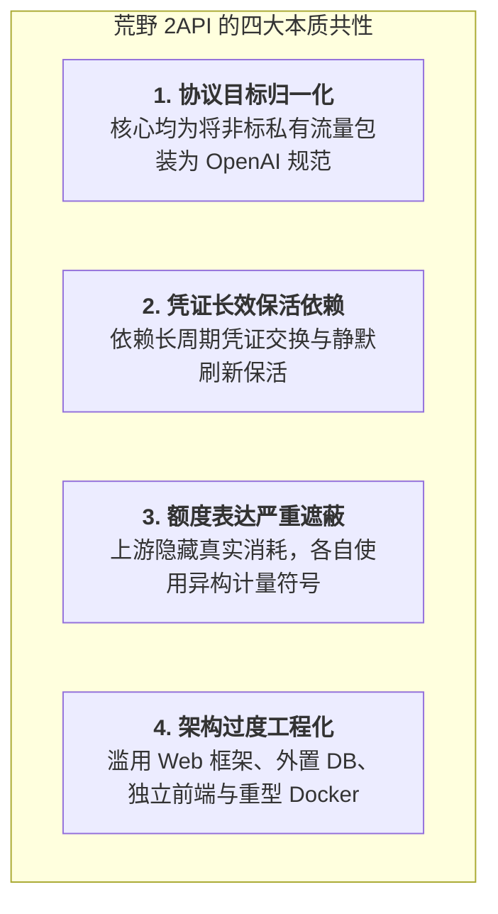
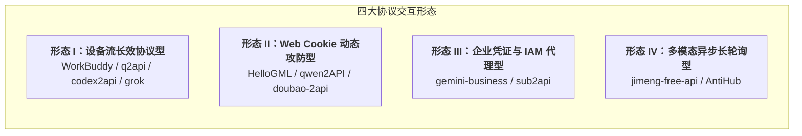
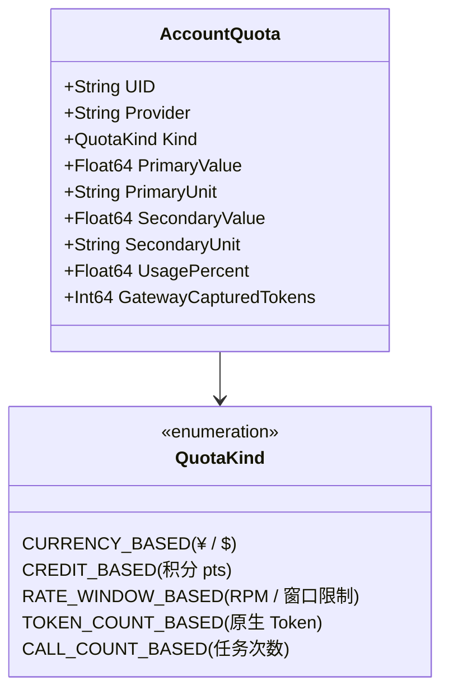
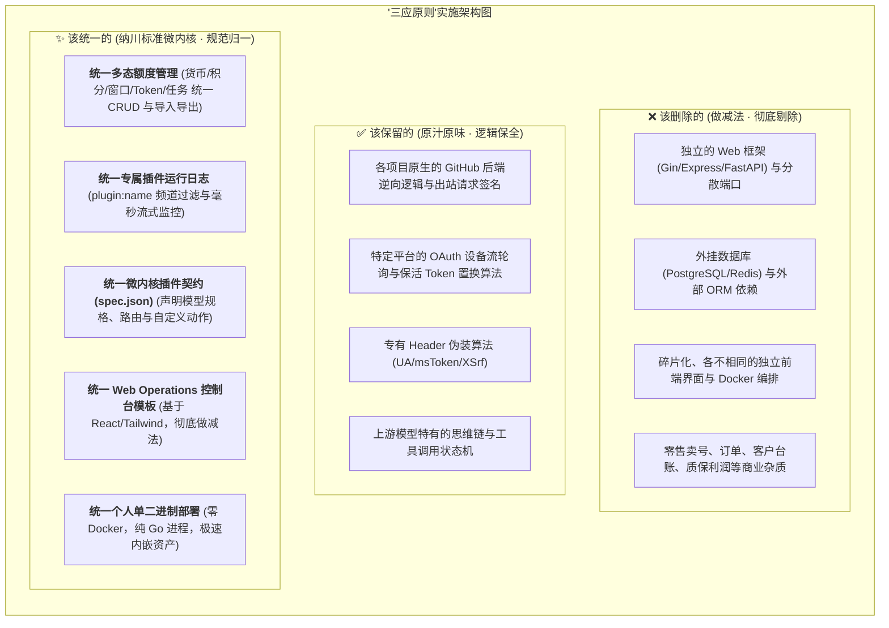

# 10 款 GitHub 热门 2API 开源项目综合对比分析报告
## ——共性解剖、差异图谱与“三应原则”统一架构全景

> **核心导言**：  
> 本报告基于对本地完整克隆并逐行审计的 10 款 GitHub 代表性 2API 开源项目（涵盖 Go、Python、TypeScript、Rust/Tauri 多语言栈，总计逾 200 万行代码），进行深度的横向横切对比。系统性剖析其架构共性、运行机制差异，并紧扣用户提出的**“该统一的统一、该保留的保留、该删除的删除”**三大原则，重点论证**“多态额度统一表达”**、**“专属插件运行日志监控”**与**“原生后端保留+前端适配统一模板”**的技术落地路径。

---

## 一、10 款 2API 核心维度对比矩阵

| # | 目标项目 | 语言与运行时 | 原始过度工程化实体 (待删除) | 逆向上游目标 | 额度表示方式 (多态性) | 会话与保活机制 | 协议转换复杂度 |
|:---:|---|---|---|---|---|---|---|
| **01** | **`sub2api`** | Go (Gin) + Vue 3 | PostgreSQL + Redis + Ent ORM + 支付系统 + Vue 前端 | Claude / OpenAI / Grok | **货币余额 / 计费倍率** (后台换算 Token) | API Key 轮询 + 独立多租户会话 | 极高 (多协议双向转译) |
| **02** | **`codex2api`** | Go (Gin) + React | SQLite + Redis + React 前端 + 重型 Docker | OpenAI Codex / Copilot | **请求频次窗口 / 月度配额** (物理捕获 Token) | GitHub Device Flow + macOS CBOR 硬件注入 | 极高 (WebSocket 全双工流) |
| **03** | **`gemini-business2api`** | Python (FastAPI) + React | FastAPI + Uvicorn + Docker Compose + React 前端 | Google Gemini Business | **组织席位额度 / 请求上限** (捕获 Token) | Google SA JWT 签名 + XSrf 动态置换 | 高 (widgetStreamAssist 拆包) |
| **04** | **`qwen2API`** | Python/Go (Flask/Gin) + React | Gin 路由 + 独立前端 + Docker 容器 | 阿里通义千问 Web | **原生 Token 计数** (直接透出) | Web Cookie + CSRF 自动化防爬置换 | 高 (QNML/XML 工具调用状态机) |
| **05** | **`jimeng-free-api`** | TypeScript (Node/Express) | Node.js 独立进程 + Express + 独立端口服务 | 字节跳动即梦 Web | **任务点数 / 每日免费次数** (按张计费) | 网页端 Sessionid + 动态 Header 伪装 | 中等 (异步长轮询状态机转同步) |
| **06** | **`grokcli-2api`** | Go + Python 复合架构 | 双进程架构 + PostgreSQL + Redis + Docker | xAI Grok (CLI & Web) | **频次限制窗口** (如 30 次/2小时) | Cloudflare Turnstile 求解 + SSO 会话置换 | 极高 (WAF 破盾 + CLI 逆向) |
| **07** | **`AntiHub-ALL`** | Python + Next.js + Tauri (Rust) | Next.js 前端 + FastAPI + PostgreSQL + Redis | Copilot / AWS Kiro / Gemini | **订阅配额 / 积分消耗** (按模型倍率) | AWS 临时凭证 + OAuth 设备轮询 | 极高 (AWS EventStream 二进制拆包) |
| **08** | **`HelloGML`** | TypeScript (Cloudflare Worker) | CF Worker 绑定 + 简易 Admin HTML 框架 | 智谱清言 Web | **原生 Token / 对话轮次** (无显式额度) | Refresh Token 自动定时无缝置换 | 中等 (Assistant SSE 协议转译) |
| **09** | **`doubao-2api`** | Python (FastAPI, Playwright) | Playwright 无头浏览器 + Nginx + Docker | 字节跳动豆包 Web | **免费对话额度** (无上限/动态限流) | 动态 msToken 嗅探 + 出站签名注入 | 极高 (需无头浏览器执行 JS 算签名) |
| **10** | **`q2api`** | Python (FastAPI) + SQLite | FastAPI 框架 + SQLite 数据库 + Feeder 容器 | Amazon Q Developer | **账号月度免费调用量** (窗口限制) | AWS OIDC Device Authorization Flow | 高 (Claude Messages 互转) |
| *基线* | **`workbuddy`** | Go 原生 (纳川微内核) | 原历史 Docker 镜像强加 | 腾讯 WorkBuddy / CodeBuddy | **积分制** (明确可用积分 pts，如 371.4k) | OAuth 设备流 + 三段式 UA + 自动化任务 | 完整成熟 (单二进制、零 Docker) |

---

## 二、共性深度剖析：荒野 2API 的普遍规律与结构通病

通过深入分析这 10 个项目，我们提炼出荒野 2API 的四大本质共性：

### 1. 协议目标的极度统一（Ingress 归一化）
无论是网页逆向、CLI 逆向还是企业凭证代理，所有项目的终极目标**完全一致**：将上游各种私有的、非标准的交互协议（WebSocket、SSE、Protobuf、AWS 二进制 EventStream、异步轮询任务），统一转化为工业界通用标准的 **OpenAI 兼容接口**（`POST /v1/chat/completions`、`GET /v1/models`、流式 `text/event-stream`）。

### 2. 会话生命周期与静默保活的强依赖
所有 2API 均无法通过简单的静态 API-Key 长期工作。它们必须维护一套精密的**凭据生命周期状态机**：
- **OAuth 设备授权轮询**：如 WorkBuddy、q2api、codex2api，均需要先向授权端点索取 user code，提示用户访问确认 URL，随后后台异步长轮询置换 token。
- **动态 Token 静默置换**：如 HelloGML（智谱）、sub2api，在每次调用或 access token 即将过期时，调用上游刷新端点获取新令牌。

### 3. 上游额度对 Token 的严重遮蔽与异构表达
**这是最核心的共性业务痛点**：上游厂商基于商业风控或产品形态，几乎**不会直接在每次请求中诚实透出 OpenAI 标准的 `usage.total_tokens`**：
- 它们要么展示为**“余额还剩 ¥48.60”**（DeepSeek）；
- 要么展示为**“剩余可用积分 5546 pts”**（WorkBuddy）；
- 要么展示为**“当前窗口剩余 38 / 50 次，42 分钟后重置”**（Gemini Free、Grok）；
- 要么展示为**“剩余 18 次高清生成”**（即梦）；
- **所有项目本质上都需要在网关侧进行“物理捕获真实 Token”**，以便核算成本或防范刷崩。

### 4. 严重的“过度工程化”通病（结构性浪费）
每一个开源作者在实现自身平台的逆向逻辑时，都不可避免地“顺手”引入了一整套笨重的基础设施：
- **自建独立 Web 框架**：各自开辟监听端口（有的占 `:8000`、有的占 `:3000`、有的占 `:5000`）；
- **外挂复杂数据库**：动辄依赖 PostgreSQL、Redis、SQLite，甚至引入重量级 ORM；
- **自造简陋前端**：每个项目各自开发了一套参差不齐的前端页面（React、Vue、Next.js、原生 HTML）；
- **强绑重型 Docker**：逼迫最终用户在本地安装 10 个容器、拉取十几个 GB 的镜像。

---

## 三、差异深度剖析：协议机制与额度形态的本质分歧

各项目的不同之处，主要集中在**四大协议交互形态**与**五类额度计量模型**：

### 1. 协议交互形态差异
1. **形态 I：设备流长效协议型（高稳定性）**
   - 代表：`WorkBuddy`, `q2api`, `codex2api`, `grokcli`
   - 机制：利用官方 CLI 工具开放的标准 OAuth 2.0 Device Flow，获取长达数天至数周的长效 Refresh Token。
   - 优势：几乎不触发图形验证码，不依赖本地无头浏览器，极其适合纯服务器自动化托管。
2. **形态 II：Web Cookie & 动态攻防反向抓取型（高对抗性）**
   - 代表：`HelloGML`（智谱）, `qwen2API`（千问）, `doubao-2api`（豆包）
   - 机制：直接逆向网页版。依赖出站 Cookie、CSRF Token，甚至需要动态算签（如字节 `msToken` / `a_bogus`）。
   - 差异：极易随前端改版失效，需配套动态签名更新机制或 Header 伪装算法。
3. **形态 III：云原生企业级凭据代理型（高并发）**
   - 代表：`gemini-business2api`, `sub2api`
   - 机制：基于 Service Account JSON 或 IAM 私钥自签名生成短效 Token，直连企业级内部网关。
   - 差异：调用延迟低、吞吐大，但对加密库（RSA/ECDSA SHA256）与租户隔离要求高。
4. **形态 IV：多模态异步长轮询任务型（非即时流）**
   - 代表：`jimeng-free-api`（文生图/视频）
   - 机制：不支持同步生成。客户端发起请求后，上游返回 `task_id`，必须在服务端维持 500ms~1s 的长轮询探测，直至上游渲染成功提取 CDN 静态资源 URL。

---

### 2. 额度计量模型的五类多态性（核心差异）

用户精准指出的“额度到底有多少”在 10 个项目中表现为如下五类多态表达：

1. **货币计量制（`currency`）**：如 DeepSeek，前台展示为金钱余额（¥48.60 / $10.00），网关在后台通过流式 chunk 累加捕获其实际消耗的 Token 数量。
2. **积分计量制（`credit`）**：如腾讯 WorkBuddy，清晰直观地展示为可用积分（如 5546 pts / 371.4k pts 总量），请求按上游计费规则直接抵扣积分。
3. **频次窗口制（`rate_window`）**：如 Google Gemini Free Tier（15 RPM，42 分钟后重置）、xAI Grok（30 次 / 2 小时）。额度的本质是**“时间窗口内的可用请求频次与倒计时”**。
4. **原生 Token 计数制（`token_count`）**：如 Qwen、HelloGML，上游本身或网关估算直接透出累计 Token 额度。
5. **任务/次数计量制（`call_count`）**：如字节即梦，按“张”或“次”扣减，展示为“VIP 剩余 18 次生成”。

---

## 四、“三应原则”综合落地方案：统一、保留与删除

结合用户明确提出的三大指导方针，纳川平台的重构与统一标准如下：

### 1. 彻底删除（做减法）
- **删除独立的 Web 服务进程与散乱端口**：所有 2API 不再独立监听端口（如 3000、5000、8000），全部编译为微内核运行时的动态插件；
- **删除外部数据库**：剔除 PostgreSQL、Redis 依赖，配置与状态全部由宿主通过内存环形缓冲区 + 轻量 JSON/SQLite 本地自闭环落盘；
- **删除多套孤立前端**：不再让用户面对 10 个不同的网页；
- **删除商业卖号杂质**：按照用户最新指示，从控制台彻底剥离订单（Orders）、录单（Entry）、生意决策（Decision）、客户台账（Customers）、进场/已售/待售等零售售卖概念，还原纯粹的个人专属 2API 网关。

### 2. 忠实保留
- **保留原生后端逆向代码**：各个开源仓库中针对特定上游精心调试的逆向算法（如 WorkBuddy 的三段式 UA 签名、q2api 的 AWS OIDC 换票、HelloGML 的 refresh 置换、qwen2API 的 XML 解析）100% 完整保留，不得篡改上游逆向语义。
- **保留平台专有的自定义运维动作**：如各项目特有的“刷新 Access Token”、“测试上游连通性”、“清扫成长任务”，通过 `spec.json` 的 `actions` 字段声明并保留。

### 3. 全局统一（核心工程交付）
1. **统一多态额度管理引擎（`internal/quota/quota.go`）**：
   - 抽象 `KindCurrency`、`KindCredit`、`KindRateWindow`、`KindTokenCount`、`KindCallCount`；
   - 统一全平台账号的生命周期（存活、停用、冷却、暂停），支持 JSON 批量导入、导出备份与动态 CRUD；
   - 统一在网关转发层对比捕获物理真实消耗的 Token。
2. **统一专属插件运行日志与监控（`internal/panel/ring.go` & `internal/plugin/metrics.go`）**：
   - 每接入一个 2API 插件，系统自动分配专属日志频道（`plugin:<name>`）；
   - 在前端实时流式输出日志中提供一键过滤胶囊（`[🔌 hellogml]`、`[🔌 qwen]`、`[🔌 workbuddy]`）；
   - 插件卡片顶部展示标准化遥测条：请求总数、成功率、异常数、均耗时、捕获 Token。
3. **统一 Operations 前端模板适配（`frontend/`）**：
   - 原项目后端接入后，其配置输入项（`credentials`）、运维操作（`actions`）、模型路由（`models`）全部自动渲染进纳川统一的 Operations 原生模板中，无需开发任何孤立前端。

---

## 五、结论与后续实施指引

本报告阐明的“共性与差异”，清晰界定了 2API 架构中**“易变与不变”**、**“核心与外围”**的分界线：
- **不变的核心**：上游协议的逆向转译代码。
- **应变的外围**：Web 框架、数据库、前端控制台、额度管理、运行日志。

纳川平台正是通过将外围的框架与前端全部收拢归一，让每一个野生的 2API 项目都能“脱掉笨重的外壳”，以极度轻量、稳定可靠的标准微插件形态并入系统，实现单二进制、零 Docker、多态额度聚合与专属日志全景监控。
