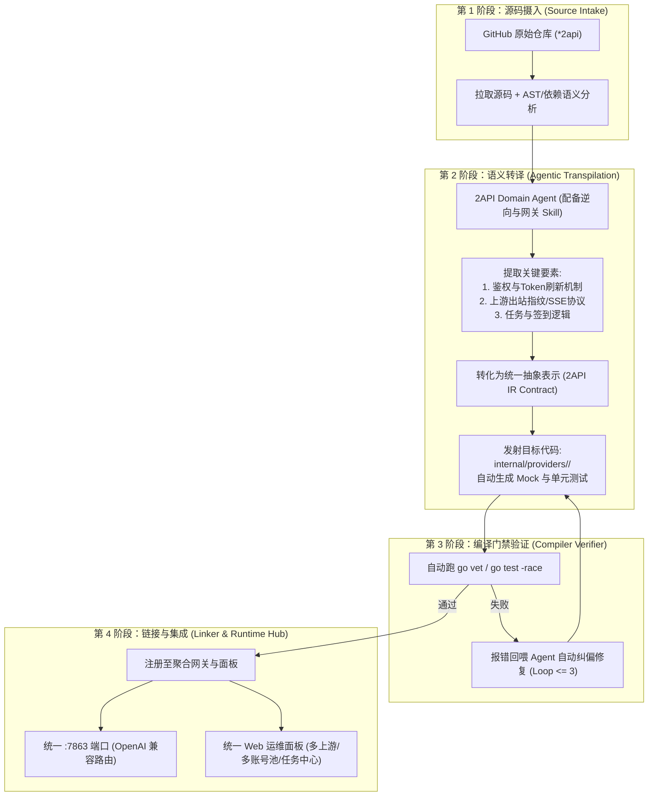

# nachuan (纳川) · 2API 聚合工作台与语义编译器产品需求文档 (PRD)

| 项目 | 内容 |
|---|---|
| **产品名称** | **nachuan (纳川)** · 2API Agentic Transpiler & Unified Panel Hub |
| **文档版本** | v1.0 |
| **文档状态** | 技术评审与架构蓝图定稿 |
| **全景索引** | **[官方全景文档总索引 (DOCS_INDEX.md)](DOCS_INDEX.md)** |
| **理论模型** | 编译器工程模型（Source Code → Lexer/Parser → IR → Codegen → Linker） |
| **核心命题** | 取“海纳百川”之意，将 GitHub 上异构、碎片化的 `*2api` 开源逆向项目，通过具备专属 Skill 的 Agent 自动化转译为标准插件，并无缝链接入统一的 OpenAI 兼容网关与 Web 运维面板。 |

---

## 一、背景与问题

### 1.1 现状与痛点
在开源社区中，存在大量优秀的 `*2api` 项目（如 `workbuddy2api`、`phanthycode2api`、`cursor2api`、`kiro2api` 等），它们通过逆向工程将各大平台账号转化为 OpenAI 格式 API。然而当前开发与使用面临严重碎片化问题：
1. **异构割裂，运维极重**：各个项目语言不一（Go/Python/Node）、配置格式各异、端口互相冲突。用户若想同时使用 3 个服务，必须启动 3 个独立容器/进程，维护 3 套鉴权与配置。
2. **重复造轮子**：每个项目都在重复编写脆弱的 HTTP 服务器、单薄的错误重试、简陋的 Token 刷新，缺乏健全的账号池调度（冷却、熔断、在途并发租约、会话粘性）。
3. **人工重构成倍消耗精力**：手工将一个第三方 2api 项目改造成带面板、带账号池的企业级网关（如本仓库从 `workbuddy2api` 演化为 `workbuddy2api-panel`），需要数天高强度的逆向、重构与测试。

### 1.2 解决思路：以“编译器”视角实现全自动化
将「人工分析与代码改造」转化为**基于大语言模型 Agent 的代码级语义编译（Semantic Transpilation）与统一链接（Linking）**：
- **输入源（Source）**：GitHub 上的第三方原始 2api 代码库。
- **编译器前端与中端（Transpiler Engine）**：由专门具备 2api 逆向与网关知识的 Agent，提取逆向协议，提纯为通用中间表示（IR）。
- **目标链接（Linker & Hub）**：以本仓库成熟的账号池与面板架构为宿主基座，自动挂载成为统一切片模块，输出**个人专用的原生单二进制（Zero Docker · 免环境开销）**与内嵌 Web 控制台。

### 1.3 核心原则：个人极简专用 · 零 Docker 负担
* **拒绝无谓虚拟化**：坚决摒弃企业级复杂的 Docker/K8s/容器注册表套路，以“如无必要，勿增实体”为原则，原生单二进制执行，内存占用仅 ~20MB，不抢占本地工作站算力；
* **本地状态自足**：纯本地文件（`auths/` 与 `data/`）持久化，零外部数据库依赖，单目录备份迁移即全部。

### 1.4 研发范式：双轨敏捷试错与价值重构
* **实验探索期（Python / TS 优先）**：前期不拘泥于静态语言编译，允许开发者和 Agent 快速用 Python/TypeScript 脚本对上游鉴权与 SSE 端点进行敏捷打通，0 编译成本试错；
* **契约中间件（ProtocolSpec IR）**：将验证跑通的特征沉淀为标准 JSON（`spec.json`），实现语言无关的契约冻结；
* **生产重构期（Go 生产加固）**：对被验证为高价值、高并发且需要长期自用的通道，再精选重构进 Go 宿主单二进制，兼顾研发极速与运行时极简。

---

## 二、系统架构与编译器理论映射



---

## 三、三步流程的详细规范

### 阶段 1：从 GitHub 自动化抓取与逆向理解（Source Ingestion）

* **输入**：用户指定的目标 GitHub Repo URL（或抓取端自动扫描发现的目标）。
* **处理动作**：
  1. 克隆代码至沙箱工作区，扫描依赖清单（`go.mod` / `requirements.txt` / `package.json` 等）。
  2. 生成项目的《协议拓扑报告》：
     - 上游端点（Base URL、API 路径）；
     - 鉴权形态（Cookie、Bearer Token、OAuth Device Code、私有签名）；
     - 出站协议（是否流式 SSE、是否需要伪造设备指纹、私有标记如 DSML）；
     - 附加能力（是否包含每日签到、积分查询、任务完成端点）。

---

### 阶段 2：具备专属 Skill 的 Agent 语义转译（Semantic Transpilation）

为了避免 Agent 生成代码的接口漂移（Interface Drift），必须在系统层面建立固化的 **2API 中间表示接口契约（The 2API IR）**：

#### 核心 IR 接口定义：
每个被转译出的 Provider 模块必须严格实现以下标准接口：

```go
package provider

import "context"

// UpstreamProvider 统一上游接口契约 (2API IR)
type UpstreamProvider interface {
    // 基础元信息
    Name() string               // 唯一标识 (如 "workbuddy", "phanthycode", "cursor")
    DisplayName() string        // 面板展示名称
    SupportedModels() []ModelInfo // 支持的模型列表

    // 鉴权与凭证生命周期
    LoginFlow(ctx context.Context, trigger LoginTrigger) (*Credential, error)
    RefreshToken(ctx context.Context, cred *Credential) (*Credential, error)
    ValidateToken(ctx context.Context, cred *Credential) (bool, error)

    // 核心转发 (出站出流)
    ChatStream(ctx context.Context, cred *Credential, req *ChatRequest) (<-chan StreamChunk, error)
    
    // 错误分类状态机 (驱动通用账号池熔断/冷却)
    ClassifyError(err error, statusCode int, respBody []byte) ErrKind

    // 扩展运维能力 (可选接口)
    Checkin(ctx context.Context, cred *Credential) (*CheckinResult, error)
    FetchQuota(ctx context.Context, cred *Credential) (*QuotaInfo, error)
}
```

* **Agent 转译动作**：
  1. 丢弃第三方项目自建的 Web 框架代码（Gin/FastAPI 等冗余 HTTP 服务端）。
  2. 将其核心网络调用逻辑“提纯”，重构为上述 `UpstreamProvider` 接口实现。
  3. 自动生成对应的单元测试代码（使用 `httptest` 进行网络打桩）。

---

### 阶段 3：编译门禁与自愈闭环（Compiler Verifier）

转译不是一次性盲信的，必须有编译器级别的验证门禁：
1. **静态代码与编译期检查**：执行 `go vet ./internal/providers/...` 和 `go build`。
2. **确定性单测**：自动运行生成好的 `go test -v ./internal/providers/<provider_name>/...`。
3. **反馈修复环路**：若单测或构建报错，将 Compiler/Linter 的输出重定向回馈给 Agent，限制最多 3 轮自我修复；仍失败则阻断合并并提示人工介入。

---

### 阶段 4：链接改造至统一面板（Linker & Unified Hub）

转译成功的 Provider 模块将被正式“链接”进主程序：
1. **命名空间与模型路由**：
   - 方式一：裸模型名按账号池健康度自动路由（跨平台负载均衡）。
   - 方式二：命名空间前缀显式指定（如 `wb:deepseek-v3` 调用 WorkBuddy，`pc:deepseek-v3` 调用 PhanthyCode）。
2. **多账号池统一治理**：
   - 每个 Provider 实例挂载独立的子账号池，但复用统一的在途租约、指数冷却退避、状态持久化机制。
3. **统一 Web 管理面板**：
   - 账号管理页：以 Tab 或筛选器无缝切换管理各个平台的账号状态与积分。
   - 自动化中心：一键聚合运行各平台的每日签到与任务领奖。
   - 监控与日志：集中查看所有来源的调用分布、成功率、Token 消耗统计。

---

## 四、安全与合规红线

1. **凭证隔离与安全**：所有上游 Token 仅保存在本地持久化目录，权限严格设为 `0600`；严禁在代码、构建产物、日志中硬编码明文凭证。
2. **自用与防滥用边界**：生成的网关仅面向个人多账号接入本地 AI 客户端使用；严禁用于批量注册黑产、对外转售或商业卡密分发。
3. **优雅降级原则**：单个 Provider 的上游风控封锁不得影响整个聚合网关内其他 Provider 的正常运行。

---

## 🧭 架构文档导航
| 上一篇 | 📑 全景总索引 | 下一篇 |
|:---|:---:|---:|
| 🏠 [项目总览 (README.md)](README.md) | 📑 [官方全景文档总索引 (DOCS_INDEX.md)](DOCS_INDEX.md) | ⚙️ [微内核技术规范 (2API_CORDIS_TECH_SPEC.md)](2API_CORDIS_TECH_SPEC.md) ➡ |
