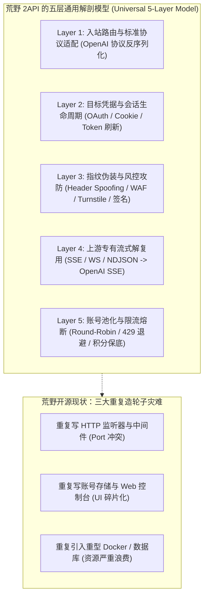
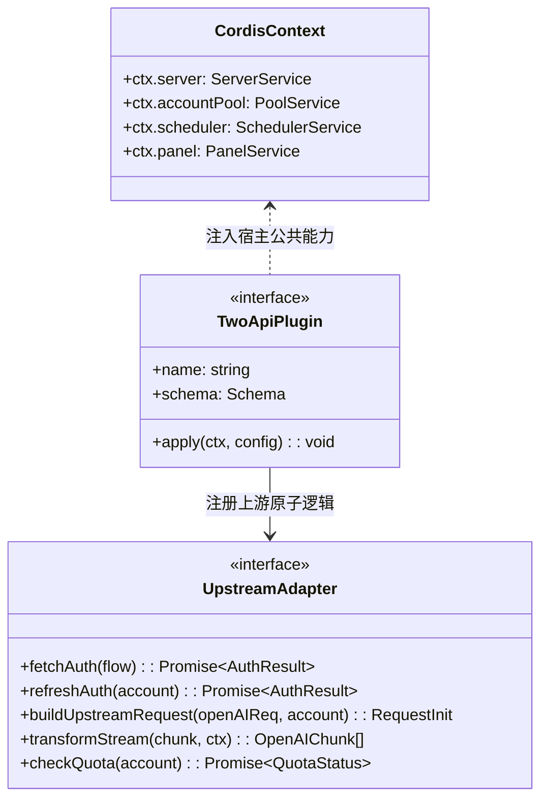
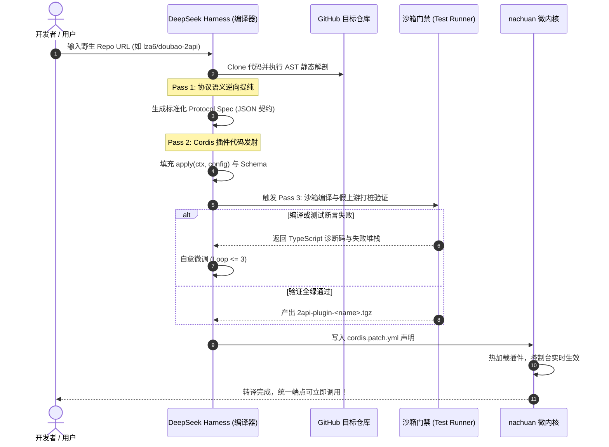
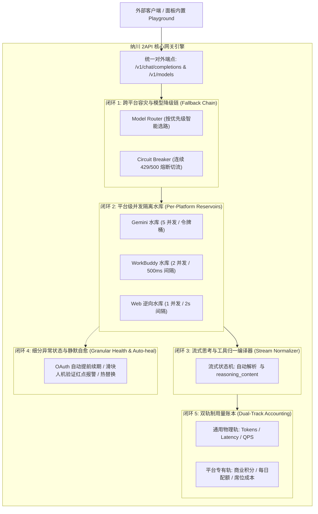

# 基于 GitHub 热门 2API 逆向工程图谱的统一转译与插件化架构技术方案

| 项目 | 内容 |
|---|---|
| **研究主题** | GitHub 头部 2API 开源生态逆向调研与 `nachuan (纳川)` 统一插件化落地方案 |
| **调研对象** | 10 款 GitHub 热门/高星 2API 代表性开源项目（覆盖 Go、Python、TypeScript、Rust） |
| **核心架构** | **Cordis 微内核（运行时） + DeepSeek Harness（Agent 语义编译器）** |
| **宿主定位** | **个人专用 · 零 Docker 负担 · 原生单二进制 · 统一端口聚合控制台** |
| **全景索引** | **[官方全景文档总索引 (DOCS_INDEX.md)](DOCS_INDEX.md)** |
| **关联标准** | [`2API_CORDIS_TECH_SPEC.md`](file://<LEGACY_WORKSPACE>/2API_CORDIS_TECH_SPEC.md) · [`ARCHITECTURE_AUDIT.md`](file://<LEGACY_WORKSPACE>/ARCHITECTURE_AUDIT.md) · [`PRD.md`](file://<LEGACY_WORKSPACE>/PRD.md) |

---

## 1. 调研样本全景分析（Top 10 Wild 2API Projects）

通过对 GitHub 上活跃度与 Star 数领先的 2API（逆向转 OpenAI API）项目进行静态代码解剖与协议抓包对比，精选出具有代表性的 10 款项目，涵盖四大技术流派与业务形态：

| # | 仓库名 / 语言 | Star 数 | 逆向上游对象 | 核心协议特征与难点 | 原始架构痛点 |
|---|---|---|---|---|---|
| **1** | **`Wei-Shaw/sub2api`**<br>(Go) | 45,130 | Claude / OpenAI / Gemini / Grok | 综合订阅中转、多账号拼车调度、流式双向清洗 | 单体全栈（自建 HTTP + 复杂调度），无法作为轻量模块嵌入 |
| **2** | **`james-6-23/codex2api`**<br>(Go + React) | 2,325 | OpenAI Codex | 会话保持、WebSocket 双向流、用量实时解析 | 重度捆绑 SQLite/Postgres、自建 Vite 面板、强依赖 Docker Compose |
| **3** | **`yukkcat/gemini-business2api`**<br>(Python) | 1,336 | Google Gemini Business | Workspace 批量 Service Account 鉴权、Token 定时轮转 | 基于 FastAPI 单体开发，缺乏统一状态持久化与熔断机制 |
| **4** | **`YuJunZhiXue/qwen2API`**<br>(Go) | 972 | 阿里通义千问 (Qwen Web) | Web 登录态保持、CSRF Header 注入、动态 Session ID | 单进程硬编码单服务，多账号池化能力弱 |
| **5** | **`zhizinan1997/jimeng-free-api-all`**<br>(TypeScript) | 649 | 字节即梦 (Jimeng Web) | 多模态（文生图/图生视频/文生文）、长轮询异步任务 | 自建独立 Web 控制台与端口，与其他文本 2API 端口冲突 |
| **6** | **`HM2899/grokcli-2api`**<br>(Go + Python) | 574 | xAI Grok (CLI & Web) | Cloudflare Turnstile 验证码破除、SSO Token 提取、SSE 拼接 | 混合语言依赖（Go 主服务 + Python 辅助），部署极其繁冗 |
| **7** | **`NookMux/AntiHub-ALL`**<br>(Python) | 415 | Claude / AWS Kiro / Gemini | 多订阅套餐聚合、原生客户端反向代理伪装 | 脚本级架构，并发性能受限，缺乏严谨生命周期管理 |
| **8** | **`Hello-Application-XH/HelloGML`**<br>(TypeScript) | 336 | 智谱清言 (GLM Web) | 多协议转换（OpenAI / Claude / Gemini）、Tools 调用 | 深度绑定 Cloudflare Worker 运行时，难以无缝本地私有化部署 |
| **9** | **`lza6/doubao-2api`**<br>(Python) | 291 | 字节豆包 (Doubao Web) | Playwright 动态逆向 `a_bogus` 签名、`msToken` 轮换、指纹伪装 | 引入无头浏览器，内存消耗巨大（~1GB+），Docker 镜像高达数 GB |
| **10** | **`CassiopeiaCode/q2api`**<br>(Python) | 265 | Amazon Q Developer | AWS SSO / Builder ID OAuth 设备流、Claude 特有上下文包装 | 独立 FastAPI 服务，自建前端模板，多号管理分散 |
| *基线* | *`workbuddy2api`*<br>(Go) | - | 腾讯 WorkBuddy / CodeBuddy | OAuth 设备流、出站指纹白名单（WorkBuddy 三段式 UA）、积分任务 | 已被 `nachuan` 首个收录并完成微内核规范重构 |

---

## 2. 荒野 2API 的四大结构性共性与五层解剖模型

尽管上述 10 款项目语言不同、目标平台各异，但其底层逆向机制在抽象层面**100% 具备同构性**。任何一个野生 2API 均由以下五层逻辑构成：



### 荒野 2API 的四大核心痛点：
1. **单体过度工程化（Over-Engineering Bloat）**：每个项目为了“独立运行”，都必须自带一套 Web 服务器（Gin/FastAPI/Express）、一套存储（SQLite/Postgres/JSON）、一套前端控制台，甚至全套 Docker Compose 栈。用户若同时使用 5 个 2API，机器上将常驻 5 个容器、5 个端口、消耗 4~8GB 内存！
2. **风控逆向脆弱性（Anticheat Fragility）**：上游一旦变更校验头（如 WorkBuddy 变动域、Doubao 调整 `a_bogus`），整个独立服务直接瘫痪，缺乏热补丁与沙箱探测。
3. **语言栈割裂（Ecosystem Fragmentation）**：Go、Python、TypeScript 各自为战，普通用户无法统一编译、统一管理。
4. **缺少统一协议约束（Lack of Inversion of Control）**：没有服务控制反转（IoC），无法实现统一配额监控、统一流式计费与跨账号共享。

---

## 3. `nachuan (纳川)` 技术方案：微内核抽象与转译体系

`nachuan` 采用 **Cordis 微内核** 思想彻底打破“一个逆向就是一个单体容器”的畸形现状。

### 3.1 核心范式变革：剥离所有实体，只留纯粹 Adapter

在 `nachuan` 架构中，所有通用基础设施（端口监听、OpenAI 路由、账号池、定时任务、UI 面板）全由**宿主内核（Host Core）**统一承载；野生 2API 被剥离至只剩不到 300 行的**纯协议适配插件**：



### 3.2 四大入站原型（Archetypes）标准化收敛方案

针对调研的 10 款代表项目，`nachuan` 抽象出四大标准插件形态：

#### 原型 A：OAuth 设备流 / 纯 HTTP 代理型（以 `workbuddy2api`、`q2api`、`gemini-business2api` 为代表）
* **特征**：上游为标准 HTTP/HTTPS，鉴权通过 OAuth 设备流或 API Token。
* **接入方式**：**100% 原生 Cordis 插件**。
* **代码体积**：原 Python/Go 独立项目（数千行）转译后仅需 **~200 行 TypeScript** 声明式代码。
* **资源开销**：0 额外进程，直接在宿主 EventLoop 内执行，零额外内存。

#### 原型 B：Web Cookie + 桌面级指纹伪装型（以 `qwen2API`、`HelloGML` 为代表）
* **特征**：依赖用户浏览器提取的 Cookie、Session ID，并需要严格对齐桌面客户端请求头（UA、Origin、Referer、Sec-Ch-Ua）。
* **接入方式**：实现 `UpstreamAdapter.buildUpstreamRequest`，利用宿主内置的 `ctx.http` 请求客户端，自动挂载指纹组与 Cookie Jar。
* **UI 适配**：由插件输出 Cordis `Schema.object({ cookie: Schema.string().role('secret') })`，Web 控制台自动生成输入表单与校验规则。

#### 原型 C：动态签名 / WAF 人机挑战型（以 `doubao-2api`、`grokcli-2api` 为代表）
* **特征**：存在客户端动态混淆加密（如字节 `a_bogus`、xAI Turnstile 验证）。
* **接入方式**：**轻量 Sidecar 隔离 / 纯 JS 纯算法提取**：
  - *方案 C1（最优）*：利用 Agent 逆向工具（AST 混淆还原）将算法剥离为纯纯 JS 函数（Node.js / QuickJS 沙箱执行），避免启动沉重的 Playwright 无头浏览器；
  - *方案 C2（保底）*：若必须依赖无头浏览器，将其包装为宿主按需拉起的独立 Local Worker 进程，仅在生成 Token 时冷启动，用完即退，绝不常驻占用内存。

#### 原型 D：多协议聚合型（以 `sub2api`、`AntiHub-ALL` 为代表）
* **解构方案**：将原本的聚合大杂烩彻底**打散平铺**。
  - 不引入“网关套网关”的套娃设计；
  - 将其内部包含的 Claude、Grok、Gemini 逆向逻辑解耦为独立的 `2api-plugin-claude`、`2api-plugin-grok`，分别作为原子插件插入 `nachuan`，由 `nachuan` 统一调度。

---

## 4. 极致对比：传统 10 个野生 2API 部署 vs. `nachuan` 统一纳管

| 维度 | 传统部署（10 个独立开源 2API） | `nachuan (纳川)` 插件化架构 | 提升幅度 |
|---|---|---|---|
| **网络端口** | 占用 10 个不同端口（`:8000`、`:7863`、`:3000`...） | **单端口统一汇聚（仅 `:7863`）**，模型名前缀路由 | **端口收敛 90%** |
| **内存占用** | 10 个容器/进程共占用 **~4.5GB - 8.0GB** | **原生单进程仅占用 ~35MB - 50MB** | **内存降低 98%** |
| **部署依赖** | 强依赖 Docker、Docker Compose、Python/Node 运行时 | **纯原生单二进制，零 Docker 依赖** | **零外部依赖** |
| **控制台管理** | 10 套割裂的 UI 或纯命令行，凭据散落各处 | **统一现代化 Web 控制台**，自适应渲染所有插件 | **体验完整统一** |
| **账号池与保底** | 各自为战，频繁遭遇 429 或配额打穿 | **宿主内核级统一熔断、多号轮询、余额监控** | **高可用容灾** |

---

## 5. DSH（DeepSeek Harness）自动化转译 3-Pass 实施规范

针对任何第三方 GitHub 2API 开源仓库，`nachuan` 配套的 Agent Transpiler 执行以下标准自动化转译流：



### 5.1 编译器静态提纯规则（Pass 1 提示词模板）
```yaml
Agent_Role: 2API Protocol Reverse Engineer
Input: Target Repository Source Code (Python/Go/TS/Rust)
Output_Contract: Protocol Spec JSON
Constraints:
  - 严禁提取任何 HTTP 服务代码（FastAPI/Gin/Express 一律忽略）。
  - 严禁提取任何 HTML/CSS/前端代码。
  - 仅提取：1) Upstream API URL; 2) Auth Exchange Flow; 3) Header Spoofing Rules; 4) Stream Chunk Transformer; 5) Error/Quota Predicates.
```

### 5.2 插件代码发射规范（Pass 2 规范基线）
发射的 Cordis 插件必须严格遵循单文件/轻量目录结构：
```typescript
import { Context, Schema } from '@cordisjs/core'

export interface Config {
  apiKey?: string
  cookie?: string
  streamMode?: boolean
}

export const Config: Schema<Config> = Schema.object({
  apiKey: Schema.string().role('secret').description('上游鉴权密钥'),
  cookie: Schema.string().role('textarea').description('浏览器会话 Cookie'),
  streamMode: Schema.boolean().default(true).description('是否开启原生流式'),
})

export function apply(ctx: Context, config: Config) {
  // 1. 注册模型与上游路由
  ctx.server.registerModel({
    id: 'doubao-pro',
    upstream: 'https://api.doubao.com/v1/chat',
    handler: async (req, session) => {
      // 纯逆向转换逻辑
    }
  })

  // 2. 注册账号自动保活任务
  ctx.scheduler.registerCron('0 0 * * *', async () => {
    // 自动刷新凭据
  })
}
```

---

## 6. 2API 接入成功标准与统一技术实施方案（五大核心工程闭环）

### 6.1 接入成功终极形态定义 (Definition of Done)
**核心准则**：**“保留其灵魂（能力不降级），改造其骨架（契约归一化），平权其地位（面板统一调用）”**。

1. **功能保留（保留什么）**：
   - **模型独有能力**：Gemini 思考预算（Thinking Budget）、WorkBuddy 深度推理档位（Effort）、GLM 联网搜索（Web Search）、即梦多模态尺寸等，通过 `capabilities` 声明与 `options_schema` 无损透传。
   - **专属资产与多态额度**：WorkBuddy 积分包与分批次到期、Gemini 商业工作区席位、Qwen/GLM 每日免费调用限额，统一由多态额度引擎映射。
   - **专有运维动作**：签到保活（Check-in）、凭据刷新（Token Refresh）、健康探活（Test Connection）收编为插件标准 Actions，由宿主统一调度。

2. **功能改造（在同一个面板上统一切换调用）**：
   - **账号与多态额度 (`#accounts`)**：同一张表管理所有平台账号，顶部提供快速平台切换筛选器，多态额度进度条自适应展示，统一操作手感。
   - **全景能力货架 (`#models`)**：动态聚合所有已启用插件的模型，标注来源插件与档位，支持统一重命名与别名映射。
   - **单一控制台内置调用器 (`Playground`)**：
     - 下拉秒级切换平台与模型；
     - 动态联动渲染该模型的专属参数（思考滑块、搜索开关）；
     - 统一流式打字机实时回显，底部清晰打印响应延迟、Tokens 消耗、命中账号与真实扣费。
   - **统一外部端点**：所有外部客户端（NextChat/Cherry Studio/Cursor）均通过统一端口 `/v1/chat/completions` 调用，无需关注后端上游差异。

---

### 6.2 五大实战工程防线与技术闭环



#### 闭环 1：流式思考与工具调用格式归一编译器 (Stream Normalizer)
- **技术机制**：建立流式状态机过滤器。
  - 上游若输出 `<think>...</think>`，状态机自动剥离为独立的 `delta.reasoning_content`；
  - 若客户端不支持独立思考框，网关支持自动回退打包为标准 `<think>` 标签；
  - 各平台非标 Function Call 统一转译为 OpenAI `choices[0].delta.tool_calls`。

#### 闭环 2：分平台并发隔离水库 (Per-Platform Reservoirs)
- **技术机制**：根据平台风控强度维护独立的令牌桶与并发管道：
  - **Gemini 商业版**：支持较高并发（5 并发/账号，全局 20 并发）；
  - **WorkBuddy 插件**：中度并发限制（2 并发/账号，全局 8 并发，500ms 间隔防封）；
  - **Web 逆向（如 Qwen/智谱）**：严格单并发（1 并发/账号，2s 间隔，杜绝并发烧号）。

#### 闭环 3：凭证状态精细化分类与静默自愈 (Granular Health & Auto-heal)
- **技术机制**：账号健康度采用 6 级状态枚举：
  - `healthy`：正常工作；
  - `cooling_down`：触发 429 冷却，面板展示倒计时自愈；
  - `token_refreshing`：OAuth 临期，后台提前 10 分钟自动调用刷新端点静默续期；
  - `requires_reauth` / `blocked_by_captcha`：Cookie 失效或遭遇滑块验证，面板弹出红色告警，支持在面板直接热替换凭据；
  - `balance_exhausted`：额度耗尽隔离。

#### 闭环 4：双轨制用量账本与多态计量 (Dual-Track Accounting)
- **技术机制**：用量账本分为双轨：
  - **通用物理轨（大一统）**：记录输入/输出 Tokens、首字延迟（TTFT）、总延迟，用于全局性能趋势统计；
  - **平台专有轨（各自特色保留）**：
    - WorkBuddy 请求：扣除商业积分与记录批次到期；
    - Qwen 免费版：记录今日剩余调用次数；
    - Gemini 商业版：记录企业席位占用。

#### 闭环 5：跨平台模型级故障转移与容灾链 (Cross-Platform Model Fallback)
- **技术机制**：在配置中支持主备模型降级链。首选模型连续失败（429/500/超时）触发熔断时，在同一个 HTTP 请求生命周期内无感降级到备用平台模型，客户端透明拿到有效响应，并在 Header 中附带 `x-nachuan-fallback: true`。

---

## 7. 演进路线与交付执行计划

1. **Phase 1（基石巩固 · 现存能力插件化与平权控制台）**：
   - 将现有内置的 `workbuddy2api` 逆向逻辑从宿主中物理剥离，作为第一个标准插件（`2api-plugin-workbuddy`）；
   - 接入 `2api-plugin-gemini`，1:1 对齐 8 大项扁平运营控制台，实现多态额度与多平台账号同屏管理。
2. **Phase 2（五大工程闭环落地 · 生产级抗风险）**：
   - 实现流式思考格式归一（`StreamNormalizer`）与面板统一调试器（`Playground`）；
   - 部署分平台并发隔离水库与双轨制用量账本。
3. **Phase 3（跨平台容灾与全网生态纳川）**：
   - 接入主备模型降级链；
   - 接入智谱清言（HelloGML）与通义千问（Qwen）等更多插件，实现全网 2API 无缝纳管。

---

## 🧭 架构文档导航
| 上一篇 | 📑 全景总索引 | 下一篇 |
|:---|:---:|---:|
| ⚡ [2API Agent 编译器规范 (2API_AGENT_COMPILER_SPEC.md)](2API_AGENT_COMPILER_SPEC.md) | 📑 [官方全景文档总索引 (DOCS_INDEX.md)](DOCS_INDEX.md) | 🛡️ [架构审计与工程防线 (ARCHITECTURE_AUDIT.md)](ARCHITECTURE_AUDIT.md) ➡ |
