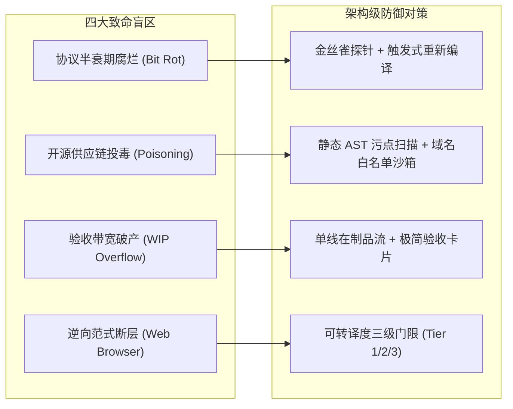

# nachuan (纳川) · 产品全周期规划与 AI 时代工程管理白皮书 (Lifecycle & Governance Specification)

| 项目 | 内容 |
|---|---|
| **文档名称** | **nachuan (纳川)** 产品全周期规划与 AI 时代工程管理白皮书 |
| **版本** | v1.0.0 (Baseline 定稿) |
| **全景索引** | **[官方全景文档总索引 (DOCS_INDEX.md)](DOCS_INDEX.md)** |
| **核心管理哲学** | **海纳百川 · 以人的注意力为第一稀缺资源 · 机器门禁替代人工审查 · 闭环韧性自愈** |
| **适用范围** | 指导 nachuan 微内核研发、DeepSeek Harness 语义转译流水线编排及全周期运维治理 |

---

## 一、 AI 时代的工程管理范式转移

传统软件工程（敏捷/瀑布）的核心假设是：**“工期受限于人类工程师的编码产能”**。因此，传统管理围绕工时估算、任务拆解与人月排期展开。

而在具备代码生成与逆向能力的 Agent 时代，这个假设彻底失效：
* **代码生成边际成本趋近于零**：AI 单次生成耗时仅数分钟（$L_{ai}$），且可全天候不知疲倦地工作；
* **人的注意力与验收带宽成为唯一瓶颈**：人类理解、审查、验证代码并作出决策的时间（$L_h$）通常以小时甚至天计。

```
传统管理模型：需求定义 ──> 人工编写代码 (最昂贵) ──> 人工测试 ──> 交付
AI 时代管理模型：定义中间契约 (IR) ──> AI 批量代码发射 (最廉价) ──> 自动化沙箱门禁 (机器代劳) ──> 人类极简验收
```

### 1.1 第一性管理公式与推论
基于提示词统筹（PCP）理论的第一性周期公式：
$$T(\text{工序}) = R \times (L_{ai} + L_h) = \frac{1}{\text{FPY}} \times (L_{ai} + L_h)$$

* **$L_{ai}$（AI 生成时延）不可压缩**：取决于底层模型算力与推理步数；
* **$L_h$（人的响应与验收时延）决定了 90% 的总周期**：交付物堆积越多，人的上下文切换成本越高；
* **FPY（一次通过率，First-Pass Yield）是唯一的乘数杠杆**：$R = \frac{1}{\text{FPY}}$。前置约束越严密，返工轮次 $R$ 越小。

### 1.2 AI 时代工程管理的三大铁律

1. **铁律一：代码生产是廉价的，代码审查是天价的（禁止一次性大推）**
   * 严禁人类去 Review 上千行的具体业务实现细节；
   * 人类只审查两点：**① 契约结构体（Schema / IR）是否合理；② 物理测试结果是否全绿**。测试未过的代码一律拒收，不进入人类视野。
2. **铁律二：在制品严格受限（WIP Limit $\le$ 验收带宽 $B$）**
   * 同时处于“转译中-待验收”状态的 2API 插件数量严格限制为 **1 个**。不验收完当前插件，绝不开辟下一条流水线。
3. **铁律三：黑盒门禁与机器自愈（Zero-Manual Debugging）**
   * 代码报错、编译失败、语法不合规，一律由 Harness 自动把控制台 `stderr` 回喂给 Agent 自行修复（限制 3 轮循环）；超过 3 轮未通过则直接归档报错，绝不让人去手工改 Bug。

---

## 二、 关键系统性盲区与防御机制

在多上游逆向与聚合场景中，必须在架构层面提前布设以下 4 道防线：



### 2.1 盲区一：上游协议半衰期腐烂（Bit Rot Crisis）
* **风险本质**：反代项目依赖上游非公开接口。厂商每 2~4 周更新一次签名或 WAF，会导致已转译插件静默失效。
* **防御机制（Canary Probe + Event-Triggered Re-compilation）**：
  * 每个 2API 插件必须内置独立的轻量心跳探针；
  * 定时任务（如每日 04:00）发送微型请求；一旦上游返回 403 或验签失败，系统自动将该插件置于 `degraded` 隔离状态，并**自动唤醒 DeepSeek Harness 触发增量修复编译**，杜绝人工消防式排障。

### 2.2 盲区二：开源供应链投毒与凭证外泄（Supply Chain Poisoning）
* **风险本质**：野生开源仓库可能隐藏恶意网络请求，在异常报错时窃取用户的 `refreshToken`。
* **防御机制（AST Taint Analysis & Network Sandbox）**：
  * **域名白名单隔离**：Agent 转译出的插件，出站网络请求域名必须严格限制在该平台的官方白名单内；
  * **敏感数据脱敏审查**：静态代码检查确保凭证仅流向本地配置目录（权限 `0600`），禁止任何第三方 Webhook 或外部遥测端点。

### 2.3 盲区三：验收带宽破产与在制品积压
* **风险本质**：Agent 生成速度极快，若无限制地并发转译多个项目，人类将无法消化积压的交付物，导致项目停滞。
* **防御机制（单件流 Single-Piece Flow）**：
  * 采用 Kanban 严格单件流：`[待转译] ──(仅1个)──> [转译自愈中] ──(仅1个)──> [待验收] ──> [正式链接入库]`。

### 2.4 盲区四：逆向技术范式的断层
* **风险本质**：并非所有 2API 都可以通过纯 HTTP 协议搞定。部分平台重度依赖 Playwright 无头浏览器或复杂环境指纹注入。
* **防御机制（可转译度三级分水岭）**：
  * **Tier 1 (纯 REST/SSE 逆向)**：直接进入全自动编译流水线，发射 Cordis 插件；
  * **Tier 2 (强算法混淆/Wasm 签名)**：半自动编译，网络逻辑由 Agent 提纯，签名提取为独立二进制工具包；
  * **Tier 3 (强依赖完整浏览器运行时)**：立即阻断并标记非目标，严禁将重型浏览器引入轻量网关内核。

---

## 三、 2API 产品全周期路线图 (Day 1 ~ Day 30+)

```
[Phase 0: 标杆筑基] ───> [Phase 1: 编译器跑通] ───> [Phase 2: 生态与自愈] ───> [Phase 3: 韧性自治]
     (Day 1~3)                  (Day 4~7)                 (Day 8~21)                (Day 22+)
```

### Phase 0: 标杆筑基期（The Golden Master）· Day 1 ~ Day 3
* **目标**：搭建 Cordis 微内核底座，手工打磨两套黄金标准插件，冻结所有接口与服务契约。
* **工序与里程碑**：
  1. 搭建 `2api-core` 微内核（提供 `ctx.server`, `ctx.accountPool`, `ctx.scheduler`, `ctx.panel`）；
  2. 重构并封装 `2api-plugin-workbuddy`（基于本仓库经验）；
  3. 重构并封装 `2api-plugin-phanthycode`（验证多插件挂载）；
  4. 验证统一 Web 控制台的 Cordis `Schema` 驱动表单。
* **验收准则（DoD）**：
  - [x] 单一进程监听 `:7863`，同时接管两个平台的账号池与模型请求；
  - [x] 插件热装卸测试：`ctx.dispose()` 卸载任意一个插件，不引起主服务抖动或内存泄漏。

---

### Phase 1: 编译器跑通期（The Transpiler Pipeline）· Day 4 ~ Day 7
* **目标**：在 DeepSeek Harness 中固化转译 Skill，跑通单插件的全自动代码提取与沙箱门禁闭环。
* **工序与里程碑**：
  1. 在 DSH 中建立 `.agents/skills/2api-transpiler/` 模块；
  2. 确立三阶段 Pass 编排提示词（Pass 1 协议提取 -> Pass 2 插件发射 -> Pass 3 门禁自愈）；
  3. 选取未适配过的开源仓库（如 `muse2api`）执行全自动转译实战。
* **验收准则（DoD）**：
  - [x] 全过程人类 0 编码参与，仅提供 GitHub URL；
  - [x] Agent 自动生成带 `cordis.patch.yml` 的独立插件包；
  - [x] 沙箱内自动跑通 `pnpm test`，单元测试覆盖率 $\ge 70\%$；
  - [x] 产物放入微内核中能被直接识别并拉起。

---

### Phase 2: 生态集聚与自愈期（Ecosystem & Self-Healing）· Day 8 ~ Day 21
* **目标**：规模化拓展主流上游，上线金丝雀健康探针与自动降级中枢。
* **工序与里程碑**：
  1. 批量接入 5~8 个主流 2API 插件（如 Cursor、Kiro、Trae 等）；
  2. 落地金丝雀主动健康探测排程（每日自动发送 Canary 测试流）；
  3. 实现跨平台动态故障转移（Failover）：单个插件上游 502/403 时，网关静默重定向至同级备用模型通道。
* **验收准则（DoD）**：
  - [x] 统一控制台呈现多 Provider 统一监控大屏与一键批量签到；
  - [x] 任意单上游突发性下线，客户端无 500 级报错，1 秒内完成故障隔离。

---

### Phase 3: 韧性自治与去中心化期（Autonomous Grid）· Day 22+
* **目标**：实现免运维自托管、网络代理池集成与社区生态标准化。
* **工序与里程碑**：
  1. 引入出口多 IP 代理池轮换，降低单 IP 挂载多账号的风控关联风险；
  2. 跨平台原生单二进制一键自举（macOS Launchd / Linux Systemd 极简服务化常驻，零 Docker 依赖与虚拟机损耗）；
  3. 开放 `2api` 插件规范，支持社区第三方直接通过提交 `cordis.patch.yml` 贡献扩展。
* **验收准则（DoD）**：
  - [x] 个人自托管部署后，日常无需人工打理，签到、保活、转译自愈全自动静默运行。

---

## 四、 工序卡五要素规范（DoD 质检标准）

任何任务（无论是交付给 AI 还是人类决策）必须严格满足以下五要素，否则判定为发散工序，不得进入关键路线排期：

| 要素 | 规范定义 | 本项目落地标准示例 |
|---|---|---|
| **1. 交付物 (Deliverable)** | 产出物形态是什么，物理落点在哪 | 一个包含 `cordis.patch.yml`、`src/index.ts`、`tests/` 的标准 npm/ts 插件包 |
| **2. 验收标准 (DoD)** | 机器可判定的客观检查判据 | `pnpm test` 全绿、覆盖率 $\ge 70\%$、静态检查零 warning |
| **3. 输入契约 (Context)** | 依赖什么前置信息 | 目标 GitHub 源码树 + 宿主 `2api-core` 导出的 TypeScript 声明文件 |
| **4. 边界与红线 (Guardrails)** | 绝对不许做什么 | 严禁自建 HTTP 监听，严禁引入未经声明的第三方外部依赖，凭证目录必须为 0600 |
| **5. 输出规范 (Schema)** | 结构化格式定义 | 符合 Cordis `apply(ctx, config)` 规范，配置必须使用 `Schema.object` 强类型定义 |

---

## 五、 人机注意力投资矩阵

为彻底释放个人精力，各角色在整个生命周期中的精力分配比例规范如下：

```
人类总指挥 (10% 注意力)
├── 阶段入口决策 (定义输入源 Repo 与业务优先级)
├── 审阅核心 Schema (确认是否有架构漂移)
└── 最终成果验收 (查看绿灯报告，点击上线)

提示词架构师 Agent (30% 算力与推理)
├── 拆解 Pass 1/2/3 上下文流水线
├── 编排负向约束 Guardrails
└── 处理自愈异常与降级熔断

执行代码 Agent (60% 物理流水线算力)
├── GitHub AST 分析与逆向时序提取
├── 发射符合 Cordis 规范的代码与伴生单测
└── 吞下编译报错、执行定向 Patch 自修复
```

**结论**：你的核心注意力只聚焦在**“定义标准”**与**“享受聚合后的高可用 API 生产力”**上。系统工程的重型流水线，全部交给基于 Cordis 与 DeepSeek Harness 的自动化基础设施持续运转。

---

## 🧭 架构文档导航
| 上一篇 | 📑 全景总索引 | 下一篇 |
|:---|:---:|---:|
| 🛡️ [架构审计与工程防线 (ARCHITECTURE_AUDIT.md)](ARCHITECTURE_AUDIT.md) | 📑 [官方全景文档总索引 (DOCS_INDEX.md)](DOCS_INDEX.md) | 📜 [历史基线仓库审计 (PROJECT_ANALYSIS.md)](PROJECT_ANALYSIS.md) ➡ |
