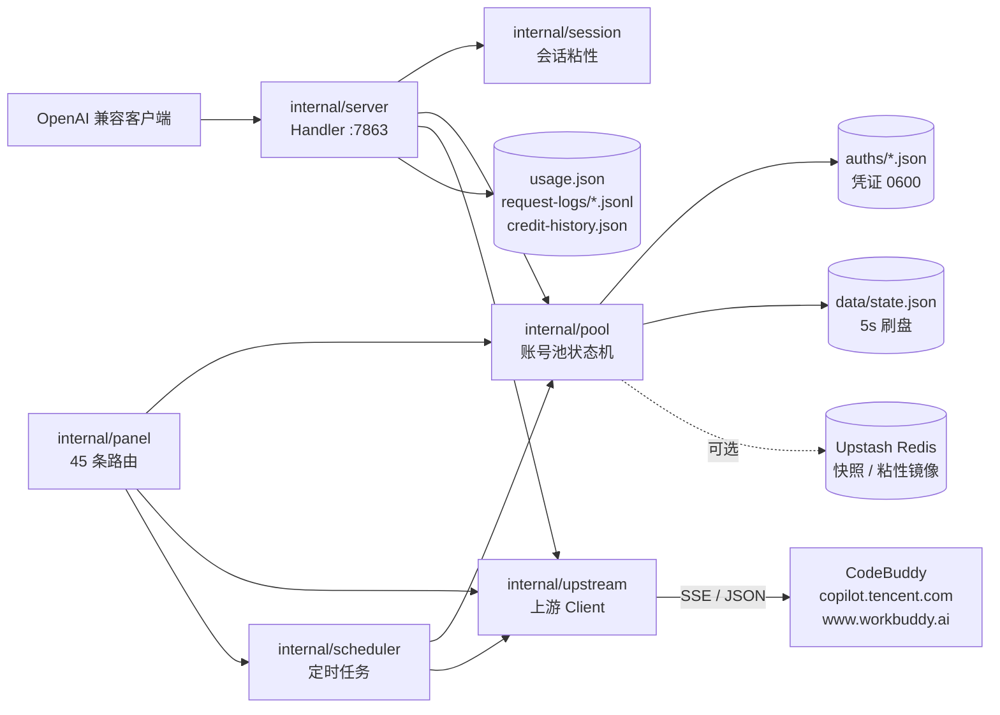

# WorkBuddy2API Panel 项目分析报告 (历史基线审计)

| 项目 | 内容 |
|---|---|
| **文档定位** | 历史基线仓库代码审计与技术债务基准报告 |
| **全景索引** | **[官方全景文档总索引 (DOCS_INDEX.md)](DOCS_INDEX.md)** |
| **分析时间** | 2026-10-29 |
| **分析对象** | `github.com/linguo2625469/workbuddy2api-panel`，`main` @ `73a7560`（2026-10-21） |
| **方法** | 全仓代码阅读 + 依赖图 + 构建/静态检查/测试/竞态/覆盖率 + 本地运行时冒烟 |
| **承接关系** | 成为后续重构为 `nachuan (纳川)` 与 `2API Agent 编译器` 的历史问题发现源头与对照基线 |

---

## 一、结论

**这是一个功能密度极高、测试纪律罕见地好的单进程 Go 网关，但已于 2026-10-21 主动停止维护，且它的生存依赖与上游反代风控的对抗。**

| 维度 | 评价 | 依据 |
|---|---|---|
| 工程质量 | **A-** | 生产 28,310 行 / 测试 26,489 行；845 个测试函数；`go build`、`go vet`、`go test ./...`、核心包 `-race` 全部通过 |
| 可维护性 | **B+** | 分层清晰、注释带 issue/实案；但核心请求函数 773 行、错误策略分散 5 处、配置装配双写 |
| 可运维性 | **B** | 单二进制 / Docker / GHCR / 面板 / 健康检查齐全；无 TLS、无 metrics、单 key 鉴权 |
| 长期可用性 | **D** | 项目停更；上游已开始识别并拦截非官方客户端；账号有风控/封禁风险 |
| 复用价值 | **A-** | 账号池状态机、粘性路由、热配置、面板嵌入、错误分类都是可迁移的成熟实现 |

**最高杠杆的改进**（如果还要继续演进）：把「错误分类 → 账号处置 → 是否轮转 → HTTP 映射 → hint」收敛为一张按 `ErrKind` 索引的策略表；把「启动装配」与「热更新装配」收敛为同一个 `applyRuntimeConfig`。

---

## 二、项目定位与现状

| 项 | 内容 |
|---|---|
| 定位 | 自托管 OpenAI 兼容反向代理网关：把腾讯 CodeBuddy（`copilot.tencent.com` / `www.workbuddy.ai`）账号包装为 `/v1/chat/completions` 等服务 |
| 来源 | [Sliverkiss/workbuddy2api](https://github.com/Sliverkiss/workbuddy2api) 的增强分支（上游已删库） |
| 版本 | `1.13.0-panel`（`cmd/server/main.go:35`） |
| 许可 | MIT |
| 维护状态 | **已停止维护**（`README.md:22`）：不再更新、不跟进上游、不处理 issue/PR |
| 维护方式 | README 披露：近期 issue/PR 处置、审查、测试与修复**大量由 AI 辅助完成**（`README.md:31`） |
| 停更原因（作者声明） | 上游开始禁用反代；个人精力有限；非法转卖/批量小号滥用 |
| 历史 | 271 个提交，41 位作者，2026-09-12 → 2026-10-21；主维护者占约 2/3 |
| 形态 | 单二进制（前端 `go:embed`）/ Docker 多架构镜像 / Windows exe；无外部数据库（Redis 可选） |

> 合规边界很重要：这是**非官方客户端**，通过 OAuth 设备授权拿账号凭证，再模拟官方客户端出站。仓库自身明确限定「仅本人授权账号、本机/私有环境」，并声明反代可能违反上游服务条款。

---

## 三、规模与技术栈

| 指标 | 数值 |
|---|---|
| 语言 / 模块 | Go 1.22.5（本机用 go1.23.12 验证） |
| Go 包 | 20 个 |
| 生产 Go 代码 | 28,310 行 |
| 测试 Go 代码 | 26,489 行（测试/生产 ≈ 0.94） |
| 测试函数 / 测试文件 | 845 / 97 |
| `httptest` 使用点 | 314 处 |
| 前端（内嵌） | `app.js` 3,437 行 + `index.html` 1,381 行 + `mobile.css` 317 行 |
| 第三方依赖 | 极少：`redis/go-redis/v9`、`cespare/xxhash/v2`、`golang.org/x/sys`；无 Web 框架、无 ORM |
| 配置面 | `Config` 约 98 个 JSON 字段；面板表单覆盖 30 个；README 字段表约 55 行 |
| 打包 | 多阶段 Docker（非 root uid 10001）、GHCR 多架构、五平台二进制、CI 先测后构建 |

**技术选型评价**：标准库 `net/http` + `embed` + 原子快照，依赖面极小，升级/审计成本低；这是这个项目最值得保留的工程决策之一。

---

## 四、系统地图

### 包职责

| 包 | 总行数（含测试） | 职责 |
|---|---:|---|
| `internal/upstream` | 17,550 | 唯一上游适配层：SSE 聊天、刷新 token、模型目录、计费、签到/旅行/成长任务、设备指纹、脱敏、搜索 |
| `internal/panel` | 8,342 | 管理面板：概览/账号/用量/套餐/任务中心/模型/配置/日志；OAuth 添加账号；任务自动化 |
| `internal/pool` | 8,231 | 账号池唯一状态机：选号、冷却、熔断、连败降权、模型级限流、在途租约、持久化 |
| `internal/server` | 6,618 | OpenAI 兼容 HTTP 层：鉴权、提示词改写、轮转、SSE 透传、错误策略、请求日志 |
| `internal/scheduler` | 4,103 | 签到 / 旅行 / 活跃 / 保活 / 夜猫子 / 成长 / 余额刷新 / 补领清扫 |
| `cmd/server` | 3,518 | 组合根：配置加载/默认值/校验、依赖装配、启停、面板保存配置 |
| `internal/session` | 1,303 | 会话粘性：双段分配、TTL、Redis 异步镜像 |
| `internal/usage` / `reqlog` / `credithist` | 1,150 / 913 / 801 | 逐请求用量、指标与脱敏归档、积分变动历史 |
| `internal/auth` | 1,108 | 凭证解析/落盘/刷新/域判定 |
| 其余 | ~1,000 | `prompt`、`redisstore`、`livecfg`、`httpauth`、`logfmt` |

**依赖方向**（重要）：`pool` 不导入 `upstream`（用回调 `SetModelRateOf` 反转依赖），`server`/`scheduler`/`panel` 依赖两者，`cmd/server` 是唯一组合根。没有循环依赖。

---

## 五、核心链路

### 5.1 聊天请求（主链路）

1. `POST /v1/chat/completions` → Bearer 常量时间校验（`httpauth.VerifyBearer`）。
2. 读完整 body；解析 `model` / `stream`；提取 `realm` 前缀（`cn:` / `global:`）与裸模型名。
3. `models.hidden` 黑名单点名拒绝（不打上游、不占号）。
4. 会话粘性：从 body 提取会话键，按模型解析已绑定账号；不可用则解绑。
5. 在途租约：选中账号即 `Acquire`，函数出口统一 `Release`。
6. 提示词改写：`custom` 替换 system / `append` 追加 / `passthrough` 降级时改用中性提示词。
7. 选号：`Pool.Pick...`（健康过滤 → 积分保底 → 在途未满 → 成本分层 → Top-5 加权随机 / 有序策略）。
8. 出站：`upstream.ChatStream` 强制 `stream:true`，注入会话头族 / UA / 设备头 / 指纹脱敏。
9. 入站：SSE 帧白名单重建、原生工具调用标记还原、空流/错误帧识别。
10. 记账：`Pool.RecordTokenUsage` + `usage.Recorder` + `reqlog`（Prompt/响应正文不落盘）。
11. 出错：`upstream.Classify` → `applyErrorPolicy`（冷却/禁用/模型负缓存）→ 轮转（默认最多 3 次）→ 末端 OpenAI 错误映射。
12. 成功：`NoteSuccess`、清模型负缓存、绑定粘性。

### 5.2 账号池状态机

- 单账号状态：健康 / 软冷却 / 硬冷却（余额不足到次日 04:00）/ 熔断 / 连败降权 / 模型级冷却 / 暂停 / 禁用。
- 选号：`pick.go:45`；权重 = 积分 + 闲置补偿 + 快过期优先；Top-5 截断后加权随机。
- 防雪崩：在途租约、全冷却兜底取最早到期、熔断、WAF IP 级 fail-fast。
- 计费保底：`credit_floor` 触底账号不接实测收费模型，宁 503 不打穿。
- 成本分层：每（账号, 模型）实测 `cost_per_1k`，免费层优先、未知层探索、收费层比价。

### 5.3 定时任务

| 任务 | 默认时点/间隔 | 说明 |
|---|---|---|
| 签到 | 09:00 / 21:00 | 末尾自动连登兑换 + 抽奖 + 补偿领取 |
| 猫猫旅行 | 09:00 / 21:00 | 派出 + 领奖 + 领养闭环 |
| 活跃上报 | 10:00 | 点亮连登 / streak 自检 |
| token 保活 | 22:00 | refresh 单飞，防 12153 |
| 夜猫子 | 23:00 | 23:00–08:00 计数窗口 |
| 成长任务 | 01:00 | 扫描 + 队列执行 + 补领清扫（15m） |
| 余额刷新 | 每 5 分钟 | 更新积分/到期批次，冷却号回血自动解冻 |

### 5.4 管理面板

- 7 个视图：账号、用量、套餐、任务中心、模型、配置、日志；移动端适配。
- 45 条 `/panel/api/*` 路由；账号操作（复活/禁用/暂停/签到/余额/移除）、批量任务、OAuth 登录、配置热保存、模型探测、补偿、日志。
- 前端零外部依赖、CSP + `X-Frame-Options: DENY` + `nosniff`；UID 白名单防路径穿越。

### 5.5 数据文件

| 路径 | 内容 | 生命周期 |
|---|---|---|
| `auths/workbuddy-<uid>.json` | access/refresh token、域、设备 token（**明文**，0600） | 长期 |
| `data/state.json` | 账号池运行态（积分/冷却/熔断/成本台账/顺序游标） | 5s 防抖刷盘 |
| `data/usage.json` | 逐请求 token/积分/延迟/速率 | 滚动 |
| `data/credit-history.json` | 余额变动历史（2000 条） | 滚动 |
| `data/request-logs/*.jsonl` | 脱敏请求元数据（7 天 / 100 MiB） | 按策略清理 |
| `data/output_probes.json` | 模型输出上限探测结果 | 手动/脚本 |
| `data/model.json` | 模型目录缓存（models.dev 兜底） | 按需刷新 |
| Upstash Redis（可选） | 池状态快照 + 粘性绑定镜像 | 择新恢复 |

---

## 六、工程质量验证（本次实测）

| 检查 | 命令 | 结果 |
|---|---|---|
| 构建 | `go build ./...` | ✅ 通过 |
| 静态检查 | `go vet ./...` | ✅ 无告警 |
| 全量测试 | `go test ./...` | ✅ 20/20 包通过（最慢 scheduler 15.5s） |
| 竞态 | `go test -race ./internal/pool ./internal/server ./internal/scheduler ./internal/session` | ✅ 全部通过 |
| 冒烟 | 临时实例 `127.0.0.1:17863` | `/healthz` 503（无账号，符合预期）；`/v1/models` 无 key 401、带 key 200；`/panel/` 200（80,943 字节）；`/panel/api/overview` 无 key 401 |

### 覆盖率（Go 语句）

| 包 | 覆盖率 | 包 | 覆盖率 |
|---|---:|---|---:|
| `httpauth` | 100.0% | `credithist` | 92.3% |
| `usage` | 85.6% | `pool` | 82.8% |
| `session` | 80.5% | `server` | 76.4% |
| `auth` | 74.5% | `reqlog` | 73.8% |
| `scheduler` | 65.9% | `livecfg` | 60.9% |
| `upstream` | 57.1% | `cmd/server` | 52.3% |
| `prompt` | 41.3% | `panel` | 23.0% |
| `redisstore` | 16.8% | | |

**解读**：核心状态机与请求层覆盖扎实；`panel` 的 Go 覆盖率低（23%），但它有 1,521 行前端测试与 JS 运行时冒烟，属于「HTTP 适配层 + 大量前端」的结构性结果，不是单纯的测试缺失。`upstream` 57% 合理——大量协议分支依赖真实上游，无法全用单测覆盖。

### 测试风格

- 大量表格驱动、`httptest` 假上游、故障注入（`fault_test.go`）、对抗性前端测试（`credit_frontend_adversarial_test.go`）。
- 注释质量异常高：几乎每个非显然决策都写了「为什么」、关联 issue 编号、真实事故。这是本项目最大的隐性资产。
- 不足：`t.Parallel` 仅 6 处，测试串行偏慢；没有 fuzz；没有上游契约的录制回放。

---

## 七、架构发现（按影响排序）

### P1：请求错误策略分散，核心函数过大

**影响**：新增/调整一个上游错误语义，需要在 5～6 处同步修改；漏一处不会编译失败，而是静默落到 `default`（继续轮转 + 喂连败计数），表现为「该立即失败的请求被放大 3 倍」或「该罚的号没罚」。

**证据**：
- 分类：`internal/upstream/client.go:565` `Classify`，16 种 `ErrKind`；SSE 错误帧另走 `internal/upstream/hint.go:112` `FrameKind`（复用 `Classify`）。
- 账号处置：`internal/server/handler.go:1440-1554` `applyErrorPolicy` 的 16 分支 switch。
- 轮转决策：`chatCompletions` 内 5 段近乎复制的 fail-fast 块——`handler.go:963`（内容拦截）、`987`（prompt 过长）、`998`（图片无效）、`1016`（坏参数）、`1034`（上游满载），每段都重复 `applyErrorPolicy → fail → writeOpenAIErrorHint → 设状态 → return`。
- HTTP 映射：`handler.go:1224-1325` 末端再按 `ErrKind` 映射一次 status/code。
- hint：`handler.go:1649` `hintOf` 第三次按 kind 分支。
- 保护不足：直接测 `applyErrorPolicy` 的测试只有 3 个；没有「每个 ErrKind 都必须有策略」的穷举测试。

**原因**：错误语义是按 issue 增量长出来的，每来一个上游新码就在所有消费点各打一块补丁，而不是先扩展策略模型。

**保守方案**：先把 5 段 fail-fast 抽成一个 `failFast(...)` helper，加 `TestEveryErrKindHasPolicy` 穷举测试。
**更干净方案**：在 server 包内建 `errPolicy` 表（键 `ErrKind`）：`{rotate, failFast, httpStatus, code, poolEffect, hintBuilder}`；轮转循环、末端映射、hint 都查表；`applyErrorPolicy` 变成表里的副作用函数。调用方知道的更少，新增 kind 只改一行表 + 一个测试。
**建议**：采用表驱动方案；第一步只迁移 5 个 fail-fast kind + default，用现有 golden 测试冻结行为。
**验证**：16 种 kind 的表驱动测试 + 现有 76.4% server 覆盖率不回退 + 冒烟。

**成本**：M

---

### P2：配置装配双写，重启提示是静态清单

**影响**：`Config` 约 98 个字段；同一批运行时参数在「启动」和「面板保存」两条路径各写一遍。新增一个池参数要同时改两处，漏一处就是「面板显示已保存，实际没生效」这类最难排查的运维故障。

**证据**：
- 启动装配：`cmd/server/main.go:96-110`（`SetBreaker` / `SetMaxInFlight` / `SetDegrade` / `SetSoftRateMax` / `SetCostExploreInterval` / `SetCreditFloor` / `SetWeights` / `SetPreferExpiring` / `SetCrossDomainFallback` / `SetScheduling` ...）。
- 热更新装配：`cmd/server/main.go:528-552` 同一组 setter 再写一遍。
- 重启清单：`cmd/server/main.go:566-592` `restartRequiredFields` **恒返回** `listen`、`auth_dir`、`state_file`、3 个 upstream 超时、`user_agent`、`cn.chat_base`、sticky、logging、server 等固定项——即使本次只改了 `soft_rate`，面板也会 toast「其中 N 项需重启」（`internal/panel/app.js:1265`）。
- 没有测试保证两条装配路径等价；只有 1 个测试检查 `cn.chat_base` 在清单里。

**原因**：热更新是后加的旁路，启动装配没有同步重构；重启清单用「装配期字段全集」代替「本次实际变化的字段」。

**方案**：
1. 抽出 `applyRuntimeConfig(cfg, live, p, up, sch)`，启动和保存都调用它；
2. `restartRequiredFields(old, new)` 做结构体 diff，只返回真正变化的装配期字段；
3. 加测试：`restartRequiredFields(Default(), Default())` 必须为空；每个热字段在两条路径都生效。

**成本**：S

---

### P2：面板承载领域自动化，边界倒置

**影响**：`internal/panel` 是 8,342 行、45 条路由、76 个方法的「第二应用层」；其中 `autotask.go` 1,307 行是成长任务/开学季任务的动作编排（补偿逻辑在 scheduler 侧）。调度器通过 hook 调用 `pn.RunGrowthQueueOnce`（`cmd/server/main.go:323`），等于让 Web 包成为定时任务的唯一生产实现。结果：任务逻辑只能经 HTTP 包测试；CLI/其他入口无法复用；面板 Go 覆盖率仅 23%。

**证据**：`internal/panel/autotask.go:1-1307`；`panel.go:154-198` 45 条路由；`main.go:323-326` 两个 hook；`scheduler.Config.GrowthHook` 注释明确说「panel 在 scheduler 之后构造，用 SetGrowthHook 事后挂载」。

**方案**：抽出 `internal/growth`（或 `taskengine`）服务，持有 `Pool`/`Upstream`/互斥锁/队列；panel 只做 HTTP 适配，scheduler 直接调用服务。保留现有 hook 作为过渡。
**建议**：若还要继续做任务功能，值得做；若只维护现状，至少在 README/代码注释里标明这是「历史边界」，避免后来者继续往 panel 里堆领域逻辑。

**成本**：M

---

### P2：`upstream.Client` 是宽接口上帝对象

**影响**：113 个方法、`client.go` 单文件 2,497 行（加上同包分文件共 17.5k 行）；聊天、计费、模型目录、任务、企业版、global 域全挂在同一个类型上。消费方（server/scheduler/panel）各自只用一小部分，但测试替身与认知负担都按全量算。

**证据**：`internal/upstream/client.go:704` `type Client struct`；`grep '^func (c \*Client)'` = 113；`client.go` 2,497 行；`sse.go` 892、`global_models.go` 668、`desktop.go` 588 等按域拆文件，但仍是同一类型。

**原因**：单一上游厂商适配器自然膨胀；Go 没有编译期接口隔离压力。

**方案**：在消费方定义窄接口（Go 惯例）——`ChatClient`（ChatStream/Classify）、`AccountClient`（Refresh/UserResource）、`TaskClient`（Checkin/Travel/Tasks），`*Client` 自然满足；不拆包、不改运行时。测试用假实现只实现用到的方法。
**建议**：低成本、低风险，优先做。

**成本**：S

---

### P2：安全与运维姿态（自托管可接受，公网需加固）

| 项 | 现状 | 风险 |
|---|---|---|
| 凭证存储 | `auths/*.json` 明文 access/refresh token，权限 0600 | 主机被入侵即全量账号失守；备份/同步目录会扩散 |
| 鉴权 | 网关与面板共用同一个 Bearer key；`api_key` 为空 = 完全放行 | 单 key 泄露 = 可加号、改配置、烧额度；空 key 是危险默认 |
| 传输 | 仅 `ListenAndServe`，无 TLS；默认 `:7863` 监听所有网卡 | 公网部署必须前置反代；局域网也可能被嗅探 |
| 管理面 | 面板与数据面同端口、同 key | 暴露面合并，无法只暴露 API 不暴露管理 |
| 审计 | 有请求日志与运行日志，无独立管理员操作审计 | 谁改了配置/删了号难以追溯 |

**建议**：默认 `listen` 改 `127.0.0.1:7863`（或文档强提示）；支持独立 `panel_key`；README 增加「反代 + TLS + 防火墙」标准部署；`api_key` 为空时启动打显著 WARN；可选对 auths 做系统级加密（如 age/sops）。

**成本**：S～M

---

### P3：文档与配置覆盖漂移

- README 1,076 行是唯一文档；`.gitignore` 忽略 `*.md`（仅保留 README），设计文档不入库。
- `Config` 约 98 个 JSON 字段，README 字段表约 55 行，面板表单 30 项——新增配置项存在「代码有、文档无、面板无」的常态。
- README 核心能力表写「四类独立开关」，实际调度有签到/旅行/活跃/保活/夜猫子/成长六类 + 余额刷新 + 补扫。
- README 引用的 `data/desktop-task-protocol.md` 被 `data/` 忽略，仓库内不存在。
- 面板每次保存都提示约 14 项需重启（见 P2），属于同一类「元数据与实际不同步」的问题。

**建议**：配置参考从 struct tag 生成（或至少加 CI 检查 README 表与字段差集）；把 `restart_required` 改为 diff；文档与配置同源。

**成本**：S

---

### P3：可观测性只有「面板 + 日志」

- 有 `/status`、`/healthz`、请求指标、JSONL 归档、积分历史；没有 Prometheus `/metrics`、没有 OpenTelemetry trace、没有告警规则。
- 单实例自用足够；多实例/托管场景下无法做集中监控与容量规划。
- 建议：若继续演进，加一个只读 `/metrics`（账号健康数、冷却数、请求成功率、P95、上游错误分类计数），成本低、收益高。

**成本**：S

---

## 八、风险登记

| 编号 | 风险 | 等级 | 说明 | 缓解 |
|---|---|---|---|---|
| R1 | 上游识别/封禁反代 | **高** | 仓库停更的直接原因；代码含大量客户端指纹模拟与反探测逻辑，属于持续对抗 | 不把生产依赖押在上面；保留可切换的官方 API 路径 |
| R2 | 账号风控/封禁 | **高** | 非官方客户端 + 多账号轮换是平台风控重点 | 仅自用；控制并发；不在公网售卖/共享 |
| R3 | 凭证泄露 | 中高 | 明文 token + 单 key 管理面 | 主机最小权限、磁盘加密、备份脱敏、独立面板 key |
| R4 | 停更后的协议漂移 | **高** | 上游一改，网关即 502/403，且无维护者修复 | 固定版本使用；自建监控；准备下线预案 |
| R5 | 单维护者/社区断层 | 中 | 41 位作者但主维护者占 2/3；上游已删库 | 不期待长期支持；关键 fork 自行接管 |
| R6 | 状态丢失窗口 | 低 | `state.json` 5s 防抖刷盘，崩溃最多丢 5s 运行态 | 可接受；Redis 快照可兜底 |

---

## 九、如果继续做：建议顺序

1. **错误策略表 + 穷举测试**（P1）——先冻结行为，再收敛 5 处分支；这是核心路径最值得的一次重构。
2. **配置装配单点 + 重启清单 diff**（P2）——消除「保存了但没生效」的整类故障，同时修掉面板 toast 噪音。
3. **安全加固**（P2）——默认 localhost、独立面板 key、TLS 反代文档、空 key WARN。
4. **抽 `internal/growth`**（P2）——让任务编排离开 HTTP 包，panel 变薄。
5. **消费方窄接口**（P2）——`ChatClient`/`AccountClient`/`TaskClient`，测试替身成本立刻下降。
6. **可观测性**（P3）——`/metrics` + 错误分类计数 + 告警示例。

**停止/重构信号**：如果上游开始要求客户端证明/证书绑定，或官方开放 OpenAI 兼容 API，则停止协议对抗投入，直接迁移到官方接口——继续维护指纹模拟的收益会迅速低于成本。

---

## 十、建议保留的设计（不要重构掉）

1. **`pool` 不依赖 `upstream`**：用 `SetModelRateOf` 回调反转依赖，底层状态机可独立测试（82.8% 覆盖）。
2. **`cmd/server` 作为唯一组合根**：没有包级全局单例，依赖显式注入。
3. **`livecfg` 原子快照**：热配置读写无锁竞争，是「面板改完立即生效」的基础。
4. **`httpauth` 单一常量时间实现**：server 与 panel 共用，避免了两份鉴权漂移。
5. **请求日志脱敏纪律**：JSONL 只写元数据，不写 prompt/响应/凭证。
6. **「择新恢复」**：本地 state 与 Redis 快照按时间戳择新，且本地不可用时采用快照——考虑过真实故障形态。
7. **测试与注释**：845 个测试 + 带 issue 编号的「为什么」注释，是这个仓库最值钱的部分。

---

## 十一、上手阅读路线

1. `cmd/server/main.go` — 启动顺序、依赖装配、`saveConfig` 热更新。
2. `internal/server/handler.go:554` `chatCompletions` — 主请求链路（建议对照本文 5.1 阅读）。
3. `internal/pool/pick.go:45` + `entry.go` + `state.go` — 选号与状态机。
4. `internal/upstream/client.go:565` `Classify` + `1190` `ChatStream` — 错误分类与上游协议。
5. `internal/scheduler/scheduler.go:377` `Run` — 定时任务。
6. `internal/panel/panel.go:135` + `autotask.go` — 面板与任务自动化。
7. `cmd/server/config.go:269` `Default` — 配置全貌与默认值。

---

## 附录：本次实际执行的证据

- `go build ./...`：exit 0
- `go vet ./...`：exit 0
- `go test ./...`：20 个包全部 `ok`（scheduler 15.5s、server 10.3s、panel 6.4s）
- `go test -race ./internal/pool ./internal/server ./internal/scheduler ./internal/session`：全部 `ok`
- `go test -cover ./...`：覆盖率见第六节
- 本地冒烟：临时配置 + 临时数据目录，验证 healthz / models / panel / panel api 四条路径
- 代码检索：`grep` 统计方法数、配置字段、路由数、ErrKind 分支、`httptest` 用量、`t.Parallel` 用量

## 范围与限制

- **未使用真实账号连接上游**（无凭证）：上游协议细节、风控行为、账号可用性只基于代码与 README 判断，未做实网验证。
- 未做渗透测试、依赖 CVE 扫描、压力测试；安全结论是代码级观察，不是安全审计。
- 未逐行阅读 `internal/upstream` 全部 17.5k 行；重点阅读了 `client.go`（Classify/ChatStream/刷新）、`hint.go`、`sse.go`、`payload.go` 的错误与协议路径。
- 覆盖率为 Go 语句覆盖，不含前端 JS；`panel` 的低覆盖率需结合其 1,521 行前端测试解读。
- 结论基于 `73a7560` 单一提交；仓库已停更，后续无变化预期。

---

## 🧭 架构文档导航
| 上一篇 | 📑 全景总索引 | 回到起点 |
|:---|:---:|---:|
| 🧠 [产品全周期管理白皮书 (PRODUCT_LIFECYCLE_PLAN.md)](PRODUCT_LIFECYCLE_PLAN.md) | 📑 [官方全景文档总索引 (DOCS_INDEX.md)](DOCS_INDEX.md) | 🏠 [项目总览 (README.md)](README.md) ➡ |
