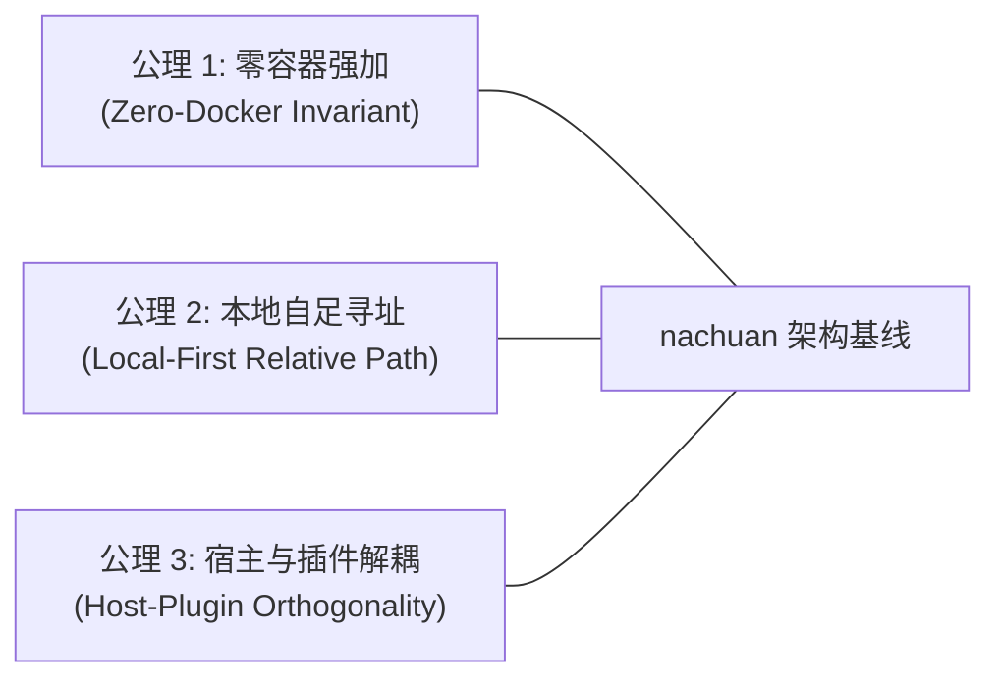

# nachuan (纳川) · 架构审计与范式迁移技术规范

| 项目 | 内容 |
|---|---|
| **文档定位** | 历史技术债务审理、工程范式纠偏与架构防线规范 |
| **全景索引** | **[官方全景文档总索引 (DOCS_INDEX.md)](DOCS_INDEX.md)** |
| **关联核心** | 关联 [`2API_CORDIS_TECH_SPEC.md`](file://<LEGACY_WORKSPACE>/2API_CORDIS_TECH_SPEC.md) · [`PRD.md`](file://<LEGACY_WORKSPACE>/PRD.md) |
| **版本状态** | v1.0.0 (Formal Baseline) |
| **指导思想** | **如无必要，勿增实体 · 剥离容器虚假繁荣，回归原生自足极简** |

---

## 1. 审理背景与问题定性

在将项目全面升级为 **`nachuan (纳川)`**（基于 Cordis 微内核的 2API 转译与聚合平台）并确立**个人专用**定位的过程中，对已有代码库进行了全量工程审计。

审计发现：原单体仓库在演进过程中，混杂了大量**“企业级思维惯性带来的虚假实体”**与**“宿主与特定插件的强耦合”**。这些问题如果未在架构规范中被明确定性并予以防范，将在 Agent 自动化转译第三方 2API 项目时引发严重的“幻觉继承”与工程断层。

---

## 2. 五大架构漂移问题深度剖析与治理实录

### 2.1 运行范式失真：容器化实体泛滥（The Containerization Trap）

* **历史病灶**：
  原工程默认推荐 `docker-compose up -d` 部署，并充斥大量针对 Docker 缺陷的防御性代码与运维注释：
  - 容器内非 root 用户（`uid 10001`）对宿主机挂载目录无权写入，被迫向用户抛出繁琐的 `PUID=$(id -u) PGID=$(id -g)` 提示；
  - 宿主机缺失 `config.json` 时，Docker bind mount 会静默将挂载点创建为同名目录，导致 Go 二进制文件写入崩溃；
  - 辅助工具运行依赖 `docker cp` 和 `docker exec`，个人开发者操作链路冗长。
* **个人场景冲突**：
  个人本地自用场景下，Docker 守护进程带来 1.5GB~2GB 的额外虚拟化内存开销，且引发文件所有权、文件系统监听失效（inotify 穿透）等系列问题。
* **治理对策**：
  - **确立原生单二进制（Native Single Binary）为一等公民**：纯 Go 静态编译产物仅 12MB，内存开销低至 ~20MB，冷启动耗时 <50ms；
  - 所有文件 IO 均基于当前登录用户权限在项目根目录相对路径执行（`./auths`、`./data`），根绝所有 UID/GID 权限错配；
  - Docker 仅保留为可选打包目标，不再作为系统运行的前置假定。

---

### 2.2 环境路径硬编码与沙箱脱节（Hardcoded Environment & Path Pollution）

* **历史病灶**：
  自动化运维脚本（如 [`scripts/task_common.py`](file://<LEGACY_WORKSPACE>/scripts/task_common.py)、[`scripts/probe_active.py`](file://<LEGACY_WORKSPACE>/scripts/probe_active.py)）中，凭证目录被硬编码为：
  ```python
  # 致命缺陷：硬编码特定 Linux 容器的绝对路径
  AUTHS = "/root/workbuddy2api/auths"
  ```
  直接导致任何在本地 macOS、Windows 或非 root Linux 环境下执行脚本的开发者遭遇 `no auth for ...` 异常终止。
* **治理对策**：
  **自适应三级路径嗅探机制（Three-Tier Adaptive Path Discovery）**：
  ```python
  _PROJECT_AUTHS = os.path.join(os.path.dirname(os.path.dirname(os.path.abspath(__file__))), "auths")
  AUTHS = os.environ.get("AUTHS_DIR") or (_PROJECT_AUTHS if os.path.isdir(_PROJECT_AUTHS) else (
      "/root/workbuddy2api/auths" if os.path.isdir("/root/workbuddy2api/auths") else _PROJECT_AUTHS
  ))
  ```
  1. 优先读取显式环境变量 `AUTHS_DIR`；
  2. 缺省使用当前项目根目录下的 `./auths`；
  3. 保留对历史容器路径的优雅回退（Graceful Fallback）。

---

### 2.3 宿主身份与原子插件的命名混淆（Identity Bleed: Host vs. Plugin）

* **历史病灶**：
  宿主应用（Host Gateway）直接以其所集成的第一个具体服务 `workbuddy2api` 命名，并在 `cmd/server/main.go`、控制台页面标题及日志中到处回显。
* **架构冲突**：
  违背了 Cordis 微内核架构的**“正交性原则”**：
  - **宿主（nachuan）**是容器、总线与聚合面板；
  - **上游逆向（如 workbuddy）**仅仅是挂载在宿主上的一个原子插件（`2api-plugin-workbuddy`）。
  如果宿主以插件命名，未来接入 `cursor2api`、`phanthy2api` 时，概念逻辑将完全崩溃。
* **治理对策**：
  - 宿主全面统一更名为 **`nachuan (纳川)`**；
  - `workbuddy` 的逆向逻辑收敛为首个官方示范插件；
  - 控制台侧边栏、控制台 `<title>`、系统启动日志全面重构为 `nachuan` 品牌。

---

### 2.4 控制台与状态机脱节：重启假定 vs. 零重启热加载（Hot-Reload Drift）

* **历史病灶**：
  命令行引导脚本（如 [`login.sh`](file://<LEGACY_WORKSPACE>/login.sh)）在完成 OAuth 授权写入 `auths/*.json` 后，提示文案仍保留历史思维：`"重启 workbuddy2api 容器加载新账号"`。
* **架构冲突**：
  宿主微内核实际已具备强大的文件监视（Inotify）与零重启热加载能力，且 Web 面板支持实时轮询上屏。强制重启容器不仅造成正在进行的流式对话被腰斩（SSE EOF），还破坏了单用户体验的平滑度。
* **治理对策**：
  - 清理所有“重启容器”的提示文案；
  - 引导使用 Web 控制台（`http://127.0.0.1:7863/panel/`）进行扫码与登录，授权完成后凭证落盘触发宿主账号池热更新，实现真正的**全链路零重启**。

---

### 2.5 个人开发者工具链断层（Native Toolchain Disconnect）

* **历史病灶**：
  项目根目录缺少标准的 Makefile 或构建脚本，仅有 `Dockerfile` 与 `docker-compose.yml`，剥离 Docker 后个人开发者缺乏开箱即用的指令体验。
* **治理对策**：
  根目录提供极简 [`Makefile`](file://<LEGACY_WORKSPACE>/Makefile)：
  - `make build`：一键编译主二进制 `bin/nachuan` 及全部配套运维工具（`login`、`signin`、`credit`、`trial`）；
  - `make run`：编译并以当前用户身份原地启动；
  - `make test`：快速运行全量自动化测试套件；
  - `make clean`：安全清理所有编译二进制产物。

---

## 3. 技术防线：三大工程不变量（Engineering Invariants）

为避免未来 Agent 在自动转译或编写新 2API 插件时重蹈覆辙，技术规范正式确立以下三大硬性约束：



1. **公理 1：零容器强加（Zero-Docker Invariant）**
   - 任何转译输出的 2API 插件及其配套工具，**严禁强制依赖 Docker 环境运行**；
   - 产物必须能够以单进程、当前操作系统原生权限直接执行。

2. **公理 2：本地自足相对寻址（Local-First Relative Pathing）**
   - 严禁在任何插件或核心逻辑中硬编码绝对系统路径（如 `/root/...`、`/etc/...`）；
   - 所有运行时数据（配置、凭据、SQLite 数据库）必须遵循基准相对目录（`./config.json`、`./auths/`、`./data/`），或由环境变量进行显式覆盖。

3. **公理 3：宿主与插件正交隔离（Host-Plugin Orthogonality）**
   - 插件代码只依赖 Cordis 注入的通用 Context 契约（`ctx.server`、`ctx.accountPool`、`ctx.scheduler`、`ctx.panel`）；
   - 插件严禁反向探测或假定宿主名称，插件自身的上游专有逻辑（如特定平台的积分规则）不得污染宿主核心。

---

## 4. 技术文档关联矩阵

本审计文件与项目技术文档体系的映射关系如下：

| 技术文档 | 关联章节 | 承接意义 |
|---|---|---|
| [`2API_CORDIS_TECH_SPEC.md`](file://<LEGACY_WORKSPACE>/2API_CORDIS_TECH_SPEC.md) | 第 8 章：工程规范与架构审计对齐 | 作为底层技术白皮书的工程底线，约束 Agent 编译器的代码生成规则（Pass 2 发射红线）。 |
| [`PRD.md`](file://<LEGACY_WORKSPACE>/PRD.md) | 第 1.2 节 & 第 4 节：非功能需求 | 锚定产品定位（个人专用 · 零 Docker），杜绝重型企业级特性的实体膨胀。 |
| [`PRODUCT_LIFECYCLE_PLAN.md`](file://<LEGACY_WORKSPACE>/PRODUCT_LIFECYCLE_PLAN.md) | 第 2 章：防线二（代码变更污染分析） | 建立静态规则：严禁向 Git 提交容器绝对路径与非标准身份标识。 |
| [`README.md`](file://<LEGACY_WORKSPACE>/README.md) | 快速上手 & 核心特性 | 对外展示原生单二进制的高效优势，抹除容器配置认知壁垒。 |

---

## 🧭 架构文档导航
| 上一篇 | 📑 全景总索引 | 下一篇 |
|:---|:---:|---:|
| 🔬 [热门 2API 逆向图谱 (TECHNICAL_SOLUTION_WILD_2API.md)](TECHNICAL_SOLUTION_WILD_2API.md) | 📑 [官方全景文档总索引 (DOCS_INDEX.md)](DOCS_INDEX.md) | 🧠 [产品全周期管理白皮书 (PRODUCT_LIFECYCLE_PLAN.md)](PRODUCT_LIFECYCLE_PLAN.md) ➡ |
