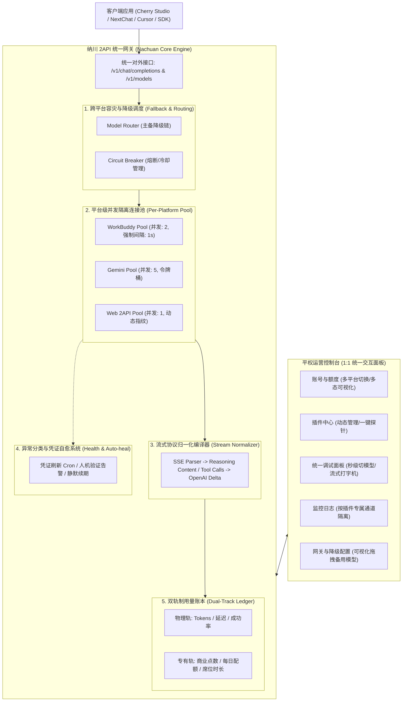

# 纳川 (Nachuan) 2API 统一网关与平权运营控制台 — 深度实施方案

> **文档版本**：v1.0.0  
> **设计目标**：建立一套“功能完整保留、格式无损归一、跨平台平权调用、生产高可用防封”的 2API 终极网关工程体系。

---

## 架构愿景：五大核心闭环



---

## 方案 1：流式思考与工具调用格式归一编译器 (Stream Normalizer)

### 1.1 痛点与现实
- **DeepSeek R1 / V3**：有的上游把思考内容塞在 `delta.reasoning_content`，有的直接用 `<think>...</think>` 拼在 `delta.content`。
- **Gemini 2.5 Pro**：将思考部分放在 `candidates[0].content.parts[0].thought`。
- **Claude / Qwen**：各自有独立的流式工具调用与思考分块。
- **结果**：客户端解析混乱，思考框无法折叠甚至吞字。

### 1.2 落地实现机制
网关在 `internal/stream` 模块建立**状态机流式过滤器（Streaming State Machine）**：

```go
type StreamNormalizer struct {
    TargetMode         string // "standard_reasoning_content" | "wrap_think_tag" | "strip_think"
    IsInThoughtBlock   bool
    Buffer             []byte
}
```

1. **自动嗅探与转译**：
   - 若上游输出 `<think>` 标签，状态机进入 `ThoughtBlock`，将其中内容实时剥离并包装为 `delta.reasoning_content`。
   - 若客户端不支持 `reasoning_content`（由面板配置开关决定），网关反向将 `reasoning_content` 转译为包裹着 `<think>` 的普通内容，满足各类客户端兼容性。
2. **工具调用（Tool Calls）规范化**：
   - 提取各平台自定义 Function Call 结构，统一转译为 OpenAI 规范的 `choices[0].delta.tool_calls[i]`。

---

## 方案 2：分平台并发水库与限流隔离 (Per-Platform Concurrency Control)

### 2.1 痛点与现实
- 统一网关中挂载了不同强度的账号：商业企业账号（耐受力强）、个人积分账号（中等）、Web 网页逆向账号（极度脆弱）。
- 若采用统一的全局并发派发，弱账号瞬间被封或触发冷却。

### 2.2 落地实现机制
连接池在 `internal/pool` 中为每个插件平台维护独立的**水库管道（Water Reservoirs）**：

```json
{
  "concurrency_policies": {
    "2api-plugin-gemini": {
      "max_in_flight_per_account": 5,
      "global_max_in_flight": 20,
      "cooldown_on_429": "30s",
      "inter_request_delay_ms": 0
    },
    "2api-plugin-workbuddy": {
      "max_in_flight_per_account": 2,
      "global_max_in_flight": 8,
      "cooldown_on_429": "300s",
      "inter_request_delay_ms": 500
    },
    "2api-plugin-qwen-web": {
      "max_in_flight_per_account": 1,
      "global_max_in_flight": 3,
      "cooldown_on_429": "600s",
      "inter_request_delay_ms": 2000
    }
  }
}
```

- **隔离派发**：调度器请求某一模型时，首先定位归属平台的水库管道，只有获取到该平台的令牌（Token Bucket）才派发给具体账号，从根本上防止“一颗老鼠屎打烂一锅汤”。

---

## 方案 3：凭证状态精细化分类与自愈告警 (Granular Health & Auto-heal)

### 3.1 痛点与现实
传统的账号状态只有“有效/无效”，管理员不知道为什么失败，只能两眼一抹黑。

### 3.2 落地实现机制
定义清晰的账号健康状态枚举：

```typescript
type AccountHealthStatus = 
  | 'healthy'               // 健康可用
  | 'cooling_down'          // 触发暂时性限速（自愈倒计时中）
  | 'token_refreshing'      // OAuth Token 正在后台自愈续期
  | 'requires_reauth'       // Cookie 失效，需人工扫码/录入
  | 'blocked_by_captcha'    // 触发验证码阻断（面板高亮预警）
  | 'balance_exhausted';    // 额度耗尽（点数归零/席位过期）
```

- **自愈机制**：
  - 对 OAuth 类型的账号（如 Gemini），后台守护进程提前 10 分钟自动调用刷新端点，无感续期。
  - 对触发冷却（429）的账号，进入指数退避倒计时，在面板展示绿色“冷却中: 剩 42 秒”。
- **人机预警与热替换**：
  - 若检测到 Cloudflare / 滑块阻断，账号自动置灰隔离，同时在控制台顶部弹出小红点通知：“通义千问 Account-3 需重新验证”。
  - 用户直接在面板点击【编辑凭证】更新，无需重启服务，热重载立即生效。

---

## 方案 4：双轨制用量账本与多态计量 (Dual-Track Accounting)

### 4.1 痛点与现实
不同平台的计费单位无法简单相加：Tokens vs 商业点数 vs 每日调用限额。

### 4.2 落地实现机制
用量账本（`internal/usage` 与 `#usage` 页面）分为两层记录：

1. **第一轨：通用物理量计量（Universal Metric）**
   - 记录：调用时间、客户端来源、模型名、输入 Tokens、输出 Tokens、总延迟（Latency）、首字延迟（TTFT）。
   - 价值：评估网关实际吞吐量、流量峰值与模型性能。
2. **第二轨：平台专有资产计量（Native Vendor Metric）**
   - 依据请求命中平台记录专属扣费详情：
     - 若命中 WorkBuddy：记录 `cost_points: 15.0`，扣除批次 `batch_id: WB-202610`。
     - 若命中 Qwen Free：记录 `daily_call_seq: 42/100`。
     - 若命中 Gemini Workspace：记录 `workspace_seat: seat_prod_01`，成本标记为 `included_in_seat`。
- **面板呈现**：大盘统计图显示全局 Token 趋势，下表明细同时呈现「Token 消耗」与「专有结算」。

---

## 方案 5：跨平台故障转移链与容灾调度 (Cross-Platform Model Fallback)

### 5.1 痛点与现实
单平台 2API 容易因上游波动导致调用完全阻断，缺乏企业级可用性。

### 5.2 落地实现机制
在网关配置（`#config`）中引入可视化的**模型降级链（Fallback Chain）**：

```json
{
  "model_routes": {
    "deepseek-v3": {
      "strategy": "priority_fallback",
      "chain": [
        { "plugin": "2api-plugin-workbuddy", "model": "cn:deepseek-v3", "priority": 1 },
        { "plugin": "2api-plugin-gemini", "model": "gemini-2.5-flash", "priority": 2 }
      ],
      "max_retries": 2,
      "timeout_ms": 15000
    }
  }
}
```

- **执行逻辑**：
  1. 优先调用第一梯队的 WorkBuddy 账号；
  2. 若 WorkBuddy 连续 2 次返回 500、429 或连接超时，熔断器自动触发；
  3. 网关在同一个 HTTP 请求生命周期内，无缝把请求改写并派发给第二梯队的备用平台；
  4. 客户端丝滑收到回复，并在响应头中附带 `x-nachuan-fallback: true; source=2api-plugin-gemini`。

---

## 六、统一控制台（单一面板）具体落地改造清单

为实现用户“在同一个面板上，自由切换与统一调用”，控制台完成以下精准适配：

### 1. 【账号与额度】（`#accounts`）
- **顶部平台 Filter 药丸条**：一键切换只看指定平台，或看全景。
- **多态额度统一组件**：根据账号类型自适应渲染（点数进度条 / 席位状态 / 每日额度环）。
- **通用操作栏**：每一行统一具备【测活】、【编辑凭证】、【启用/禁用】。

### 2. 【模型与档位】（`#models`）
- **全景能力货架**：列出所有插件汇报的模型，标注所属插件标签与健康度。
- **思考档位管理**：可针对各模型设置默认思考强度或关闭深度思考。

### 3. 【统一调用控制台】（`#playground` / 插件中心交互器）
- **秒级平台切换**：下拉选择任意平台、任意模型。
- **动态专属参数区**：选 Gemini 露出思考预算，选普通模型隐藏。
- **统一流式打字机**：实时输出文本，展示耗时、Token 数、命中账号与真实扣费。

### 4. 【运行日志与监控】（`#logs`）
- **独立频道筛选**：支持切换全局日志或指定插件日志（`plugin:2api-plugin-gemini` 等）。

### 5. 【任务中心】（`#taskscenter`）
- **定时任务大一统**：跨平台的签到、凭证刷新、健康巡检统一展示，支持一键手动执行。

---

## 七、工程落地实施路线图 (Phase Execution)

| 阶段 | 核心任务 | 交付产物与验证标准 |
| :---: | :--- | :--- |
| **Phase 1** | **流式归一与多态账本** | 完成 `StreamNormalizer`（思考流归一）与双轨制用量记录，解决不同客户端解析崩塌。 |
| **Phase 2** | **分平台并发隔离水库** | 连接池重构，支持不同平台设置独立并发限制与限速冷却，彻底杜绝弱账号被刷封。 |
| **Phase 3** | **统一调试器 (Playground)** | 在面板集成多平台即时切换调用器，实现“在同一个面板上直接调用并调试任一 2API”。 |
| **Phase 4** | **跨平台故障转移链** | 实现主备模型降级机制与熔断切流，并在网关配置页提供可视化管理。 |

---
*纳川 (Nachuan) 统一 2API 架构工程组 — 打造高可用、全平权通用网关*
