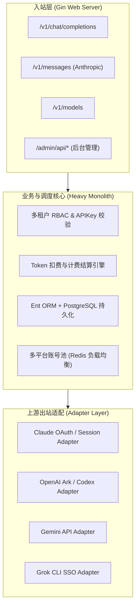

# 荒野 2API 架构深度解剖报告 (01)：Wei-Shaw/sub2api

| 项目元数据 | 内容详情 |
|---|---|
| **目标仓库** | [`Wei-Shaw/sub2api`](https://github.com/Wei-Shaw/sub2api) |
| **主要技术栈** | Go 1.22+ (Gin Web, Ent ORM) + TypeScript (Vue 3, TailwindCSS) |
| **代码规模** | 约 1,301,343 行（含前端、Ent 代码生成与全套迁移） |
| **上游逆向目标** | Claude / OpenAI / Gemini / Grok / 综合中转聚合平台 |
| **部署形态** | Docker Compose + PostgreSQL + Redis + Nginx |

---

## 1. 架构总览与拓扑结构

`sub2api` 是典型的**多租户 SaaS 商业化中转系统**，其设计初衷是为多人拼车、订阅转卖和团队额度分发提供完整的运营底座：

---

## 2. 五层核心能力解剖

### Layer 1: 入站路由与标准协议适配
- **实现位置**：`backend/internal/server/router.go`, `backend/internal/handler/gateway_handler.go`
- **协议覆盖**：同时监听 OpenAI 规范 (`/v1/chat/completions`) 和 Anthropic Claude 规范 (`/v1/messages`)。
- **机制**：在进入实际转发前，先通过 Gin 中间件解析客户端 Bearer Token，关联到系统内部的 `user` 和 `subscription_plan`。

### Layer 2: 目标凭据与会话生命周期
- **实现位置**：`backend/internal/service/openai_oauth_service.go`, `frontend/src/composables/useGrokOAuth.ts`
- **凭据类型**：支持 OAuth 2.0 PKCE 授权码流、Refresh Token 自动刷新置换、Web Cookie 提取。
- **生命周期**：由后台定时 Worker 定期扫描数据库中即将过期的 Token，调用上游 `/oauth/token` 刷新并持久化。

### Layer 3: 指纹伪装与风控攻防
- **实现位置**：`backend/internal/model/tls_fingerprint_profile.go`
- **伪装策略**：内置 TLS Fingerprint Profile，模拟特定客户端 JA3/JA4 握手特征；针对不同上游注入合规 `User-Agent` 与 `Origin`。

### Layer 4: 上游流式解复用与双向转译
- **实现位置**：`backend/internal/handler/gateway_compat_stream_usage_test.go`
- **解复用**：标准 HTTP SSE 解析器，拦截上游数据包，提取 `delta.content`，并在内存中计算 Token 用量，最终重构为 OpenAI 兼容的流式数据帧输出。

### Layer 5: 账号池化与限流熔断
- **实现位置**：`backend/internal/handler/openai_gateway_credential_failover_loop_test.go`
- **容灾策略**：基于 Redis 实现加权轮询与租约锁；在上游报 429 或 401 时触发 Failover Loop，自动剔除故障账号并重试下一个可用账号。

---

## 3. 架构痛点与实体过度膨胀分析

1. **单体严重过度工程化**：为了支撑多租户计费，引入了庞大的 Ent ORM、PostgreSQL、Redis 缓存、支付回调（Stripe/EPay）、工单系统。个人使用时必须维护一整套数据库与 Redis，启动内存消耗 >500MB；
2. **前后端深度耦合**：前端使用 Vue 3 独立工程，依赖 Vite 构建打包，无法随二进制零依赖自足交付。

---

## 4. 纳川 (nachuan) 统一与保留决策

### ✅ 该统一的（交由 nachuan 宿主微内核统一承载）
- **统一 HTTP 端口与路由**：剥离其自建 Gin 监听器，OpenAI 路由统一接入 `nachuan` 的 `:7863`；
- **统一轻量本地池化**：废弃其 PostgreSQL 与 Redis，账号池状态统一交由 `internal/pool` 本地文件原子管理，内存降至 <25MB；
- **统一统一控制台**：剔除其重型 Vue 多租户后台，账号状态与统计统一并入 `nachuan` 内嵌管理面板。

### 🔧 该保留的（提纯为 2API 插件契约）
- **上游 OAuth 刷新置换逻辑**：保留其针对 Grok/Claude/OpenAI 的 Token 刷新原子函数；
- **TLS 指纹白名单配置**：提取其 TLS Profile 为插件级 `spec.json` 声明字段；
- **出站流式多协议互转适配器**：保留其 Claude Messages <-> OpenAI Chat 的映射逻辑。
