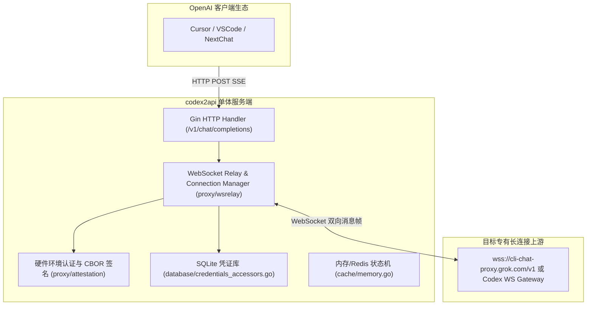

# 荒野 2API 架构深度解剖报告 (02)：james-6-23/codex2api

| 项目元数据 | 内容详情 |
|---|---|
| **目标仓库** | [`james-6-23/codex2api`](https://github.com/james-6-23/codex2api) |
| **主要技术栈** | Go 1.23+ (Gin, Gorilla WebSocket) + React (Vite, TailwindCSS) + SQLite |
| **代码规模** | 约 475,026 行（含前端构建、Grok 客户端分支与 SQLite 迁移） |
| **上游逆向目标** | OpenAI Codex / ChatGPT Backend / Copilot CLI / Grok |
| **部署形态** | Docker Compose + SQLite / Postgres + Nginx |

---

## 1. 架构总览与拓扑结构

`codex2api` 专注于将基于 WebSocket 双向长连接或专有 RPC 的代码辅助平台（如 Codex / Copilot）逆向转译为标准 OpenAI HTTP SSE 接口：

---

## 2. 五层核心能力解剖

### Layer 1: 入站路由与标准协议适配
- **实现位置**：`main.go`, `proxy/newapi_policy_test.go`
- **机制**：暴露标准 HTTP `/v1/chat/completions` 与 `/v1/models` 端点。拦截 HTTP 请求后，并不直接发起 HTTP 出站，而是将其打包为 WebSocket 交互帧。

### Layer 2: 目标凭据与会话生命周期
- **实现位置**：`database/codex_refresh.go`, `cmd/claude_login/main.go`
- **凭据类型**：Codex Session Token、Grok State Token、设备指纹密钥对。
- **机制**：通过 `codex_refresh.go` 维护 Session 的有效期，过期时自动调用刷新端点更新 SQLite 中的 Token。

### Layer 3: 指纹伪装与风控攻防
- **实现位置**：`proxy/attestation/native_darwin.go`, `proxy/attestation/cbor.go`
- **核心亮点**：实现了**原生系统硬件签名与 CBOR 认证伪装**（针对 macOS 环境的设备指纹验证），能够绕过严格的客户端设备合法性校验。

### Layer 4: 上游流式解复用与双向转译
- **实现位置**：`proxy/realtime_ws.go`, `proxy/wsrelay/executor_test.go`
- **解复用机制**：核心难点在于**全双工 WebSocket 转 HTTP 单向流式 SSE**。系统在内存中维护 WebSocket 订阅队列，实时消费 WS 数据帧，将其还原为 `choices.0.delta.content`，并在收到 WS 闭环信号时发出 `[DONE]`。

### Layer 5: 账号池化与限流熔断
- **实现位置**：`proxy/wsrelay/pool_model_isolation_test.go`, `database/account_groups.go`
- **调度策略**：支持账号分组隔离（Account Groups），依据模型类型分配独立的 WebSocket 连接池。

---

## 3. 架构痛点与实体过度膨胀分析

1. **协议层过度捆绑**：将极为精妙的“WS 转 SSE 状态机”与庞大的 React 前端、SQLite 数据库硬编码在一起，无法独立复用；
2. **部署复杂度高**：依赖 `docker-compose.sqlite.yml` 与全套环境编译，单机运行内存消耗 >150MB。

---

## 4. 纳川 (nachuan) 统一与保留决策

### ✅ 该统一的（交由 nachuan 宿主微内核统一承载）
- **统一入站与调度**：废除其独立 Gin 服务与自建端口，统一由 `nachuan` 调度分发；
- **统一账号存储**：丢弃其 SQLite 复杂表结构，账号凭证与 WS Session 统一落盘在 `auths/` 本地 JSON 文件；
- **统一管理控制台**：其 React 控制台全部由 `nachuan` 内嵌面板接管。

### 🔧 该保留的（提纯为 2API 插件契约）
- **WebSocket <-> HTTP SSE 状态机**：这是其核心价值，必须提纯为 Cordis 插件的 `transformStream` 特性；
- **CBOR 硬件环境认证模块**：保留其 `attestation` 硬件伪装算法，作为特定平台的专属防风控钩子。
