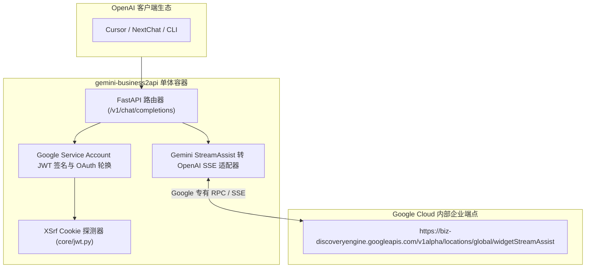

# 荒野 2API 架构深度解剖报告 (03)：yukkcat/gemini-business2api

| 项目元数据 | 内容详情 |
|---|---|
| **目标仓库** | [`yukkcat/gemini-business2api`](https://github.com/yukkcat/gemini-business2api) |
| **主要技术栈** | Python 3.10+ (FastAPI, Uvicorn, httpx) + Vue / React 前端 |
| **代码规模** | 约 17,059 行 |
| **上游逆向目标** | Google Gemini Business / Google Cloud Discovery Engine |
| **部署形态** | Dockerfile + docker-compose |

---

## 1. 架构总览与拓扑结构

`gemini-business2api` 针对企业级 Google Workspace / Gemini Business 平台进行协议逆向，利用 Google Cloud Discovery Engine 的内部端点实现免受公有 API 限制的高并发推理：

---

## 2. 五层核心能力解剖

### Layer 1: 入站路由与标准协议适配
- **实现位置**：`app/api/routers/chat.py`, `main.py`
- **机制**：通过 FastAPI 暴露 `/v1/chat/completions` 与 `/v1/models`。将标准 OpenAI 消息体（`messages` 中的 `system`/`user`/`assistant`）映射为 Google Gemini 专有的 `contents.parts.text` 结构。

### Layer 2: 目标凭据与会话生命周期
- **实现位置**：`core/auth.py`, `core/jwt.py`, `core/google_api.py`
- **凭据类型**：Google Service Account JSON 证书文件（包含 `client_email`, `private_key`）。
- **生命周期**：根据私钥自签名生成 RS256 JWT，向 Google OAuth2 端点置换有效期 1 小时的 Access Token；同时调用 `https://business.gemini.google/auth/getoxsrf` 获取防重放 Cookie。

### Layer 3: 指纹伪装与风控攻防
- **实现位置**：`core/proxy_utils.py`
- **伪装特征**：注入特定 Google 内部调用来源头 `X-Goog-Api-Client`、合规企业级 User-Agent，并支持出站 HTTP/Socks5 代理池分流。

### Layer 4: 上游流式解复用与双向转译
- **实现位置**：`app/services/chat_service.py`
- **流式特征**：上游 `widgetStreamAssist` 返回的是特殊的混合 SSE 流，包含模型生成文本、搜索引文元数据（groundingMetadata）与引用链接。适配器需逐行捕获 JSON 块，提取纯文本增量后重构为标准 OpenAI SSE 帧。

### Layer 5: 账号池化与限流熔断
- **实现位置**：`frontend/src/views/accounts/accountConfig.ts`
- **机制**：仅支持简易多 Service Account 轮询，缺乏精准的 429 退避策略与账号健康状态追踪。

---

## 3. 架构痛点与实体过度膨胀分析

1. **Python 运行时代价高**：为了运行一个轻量协议转换层，引入了完整的 Python 运行时、Uvicorn 异步服务器以及大量 pip 依赖（`pydantic`, `httpx`, `fastapi`），空载内存约 80MB；
2. **账号治理脆弱**：缺乏多租户或多凭据的故障隔离，一个账号报错容易导致批量轮换雪崩。

---

## 4. 纳川 (nachuan) 统一与保留决策

### ✅ 该统一的（交由 nachuan 宿主微内核统一承载）
- **统一轻量宿主**：用 `nachuan` 的 Go 原生微内核取代 FastAPI 和 Docker 容器，内存从 80MB 降至 0（完全复用网关常驻内存）；
- **统一账号生命周期治理**：将多个 Service Account 作为原子条目纳入 `nachuan` 统一账号池，享受加权轮询、故障软硬冷却与租约互斥；
- **统一控制台展示**：无需维护独立前端，账号状态在 `nachuan`「插件中心」统一展示。

### 🔧 该保留的（提纯为 2API 插件契约）
- **Google Service Account JWT 签名与置换逻辑**：保留其通过 RSA 私钥自签名获取 Access Token 的原子函数；
- **Gemini StreamAssist 流式转译器**：保留其从 `widgetStreamAssist` 中提取文本增量与清洗搜索引文的核心算法。
