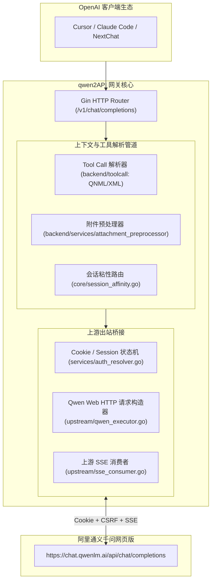

# 荒野 2API 架构深度解剖报告 (04)：YuJunZhiXue/qwen2API

| 项目元数据 | 内容详情 |
|---|---|
| **目标仓库** | [`YuJunZhiXue/qwen2API`](https://github.com/YuJunZhiXue/qwen2API) |
| **主要技术栈** | Go 1.23+ (Gin, Resty) + TypeScript (React, Vite) |
| **代码规模** | 约 19,341 行（Go 核心约 13,000 行，React 前端约 6,000 行） |
| **上游逆向目标** | 阿里通义千问网页版 (Qwen Web Chat) & 通义百炼 |
| **部署形态** | Docker Compose + 原生单二进制 (`start-all.go`) |

---

## 1. 架构总览与拓扑结构

`qwen2API` 将通义千问网页版复杂的多模态附件上传、Tool Call 专有标记（QNML/XML）、长文本分片与会话保持，整体逆向并包装为高兼容度的 OpenAI API：

---

## 2. 五层核心能力解剖

### Layer 1: 入站路由与标准协议适配
- **实现位置**：`backend/api/v1_chat.go`, `backend/adapter/standard_request.go`
- **机制**：暴露完整 OpenAI 端点，且深度兼容 Claude Code、OpenCode 等 CLI 工具特有的系统提示词与环境探测调用。

### Layer 2: 目标凭据与会话生命周期
- **实现位置**：`backend/services/auth_resolver.go`, `backend/core/account_pool/`
- **凭据类型**：Qwen 网页端 Cookie（含 `token` 与会话标识）、`device_id`。
- **生命周期**：支持单账号多 Session 动态绑定，会话结束自动回收，通过保活探针检测 Cookie 有效性。

### Layer 3: 指纹伪装与风控攻防
- **实现位置**：`backend/upstream/payload_builder.go`
- **伪装策略**：注入阿里特定风控 Header、生成动态 `chat_id` 与请求签名，伪装为最新版 Chrome 浏览器指纹。

### Layer 4: 上游流式解复用与双向转译
- **实现位置**：`backend/upstream/sse_consumer.go`, `backend/toolcall/`
- **核心亮点**：通义千问网页在调用工具时，会将参数吐为 QNML 或伪 XML 格式标签。该项目在 `backend/toolcall/` 内实现了一整套状态机，将这些非标准标记还原为标准的 OpenAI `tool_calls` 结构！

### Layer 5: 账号池化与限流熔断
- **实现位置**：`backend/core/session_affinity.go`, `backend/core/session_lock.go`
- **机制**：实现了基于内存锁的账号互斥租约与基于 `conversation_id` 的多轮会话粘性。

---

## 3. 架构痛点与实体过度膨胀分析

1. **单体服务与前端打包过重**：集成了 Vite + React 前端管理后台，导致编译体积偏大；
2. **多模态与工具解析逻辑侵入核心**：Toolcall 修复状态机与 HTTP 转发深度绑定，缺乏微内核解耦。

---

## 4. 纳川 (nachuan) 统一与保留决策

### ✅ 该统一的（交由 nachuan 宿主微内核统一承载）
- **统一网关路由与会话粘性**：废弃其 Gin 路由，直接复用 `nachuan` 既有的 `session.Router`（已在 WorkBuddy 上稳定运行的 `conversation_id` 粘性机制）；
- **统一账号池与状态持久化**：账号列表与 Cookie 统一存储在 `auths/*.json`，享受全局 429 智能指数退避冷却；
- **统一控制台运维**：丢弃其 React 前端，账号与模型指标并入 `nachuan` 面板。

### 🔧 该保留的（提纯为 2API 插件契约）
- **QNML / XML 工具调用修复器 (`backend/toolcall`)**：通义千问特有的 ToolCall 还原算法极具价值，提纯为 Cordis 插件的工具适配中间件；
- **通义千问专有请求体与附件构造器 (`upstream/payload_builder.go`)**：保留其向阿里网页端构造特定 JSON 负载与附件上传的核心代码。
