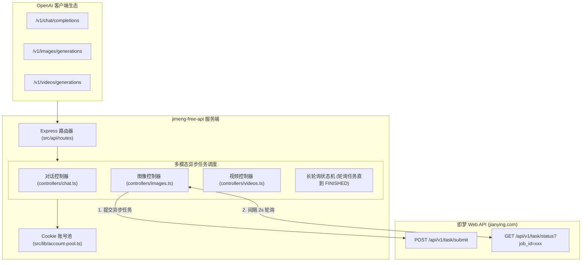

# 荒野 2API 架构深度解剖报告 (05)：zhizinan1997/jimeng-free-api-all

| 项目元数据 | 内容详情 |
|---|---|
| **目标仓库** | [`zhizinan1997/jimeng-free-api-all`](https://github.com/zhizinan1997/jimeng-free-api-all) |
| **主要技术栈** | TypeScript / Node.js (Express, Axios) |
| **代码规模** | 约 7,087 行 |
| **上游逆向目标** | 字节跳动即梦 AI (Jimeng Web - jianying.com) |
| **部署形态** | Dockerfile / Vercel Serverless / 绿色免安装包 |

---

## 1. 架构总览与拓扑结构

`jimeng-free-api` 专注于多模态生成（文生图、图生视频、文本对话），其最大特征是针对上游**异步长轮询任务生命周期（Long-Polling Job State Machine）**的适配管理：

---

## 2. 五层核心能力解剖

### Layer 1: 入站路由与标准协议适配
- **实现位置**：`src/api/routes/`, `src/api/controllers/`
- **协议覆盖**：除了标准 `/v1/chat/completions` 外，还实现了标准 OpenAI 图像生成规范 `/v1/images/generations`，以及社区约定的视频接口。

### Layer 2: 目标凭据与会话生命周期
- **实现位置**：`src/lib/account-pool.ts`, `src/api/controllers/auth.ts`
- **凭据类型**：即梦 Web 端 `sessionid` Cookie、设备指纹 `device_id`。
- **生命周期**：支持从环境变量或配置文件导入多组 Cookie，但在 Token 过期后需要人工重新扫码提取。

### Layer 3: 指纹伪装与风控攻防
- **实现位置**：`src/lib/request/`, `src/lib/browser-transport.ts`
- **伪装特征**：注入字节系专有请求头（`x-security-token`、`x-signature`、`x-bd-client`），以及剪映 Web 端的特定 User-Agent。

### Layer 4: 上游流式与异步长轮询解复用
- **实现位置**：`src/api/controllers/images.ts`, `src/api/controllers/videos.ts`
- **核心亮点**：即梦的生图与生视频是异步任务模式。控制器接收到客户端请求后：
  1. 调用上游创建任务并获得 `job_id`；
  2. 启动内部循环，每隔 1.5~2.5 秒调用 `status` 接口探测进度；
  3. 待状态变为 `SUCCESS` 后，提取 CDN 直链图片并组装为 OpenAI 标准的 `{"data": [{"url": "..."}]}` 返回。

### Layer 5: 账号池化与限流熔断
- **实现位置**：`src/lib/account-pool.ts`
- **机制**：简单的内存数组 Round-Robin，上游报未登录或风控时标记账号失效。

---

## 3. 架构痛点与实体过度膨胀分析

1. **独立端口与独立 Node.js 运行时**：为了运行这套 API，必须常驻一个 Node.js 进程、自建端口（常与其它 2API 冲突），内存占用约 70MB；
2. **多模态与文本割裂**：用户若既用 WorkBuddy（文本）又用 Jimeng（图像），需要配置两套网关地址。

---

## 4. 纳川 (nachuan) 统一与保留决策

### ✅ 该统一的（交由 nachuan 宿主微内核统一承载）
- **统一服务端口与认证**：无需常驻 Node.js 独立进程，统一收敛至 `nachuan` 的 `:7863`；
- **统一账号池与健康熔断**：即梦的 Cookie 凭据纳入统一 `auths/` 管理，共享 429 智能指数退避；
- **统一面板展示**：在「插件中心」展示即梦多模态模型能力（如 `jimeng:dall-e-3` 或 `jimeng:image`）。

### 🔧 该保留的（提纯为 2API 插件契约）
- **异步长轮询转同步/流式状态机**：保留其 `submit -> poll(status) -> resolve(url)` 的成熟逻辑；
- **字节系特定安全签名与请求头封装**：保留其在 `browser-transport.ts` 中的指纹装配算法。
