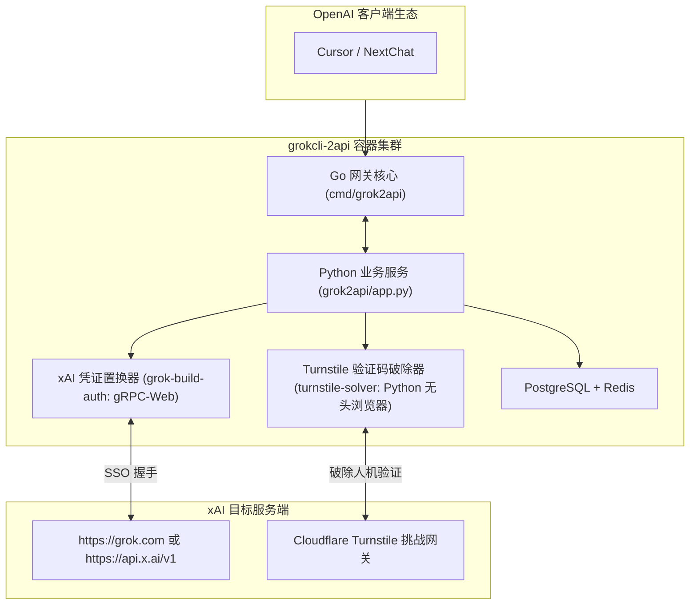

# 荒野 2API 架构深度解剖报告 (06)：HM2899/grokcli-2api

| 项目元数据 | 内容详情 |
|---|---|
| **目标仓库** | [`HM2899/grokcli-2api`](https://github.com/HM2899/grokcli-2api) |
| **主要技术栈** | Go 1.22+ (主网关) + Python 3.10+ (Turnstile 解密 & gRPC 登录) + PostgreSQL + Redis |
| **代码规模** | 约 147,782 行（含双语言运行时、静态 Admin 资产与数据库迁移） |
| **上游逆向目标** | xAI Grok (grok.com & xAI Console / CLI) |
| **部署形态** | Docker Compose 多容器栈 (grok2api + turnstile-solver + postgres + redis) |

---

## 1. 架构总览与拓扑结构

`grokcli-2api` 是典型的**复合语言双轨过渡型单体**，其核心攻坚在于突破 Cloudflare Turnstile 验证码、提取 xAI SSO 凭据，并把 Grok 专有的 gRPC-Web / SSE 流转译为 OpenAI 协议：

---

## 2. 五层核心能力解剖

### Layer 1: 入站路由与标准协议适配
- **实现位置**：`cmd/grok2api/main.go`, `grok2api/app.py`
- **机制**：暴露标准 OpenAI `/v1/chat/completions` 与 `/v1/models`，支持 Grok 2/3、Grok Vision 等模型映射。

### Layer 2: 目标凭据与会话生命周期
- **实现位置**：`grok-build-auth/xconsole_client/sso.py`, `sso_to_auth_json.py`
- **凭据类型**：xAI SSO Token、Session Cookie、`sso-rw` 令牌。
- **生命周期**：实现临时邮箱自动接收验证码、模拟 SSO 登录、置换长效 Token，并在后台由 `token_maintainer.py` 刷新。

### Layer 3: 指纹伪装与风控攻防
- **实现位置**：`turnstile-solver/api_solver.py`, `turnstile-solver/browser_configs.py`
- **核心亮点**：引入了基于无头浏览器的 Turnstile 挑战求解器，动态注入 `cf_clearance` 与挑战通过凭据，绕过 Cloudflare WAF 人机验证拦截。

### Layer 4: 上游流式解复用与双向转译
- **实现位置**：`grok2api/upstream/grok_build_adapter.py`
- **转译策略**：处理上游 SSE 数据块，提取增量字符、思维链标记（Thinking），滤除内部调试字段，封装为标准 OpenAI Chunk。

### Layer 5: 账号池化与限流熔断
- **实现位置**：`grok2api/pool/account_pool.py`, `internal/modelhealth/service.go`
- **状态治理**：基于 Redis 实现了模型健康探测（`modelhealth`），发生 429 速率限制或 403 封锁时触发熔断切号。

---

## 3. 架构痛点与实体过度膨胀分析

1. **多语言与多容器灾难**：为了跑起该项目，机器上必须同时安装 Go 环境、Python 环境、Playwright 浏览器、PostgreSQL、Redis，Docker 镜像体积高达 2GB+，常驻内存 >800MB；
2. **架构半成品割裂**：存在 Go 重写与 Python 既有代码并存的历史包袱，逻辑分散在两个语言栈中。

---

## 4. 纳川 (nachuan) 统一与保留决策

### ✅ 该统一的（交由 nachuan 宿主微内核统一承载）
- **统一轻量宿主**：废除其自建的双进程服务器、PostgreSQL 与 Redis，统一由 `nachuan` 的 Go 单二进制作为宿主网关，内存降至 ~25MB；
- **统一账号池与健康熔断**：其 `modelhealth` 熔断机制统一接入 `nachuan` 的加权轮询与智能软硬冷却；
- **统一控制台与配置**：无需运行庞大的静态管理后台，账号管理完全并入 `nachuan` 内嵌面板。

### 🔧 该保留的（提纯为 2API 插件契约）
- **Turnstile / SSO 凭据解析规范**：保留其 `sso_to_auth_json.py` 提炼出的 Token 规范与出站 Header 指纹；
- **Grok 模型映射与流式清洗器**：保留其从 Grok 响应中剥离思维链与格式化流式帧的纯算法。
