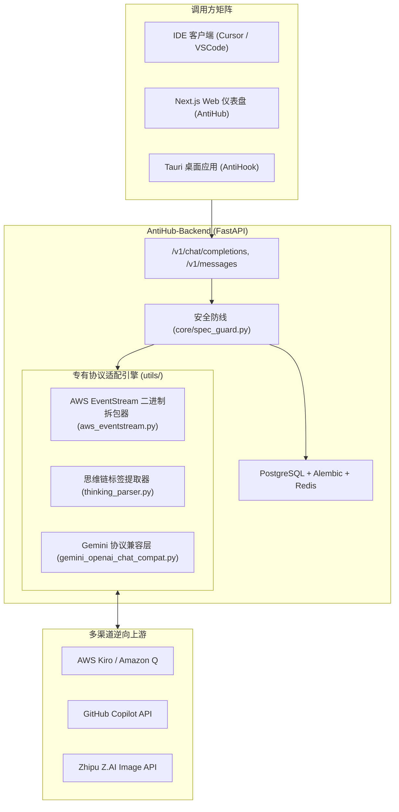

# 荒野 2API 架构深度解剖报告 (07)：NookMux/AntiHub-ALL

| 项目元数据 | 内容详情 |
|---|---|
| **目标仓库** | [`NookMux/AntiHub-ALL`](https://github.com/NookMux/AntiHub-ALL) |
| **主要技术栈** | Python 3.11+ (FastAPI, SQLAlchemy) + TypeScript (Next.js 15) + Rust (Tauri 客户端) |
| **代码规模** | 约 47,608 行 |
| **上游逆向目标** | GitHub Copilot / AWS Kiro / Claude / Google Gemini / Zhipu Z.AI |
| **部署形态** | 完整微服务全家桶 (Next.js 前端 + FastAPI 后端 + PostgreSQL + Redis + Tauri 桌面) |

---

## 1. 架构总览与拓扑结构

`AntiHub-ALL` 试图打造一个跨平台统一代理中枢，涵盖 Web 控制台、后端 API 集群以及原生桌面客户端（AntiHook），横跨文本、图像与代码补全：

---

## 2. 五层核心能力解剖

### Layer 1: 入站路由与标准协议适配
- **实现位置**：`AntiHub-Backend/app/api/routes/v1.py`, `gemini.py`, `anthropic.py`
- **协议覆盖**：在同一端口下聚合 OpenAI、Claude Messages 与 Google Gemini 三大主流入站协议。

### Layer 2: 目标凭据与会话生命周期
- **实现位置**：`AntiHub-Backend/app/repositories/copilot_account_repository.py`, `oauth_token_repository.py`
- **凭据类型**：Copilot Token、AWS SSO Bearer、API Key。
- **生命周期**：支持基于数据库持久化的 Token 过期自动探测与多租户秘钥派生。

### Layer 3: 指纹伪装与风控攻防
- **实现位置**：`AntiHub-Backend/app/core/spec_guard.py`, `spec_allowlist.py`
- **核心亮点**：实现了基于 AST 与白名单规则的入站请求清洗（Spec Guard），防止恶意 Payload 击穿上游风控规则。

### Layer 4: 上游流式解复用与双向转译
- **实现位置**：`AntiHub-Backend/app/utils/aws_eventstream.py`, `thinking_parser.py`
- **核心亮点**：
  1. 实现了纯 Python 的 **AWS EventStream 二进制协议拆包器**（解码 CRC32、Header 字典与 Payload 帧）；
  2. 实现了从混合文本中精准截取 `<thinking>...</thinking>` 思维链标签并映射到 `reasoning_content` 的解析器。

### Layer 5: 账号池化与限流熔断
- **实现位置**：`AntiHub-Backend/app/models/antigravity_model_quota.py`, `cache/redis_client.py`
- **配额管理**：基于 Redis 实现了每模型、每分钟的速率限制和用量累加。

---

## 3. 架构痛点与实体过度膨胀分析

1. **组件极度碎片化**：同时维护 Next.js 前端、FastAPI 后端、Tauri 桌面端，包含 3 套 `package.json` 和多套构建链，个人开发者部署几乎无法一次成功；
2. **重型依赖难以精简**：强制依赖 PostgreSQL 和 Redis，对于个人自用场景来说严重过剩。

---

## 4. 纳川 (nachuan) 统一与保留决策

### ✅ 该统一的（交由 nachuan 宿主微内核统一承载）
- **统一单二进制网关**：剔除 Next.js、Tauri 和 FastAPI，全部由 `nachuan` 的 Go 原生单二进制统一承载；
- **统一本地文件存储**：废弃 PostgreSQL/Redis，所有凭据与配额统一由 `internal/auth` 与 `internal/pool` 在本地无感知持久化；
- **统一思维链协议提取**：`nachuan` 已原生支持 `reasoning_content` 回填，完全吸收其思维链解析思想。

### 🔧 该保留的（提纯为 2API 插件契约）
- **AWS EventStream 二进制解码算法**：这是对接 AWS 系上游的核心技术资产，必须提纯为 Cordis 插件的专用解码器；
- **各专有渠道指纹头白名单**：提取其在 `spec_allowlist.py` 中积累的 Headers 配置。
