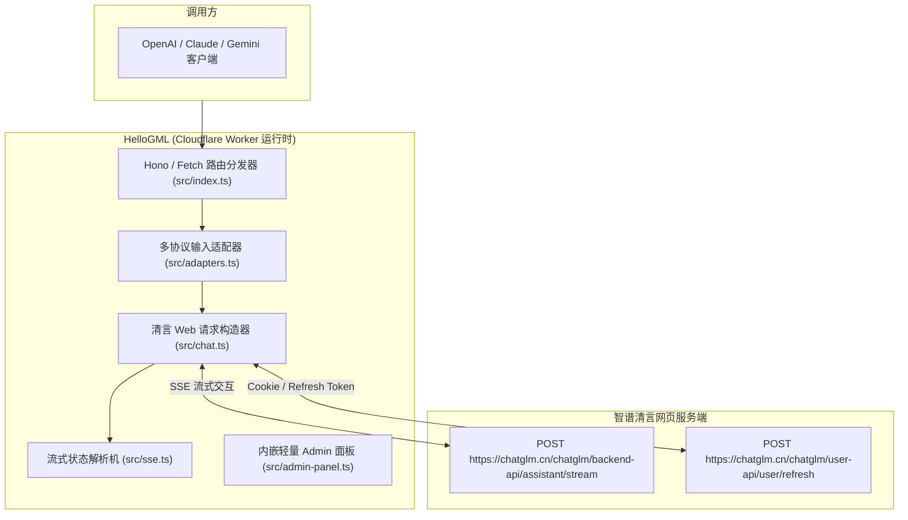

# 荒野 2API 架构深度解剖报告 (08)：Hello-Application-XH/HelloGML

| 项目元数据 | 内容详情 |
|---|---|
| **目标仓库** | [`Hello-Application-XH/HelloGML`](https://github.com/Hello-Application-XH/HelloGML) |
| **主要技术栈** | TypeScript (Cloudflare Workers, Hono / Fetch API) |
| **代码规模** | 约 3,265 行 |
| **上游逆向目标** | 智谱清言网页版 (Zhipu Qingyan Web Chat - chatglm.cn) |
| **部署形态** | Cloudflare Workers Serverless / Node.js Standalone |

---

## 1. 架构总览与拓扑结构

`HelloGML` 是典型的**轻量无服务器（Serverless-First）逆向实现**，将智谱清言网页端专有的 Assistant Stream 协议适配为标准 OpenAI / Claude / Gemini API：

---

## 2. 五层核心能力解剖

### Layer 1: 入站路由与标准协议适配
- **实现位置**：`src/index.ts`, `src/adapters.ts`
- **机制**：通过统一 Handler 支持 `/v1/chat/completions`、`/v1/messages` 等端点，并在内存中完成请求参数的归一化。

### Layer 2: 目标凭据与会话生命周期
- **实现位置**：`src/chat.ts`
- **凭据类型**：智谱网页端 `refresh_token`、`access_token`。
- **生命周期**：每次请求检查 Token 有效性，若失效则调用 `https://chatglm.cn/chatglm/user-api/user/refresh` 自动置换全新 Access Token。

### Layer 3: 指纹伪装与风控攻防
- **实现位置**：`src/chat.ts`
- **伪装特征**：严格注入 Chrome 浏览器 User-Agent，绑定 `Origin: https://chatglm.cn` 与 `Referer: https://chatglm.cn/`，抹平出站指纹特征。

### Layer 4: 上游流式解复用与双向转译
- **实现位置**：`src/sse.ts`
- **流式特征**：智谱清言的流式响应返回了复杂的事件类型（`message`、`interrupted`、`finish`、`metadata` 等）。`sse.ts` 将其清洗为标准文本增量，并注入 `data: [DONE]` 闭环。

### Layer 5: 账号池化与限流熔断
- **实现位置**：无原生多账号池，仅依赖 Cloudflare KV 存储单个全局 Token。
- **短板**：无法支持高并发多账号切号轮换与精细冷却。

---

## 3. 架构痛点与实体过度膨胀分析

1. **强绑定 Cloudflare Worker 生态**：设计之初深度依赖 CF 环境变量与 KV 存储，私有化在本地单机部署时体验欠佳；
2. **缺乏多账号治理能力**：无法应对大并发场景下的 429 限流问题，单号风控即全盘不可用。

---

## 4. 纳川 (nachuan) 统一与保留决策

### ✅ 该统一的（交由 nachuan 宿主微内核统一承载）
- **统一本地脱网运行**：脱离 Cloudflare Workers 绑定，作为原生 Cordis 插件运行在 `nachuan` 本地微内核中；
- **统一注入多账号池**：将单号架构升级为多账号加权轮询与 429 智能指数退避冷却；
- **统一内嵌控制台**：剔除其简陋的 `admin-panel.ts`，统一呈现在 `nachuan`「插件中心」并支持热重载。

### 🔧 该保留的（提纯为 2API 插件契约）
- **智谱清言 Token 自动刷新状态机**：保留其通过 `user/refresh` 端点自动保活置换凭据的闭环逻辑；
- **清言 Assistant Stream SSE 解析器**：保留其事件类型映射与增量解复用算法。
