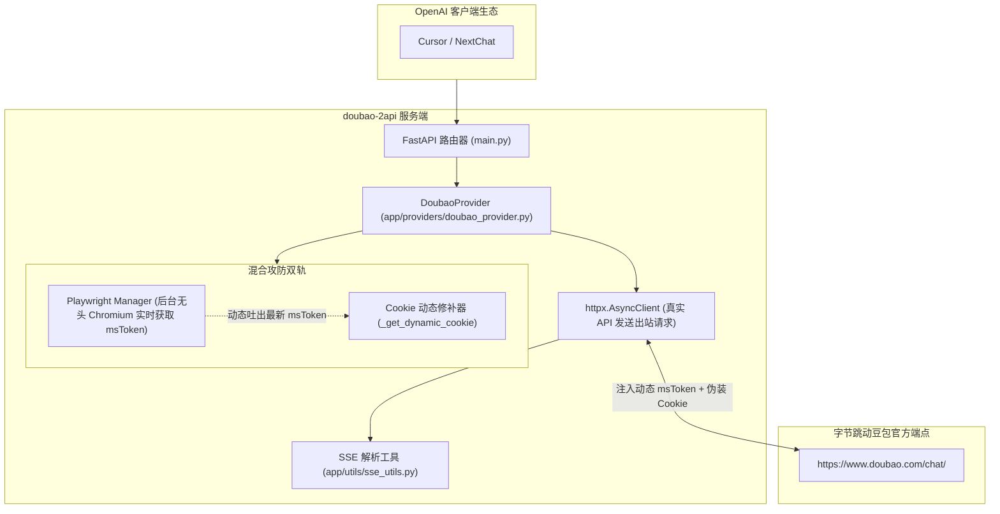

# 荒野 2API 架构深度解剖报告 (09)：lza6/doubao-2api

| 项目元数据 | 内容详情 |
|---|---|
| **目标仓库** | [`lza6/doubao-2api`](https://github.com/lza6/doubao-2api) |
| **主要技术栈** | Python 3.10+ (FastAPI, Playwright, httpx, loguru) |
| **代码规模** | 约 776 行 |
| **上游逆向目标** | 字节跳动豆包网页版 (ByteDance Doubao Web - doubao.com) |
| **部署形态** | Dockerfile (内置 Chromium 无头浏览器) + docker-compose |

---

## 1. 架构总览与拓扑结构

`doubao-2api` 针对字节跳动豆包严格的 Web 反爬签名机制（`msToken` 轮换与动态 Cookie 校验），创新性地采用了**轻量无头浏览器探针 + 异步 HTTP 高性能请求**的混合双轨架构：

---

## 2. 五层核心能力解剖

### Layer 1: 入站路由与标准协议适配
- **实现位置**：`main.py`, `app/providers/doubao_provider.py`
- **机制**：暴露 `/v1/chat/completions` 与 `/v1/models`。将标准 messages 列表扁平化处理为豆包 Web 所要求的会话历史格式。

### Layer 2: 目标凭据与会话生命周期
- **实现位置**：`app/services/credential_manager.py`, `session_manager.py`
- **凭据类型**：`sessionid`、基础 Cookie 串。
- **生命周期**：会话管理器为每次会话分配全局唯一的 UUID，并维护连续多轮对话的上下文引用。

### Layer 3: 指纹伪装与风控攻防
- **实现位置**：`app/services/playwright_manager.py`, `_get_dynamic_cookie`
- **核心亮点**：字节跳动的风控会定期使 `msToken` 失效，导致纯静态 HTTP 请求报 403。该项目在后台运行一个轻量 Playwright Chromium 实例，定时访问豆包主页并嗅探最新生成的 `msToken`，将其动态拼接进静态 Cookie 中！

### Layer 4: 上游流式解复用与双向转译
- **实现位置**：`app/utils/sse_utils.py`
- **机制**：读取上游出站的逐行 SSE 响应，滤除字节系特有的日志事件和状态心跳，提取增量正文，构造成符合 OpenAI 规范的 Chunk 并在末尾补全 `data: [DONE]\n\n`。

### Layer 5: 账号池化与限流熔断
- **实现位置**：仅支持单配置 Cookie，缺乏多账号池化与并发控制。

---

## 3. 架构痛点与实体过度膨胀分析

1. **无头浏览器极其笨重**：引入 Playwright 导致 Docker 镜像高达 1GB+，内存常驻占用 >300MB，对服务器或本地工作站资源造成不必要的侵占；
2. **缺乏多账号能力**：账号被风控后系统直接中断，无自动切号与冷却重试机制。

---

## 4. 纳川 (nachuan) 统一与保留决策

### ✅ 该统一的（交由 nachuan 宿主微内核统一承载）
- **统一宿主与无 Docker 部署**：剥离其独立的 FastAPI、Uvicorn 和 Docker 镜像，统一挂载在 `nachuan` 微内核中；
- **统一账号池与故障隔离**：将豆包凭据纳入 `nachuan` 统一池化，实现多账号轮换与 429 退避；
- **统一控制台与健康指标**：其运行状态在 `nachuan`「插件中心」统一展示。

### 🔧 该保留的（提纯为 2API 插件契约）
- **动态 msToken 嗅探与修补机制**：保留其通过本地轻量脚本或静态逆向算法更新 `msToken` 的特征；
- **豆包 Web 请求协议与 Payload 构造逻辑**：提纯为 Cordis 插件的 `transformPayload` 规范。
