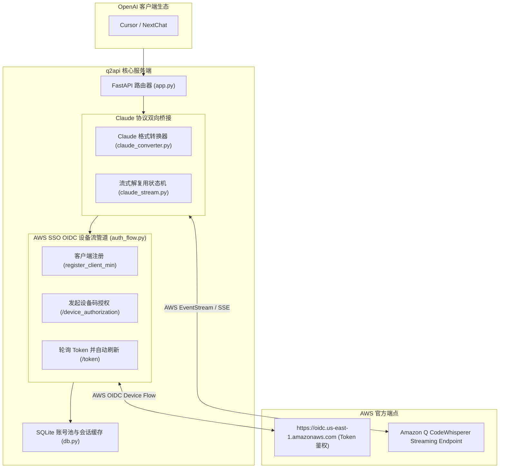

# 荒野 2API 架构深度解剖报告 (10)：CassiopeiaCode/q2api

| 项目元数据 | 内容详情 |
|---|---|
| **目标仓库** | [`CassiopeiaCode/q2api`](https://github.com/CassiopeiaCode/q2api) |
| **主要技术栈** | Python 3.11+ (FastAPI, httpx, aiosqlite) + HTML/JS |
| **代码规模** | 约 5,357 行 |
| **上游逆向目标** | Amazon Q Developer (CLI & AWS Builder ID) |
| **部署形态** | Docker Compose + SQLite (`db.py`) + Account Feeder 子工程 |

---

## 1. 架构总览与拓扑结构

`q2api` 专注于将 Amazon Q Developer 命令行工具的 AWS OIDC 凭据与长连接协议，逆向转译为标准 OpenAI `/v1/chat/completions`，并利用 AWS 后端支撑的 Claude 3.5 Sonnet 模型对外提供推理能力：

---

## 2. 五层核心能力解剖

### Layer 1: 入站路由与标准协议适配
- **实现位置**：`app.py`
- **机制**：通过 FastAPI 提供 `/v1/chat/completions` 与 `/v1/models`。重点是将请求转换为 Amazon Q 专有的上下文输入格式。

### Layer 2: 目标凭据与会话生命周期
- **实现位置**：`auth_flow.py`, `db.py`
- **凭据类型**：AWS Builder ID OIDC `clientId`, `clientSecret`, `accessToken`, `refreshToken`。
- **生命周期**：遵循标准的 **OAuth 2.0 Device Authorization Grant**：
  1. 向 `https://oidc.us-east-1.amazonaws.com/client/register` 动态注册客户端；
  2. 请求 `/device_authorization` 获取设备码和用户核验 URL（`verificationUriComplete`）；
  3. 轮询 `/token` 直到用户在浏览器确认授权；
  4. Token 即将过期时通过 `grant_type: refresh_token` 自动置换。

### Layer 3: 指纹伪装与风控攻防
- **实现位置**：`auth_flow.py` 中的 `make_headers()`
- **伪装策略**：深度伪装为 AWS 官方 Rust SDK：
  - `User-Agent: aws-sdk-rust/1.3.9 os/windows lang/rust/1.87.0`
  - `x-amz-user-agent: aws-sdk-rust/1.3.9 ua/2.1 api/ssooidc/1.88.0 os/windows lang/rust/1.87.0 m/E app/AmazonQ-For-CLI`
  - 动态生成 `amz-sdk-invocation-id` (UUIDv4)。

### Layer 4: 上游流式解复用与双向转译
- **实现位置**：`claude_stream.py`, `claude_converter.py`
- **机制**：Amazon Q 底层承载的是 Claude 模型，出站返回的是经过 AWS 包装的 SSE 流。`claude_stream.py` 负责剔除 AWS 的包装外壳，恢复 `delta.text` 并映射为标准 OpenAI Chunk。

### Layer 5: 账号池化与限流熔断
- **实现位置**：`scripts/manage_suspended_accounts.py`, `db.py`
- **容灾策略**：在 SQLite 中记录每个账号的成功与失败次数，发生风控锁定（Suspended）或配额超限（429）时将账号标记为冷却禁用。

---

## 3. 架构痛点与实体过度膨胀分析

1. **结构冗余与工具分散**：维护了一个主工程 `app.py` 和一个几乎相同的 `account-feeder/` 独立子工程，包含大量零散的运维脚本；
2. **单体自建数据库**：依赖 SQLite 的表结构变更与迁移，个人多机同步和备份困难。

---

## 4. 纳川 (nachuan) 统一与保留决策

### ✅ 该统一的（交由 nachuan 宿主微内核统一承载）
- **统一 OAuth 设备流体验**：其 `auth_flow.py` 的设备码逻辑与 `nachuan` 的 `cmd/login`、Web 控制台扫码登录**具有 100% 同构性**！完全由 `nachuan` 统一入口完成扫码添加账号；
- **统一账号存储与池化调度**：彻底干掉 `db.py` 与独立 SQLite，凭据统一落盘于 `auths/*.json`，并发调用享受 `nachuan` 的租约锁与智能退避；
- **统一单二进制**：消灭 Python 与 FastAPI，由 `nachuan` 原生调度。

### 🔧 该保留的（提纯为 2API 插件契约）
- **AWS Rust SDK 出站指纹配置**：提取其精细调优的 `x-amz-user-agent` 与 `amz-sdk-request` 请求头；
- **Amazon Q 专有消息转换与流式清洗算法**：提纯为 Cordis 插件的转译核心。
