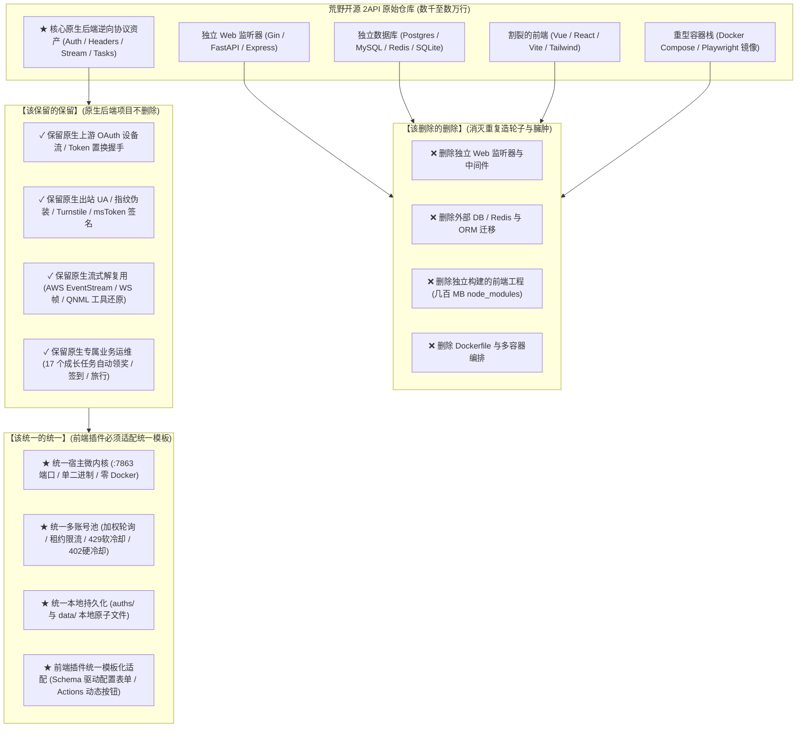

# 荒野 2API “三该原则” 与原生后端/前端插件统一模板适配规范

| 规范元数据 | 内容详情 |
|---|---|
| **规范标题** | 荒野 2API “三该原则”（该统一/该保留/该删除）与原生后端保留及前端插件模板适配规范 |
| **所属体系** | `nachuan (纳川)` Cordis 微内核架构 · 2API Agent 编译器 |
| **核心指导思想** | **该统一的统一，该保留的保留，该删除的删除。原生的 GitHub 后端项目不删除，但其前端插件必须去适配统一模板。** |
| **全景索引** | **[官方全景文档总索引 (DOCS_INDEX.md)](file://<LEGACY_WORKSPACE>/DOCS_INDEX.md)** |

---

## 1. “三该原则” 核心定义与架构红线

在对 GitHub 10 款热门开源 2API 进行全源码深度解剖的基础上，我们确立了重构与编译转译的三大绝对工程准则：



---

## 2. 深入剖析：“三该原则”的落地实施细则

### 2.1 【该删除的删除】（Eliminate Bloat）
野生开源 2API 之所以难以统一部署，根本原因在于每个项目都试图成为一个“独立的大单体系统”：
1. **删除独立 HTTP 监听器**：删掉各个仓库自带的 `gin.Default().Run(":8080")`、`uvicorn.run()`、`app.listen(3000)`，彻底终结用户本地端口冲突的梦魇；
2. **删除外部数据库与 ORM**：删掉 PostgreSQL、MySQL、Redis、Ent ORM、Alembic、Prisma。个人使用场景下，外部数据库是纯粹的运维负担与内存黑洞；
3. **删除割裂的前端工程**：删掉散落在各仓库里的 Vue 3、React、Vite、Tailwind、AntD 等独立 UI 工程；
4. **删除重型 Docker 容器**：删掉多容器 Compose 配置，拒绝拉取动辄 1~2GB 的无头浏览器或 Node 镜像。

---

### 2.2 【该保留的保留】（Preserve Native Backend Core）
**原生的 GitHub 后端项目不删除！** 核心逆向技术资产是开源作者数月心血的结晶，是穿透上游风控的关键，必须 100% 完整保留：
1. **保留专有鉴权状态机**：
   - 腾讯 WorkBuddy 的 OAuth 2.0 Device Flow 设备码轮询与 Access Token 置换；
   - 亚马逊 Q Developer 的 AWS OIDC Device Authorization (`us-east-1.amazonaws.com`)；
   - 智谱清言的 `user/refresh` 自动刷新 Token 闭环；
   - 谷歌 Gemini Business 的 Google Service Account RSA 私钥 JWT 签名；
2. **保留专有出站指纹特征**：
   - WorkBuddy 官方特有的三段式 `User-Agent` 与 `X-IDE-Product` 白名单；
   - 亚马逊 Q 的 `aws-sdk-rust` 与 `amz-sdk-invocation-id` 伪装；
   - 字节豆包的动态 `msToken` 与 Cookie 签名拼接；
   - xAI Grok 的 Cloudflare Turnstile 挑战突破凭证；
3. **保留专有流式解复用与标记修复**：
   - AWS EventStream 二进制分块 CRC32 解码与 Payload 拆包；
   - 通义千问 QNML / XML 非标准工具调用标记的捕获与 `tool_calls` 还原；
   - 上游 `<thinking>` 思维链标签的提取；
4. **保留专有业务红利任务**：
   - WorkBuddy 独有的 17 个纯 API 成长任务自动领奖、猫猫旅行、连登签到；
   - 平台专属的代金券兑换与积分查询接口。

---

### 2.3 【该统一的统一】（Unify Host & Frontend Plugin Template）
在保留原生后端逆向逻辑的同时，**所有插件的前端交互与表现层，必须完全适配我们统一的 Web 控制台模板**！

```mermaid
classDiagram
    class UnifiedHostPanel {
        +GET /panel/ (内嵌极速加载单页面)
        +GET /panel/api/plugins (获取全量已装载插件)
        +POST /panel/api/plugins/{name}/action (统一触发插件动作)
        +POST /panel/api/plugins/{name}/config (统一保存插件配置)
    }

    class StandardPluginSpec {
        +name: string
        +displayName: string
        +version: string
        +upstream: UpstreamSpec
        +models: ModelSpec[]
        +configSchema: ConfigField[]
        +actions: ActionSpec[]
    }

    class ConfigField {
        +key: string
        +label: string
        +type: string
        +default: string
        +placeholder: string
        +description: string
    }

    class ActionSpec {
        +id: string
        +label: string
        +description: string
        +style: string
    }

    UnifiedHostPanel --> StandardPluginSpec : 动态解析并自适应渲染卡片
    StandardPluginSpec *-- ConfigField : 声明式配置表单
    StandardPluginSpec *-- ActionSpec : 声明式运维动作按钮
```

---

## 3. 前端插件统一模板标准契约 (UI & Schema Specification)

为了让任何野生 2API（不论其原生后端是 Go、Python 还是 TypeScript）编译后都能完美呈现在控制台中，`spec.json` 契约扩展了声明式 UI 描述字段：

### 3.1 声明式配置项表单契约 (`configSchema`)
插件可声明自身所需的配置字段（如 Web Cookie、Access Token、自定义代理等），宿主 Web 控制台将自动在插件卡片内生成对应的配置表单：

```json
"configSchema": [
  {
    "key": "cookie",
    "label": "Web 登录 Cookie",
    "type": "textarea",
    "placeholder": "填入从浏览器抓取的完整 Cookie 字符串",
    "description": "用于与上游建立会话态，落盘于本地 auths/ 目录",
    "required": true
  },
  {
    "key": "refresh_token",
    "label": "刷新令牌 (Refresh Token)",
    "type": "password",
    "placeholder": "可选，用于自动免密续期"
  },
  {
    "key": "proxy",
    "label": "出站代理 (Proxy)",
    "type": "text",
    "placeholder": "http://127.0.0.1:7890",
    "default": ""
  }
]
```

### 3.2 声明式交互操作按钮契约 (`actions`)
插件可声明自身支持的可视化操作（如 OAuth 设备码登录、手动刷新凭证、一键签到、成长任务），控制台将自动在头部或卡片底部渲染为高质感操作按钮，点击即通过统一路由触发：

```json
"actions": [
  {
    "id": "oauth_login",
    "label": "OAuth 设备码授权",
    "description": "生成设备码并在浏览器打开授权页面完成登录",
    "style": "primary"
  },
  {
    "id": "refresh_token",
    "label": "刷新 Access Token",
    "description": "立即调用上游刷新接口置换长效令牌",
    "style": "secondary"
  },
  {
    "id": "checkin",
    "label": "每日签到",
    "description": "调用平台签到接口领取积分",
    "style": "secondary"
  },
  {
    "id": "run_tasks",
    "label": "执行成长任务",
    "description": "自动执行全部 17 个纯 API 任务并领取算力奖励",
    "style": "secondary"
  }
]
```

---

## 4. 落地适配对照范例 (以 3 款代表性插件为例)

通过上述统一模板，各异构平台的插件在前端展现上达到了前所未有的美观与统一：

| 插件 | 原生后端保留能力 | 前端插件适配模板产物 (Actions & Config) |
|---|---|---|
| **`2api-plugin-workbuddy`** (Go 原生) | 保留 OAuth Device Flow、保留 WorkBuddy UA 伪装、保留 17 个成长任务 API 与签到逻辑 | **Actions**：`[OAuth 授权]`, `[每日签到]`, `[执行成长任务]`<br/>**Config**：支持自定义设备指纹与超时配置 |
| **`2api-plugin-hellogml`** (TS 提纯) | 保留清言 `user/refresh` 自动刷新、保留 Assistant Stream 流式分包 | **Actions**：`[刷新 Token]`, `[测试连通性]`<br/>**Config**：`refresh_token` 密码输入框、Cookie 配置项 |
| **`2api-plugin-qwen`** (Python 探针) | 保留通义千问 Web Cookie 鉴权、保留 CSRF Header 与 32K 上下文映射 | **Actions**：`[网络连通性探测]`<br/>**Config**：`api_key` / `cookie` 配置项 |

---

## 5. 总结与落地路线

本规范彻底解决了“野生 2API 架构碎片化”与“过度封装失控”的两难困境：
- **不破坏原作者核心技术资产**：原生后端的算法、协议、防风控全部保留；
- **消灭宿主负担**：把多余的数据库、多端口 Web 服务和 Docker 彻底删除；
- **统一用户体验**：前端插件全部适配标准化模板，用户在一个面板、一个端口、一套 API 密钥下掌控所有 2API 插件！
