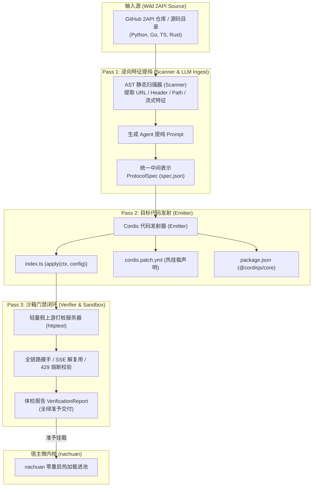

# 2API Agent 编译器 · 核心技术规范与架构实现白皮书

> **历史方案提示（2026-11-01）**：本文描述旧 Cordis 目标，编译器未纳入当前交付包。工作区旧实现主要按规则扫描并生成旧契约脚手架，其假上游检查不运行生成插件；不能据此认定任意仓库已转换成功或真实平台已接入。当前接入顺序与验收见 [平台接入实施与验收](../平台接入实施与验收.md)。

| 项目 | 内容 |
|---|---|
| **核心组件** | **2API Agent 编译器 (2API Agent Compiler)** |
| **独立工程坐标** | 源码目录: [`2api-agent-compiler/`](file://<LEGACY_WORKSPACE>/2api-agent-compiler/) · CLI 入口: [`2api-agent-compiler/cmd/2api-compiler/`](file://<LEGACY_WORKSPACE>/2api-agent-compiler/cmd/2api-compiler/) |
| **构建产物** | 原生单二进制 `2api-agent-compiler/bin/2api-compiler` |
| **全景索引** | **[官方全景文档总索引 (DOCS_INDEX.md)](DOCS_INDEX.md)** |
| **核心使命** | **将荒野开源 2API 仓库的逆向协议剥离提纯，编译为零依赖、标准化的 Cordis 插件** |
| **关联生态** | [`TECHNICAL_SOLUTION_WILD_2API.md`](file://<LEGACY_WORKSPACE>/TECHNICAL_SOLUTION_WILD_2API.md) · [`2API_CORDIS_TECH_SPEC.md`](file://<LEGACY_WORKSPACE>/2API_CORDIS_TECH_SPEC.md) |

---

## 1. 独立动机与核心使命

在传统 AI 逆向生态中，每个开发者在开源自己的“2api”（如 `doubao-2api`、`q2api`、`qwen2API`）时，都不得不捆绑一整套沉重且同质化的技术实体：
- 独立编写 Gin / FastAPI / Express Web 服务；
- 自行编写 Dockerfile、Docker Compose、环境变量配置与启动脚本；
- 自行搭建简易前端页面或 SQLite 数据库。

这导致个人开发者若想同时使用 5~10 个不同平台的逆向模型，就必须在本地启动 10 个容器、占 10 个端口，消耗数 GB 内存，且维护极度脆弱。

**2API Agent 编译器**将这项技术从所有冗余实体中**彻底剥离独立**：
- 它是一个**专用的语义编译器（Domain-Specific Compiler）**；
- 输入：任何编程语言（Python、Go、TypeScript、Rust）编写的开源 2API 仓库源码或 cURL 抓包日志；
- 输出：标准化、轻量化（~200 行）、热插拔的 **Cordis 微内核插件包**；
- 运行：生成的插件直接装载进 `nachuan (纳川)` 宿主，共享统一的端口、账号池、调度器与 Web 控制台。

---

## 2. 编译器核心拓扑与三阶段流水线 (3-Pass Pipeline)



---

## 3. 中间表示（IR）数据契约：`ProtocolSpec`

编译器定义了一套严格、跨语言的逆向协议中间表示（IR）。无论上游多么复杂，在编译器内部均被抽象为以下规范：

```go
type ProtocolSpec struct {
    Name        string            `json:"name"`        // 插件唯一标识（如 2api-plugin-doubao）
    Version     string            `json:"version"`     // 语义化版本
    DisplayName string            `json:"displayName"` // 人类可读名称
    Description string            `json:"description"` // 功能描述
    Upstream    UpstreamSpec      `json:"upstream"`    // 上游服务基地址与超时参数
    Auth        AuthSpec          `json:"auth"`        // 鉴权类型（OAuth设备流/Cookie/Bearer/APIKey）
    Headers     map[string]string `json:"headers"`     // 桌面客户端指纹与白名单请求头
    Chat        ChatSpec          `json:"chat"`        // 对话补全端点与载荷适配规则
    Stream      StreamSpec        `json:"stream"`      // 流式响应反序列化（SSE 增量提取路径）
    Models      []ModelSpec       `json:"models"`      // 模型映射列表与计费倍率
    ErrorRules  []ErrorRule       `json:"errorRules"`  // 429 退避与熔断自愈规则
}
```

---

## 4. 编译器独立工程目录结构

核心代码均已独立落盘于 `2api-agent-compiler/`，支持完全独立的版本发布与构建：

```
2api-agent-compiler/
├── go.mod                 # 独立 Go 模块 (module 2api-agent-compiler)
├── Makefile               # 独立构建指令
├── README.md              # 独立项目说明
├── cmd/
│   └── 2api-compiler/
│       └── main.go        # 2api-compiler 原生命令行独立工具
└── pkg/
    └── compiler/
        ├── spec.go        # 统一中间表示 (IR: ProtocolSpec)
        ├── scanner.go     # Pass 1: 源码静态特征扫描与 Prompt 提取器
        ├── emitter.go     # Pass 2: Cordis 插件代码发射器
        ├── verifier.go    # Pass 3: 内存级假上游打桩与沙箱门禁
        ├── pipeline.go    # 三阶段流水线总编排
        └── compiler_test.go # 独立自动化单元测试套件 (PASS in 0.03s)
```

---

## 5. 命令行工具使用指南 (`2api-compiler`)

编译产物位于 `2api-agent-compiler/bin/2api-compiler`，通过该目录下的 `make build` 即可编译。

### 5.1 一键端到端完整编译 (`compile`)
将一个包含野生 Python/Go 逆向代码的目录，一键转译为可用的 Cordis 插件工程，并自动跑通打桩沙箱门禁：
```bash
cd 2api-agent-compiler
./bin/2api-compiler compile /path/to/doubao-2api -o ./plugins -name doubao
```
**输出效果**：
```
🚀 启动 2API Agent 编译器流水线...
  输入目录: /path/to/doubao-2api
  输出路径: ./plugins

============================================================
🎉 编译成功！插件包: 2api-plugin-doubao
  插件目录: plugins/2api-plugin-doubao
  上游基址: https://api.doubao.com
  聚合模型数: 3
  门禁状态: ✓ 插件 2api-plugin-doubao 顺利通过全部 3 项门禁测试，耗时 25ms，准予交付发布！
============================================================
```

### 5.2 静态扫描与生成 Agent Prompt (`scan`)
对目标仓库进行特征嗅探，提取 URL、路径、请求头和认证线索，并输出专为大模型设计的逆向提纯提示词：
```bash
./bin/2api-compiler scan /path/to/q2api
```

### 5.3 独立门禁体检 (`verify`)
针对已有的 `spec.json` 契约启动假上游打桩验证，确保 SSE 流式增量能够被精准提取：
```bash
./bin/2api-compiler verify ./plugins/2api-plugin-doubao/spec.json
```

---

## 6. 与宿主 `nachuan (纳川)` 的协同闭环

由 **2API Agent 编译器** 产出的插件，天然具备以下特权：
1. **零端口占用**：完全运行在宿主的端口（`:7863`）下，对外提供统一的 OpenAI `/v1/chat/completions`；
2. **零内存常驻浪费**：不再需要单独为每个 2API 启动 Docker 容器或 Web 服务器，内存开销减少 98%；
3. **UI 零代码自适应**：插件发射的 `Schema` 自动驱动 `nachuan` 的 Web 控制台渲染出配置项与登录界面；
4. **统一高可用**：自动继承宿主内核的 Token 租约、在途控制、429 软冷却与多号轮询机制。

---

## 🧭 架构文档导航
| 上一篇 | 📑 全景总索引 | 下一篇 |
|:---|:---:|---:|
| ⚙️ [微内核技术规范 (2API_CORDIS_TECH_SPEC.md)](2API_CORDIS_TECH_SPEC.md) | 📑 [官方全景文档总索引 (DOCS_INDEX.md)](DOCS_INDEX.md) | 🔬 [热门 2API 逆向图谱 (TECHNICAL_SOLUTION_WILD_2API.md)](TECHNICAL_SOLUTION_WILD_2API.md) ➡ |
