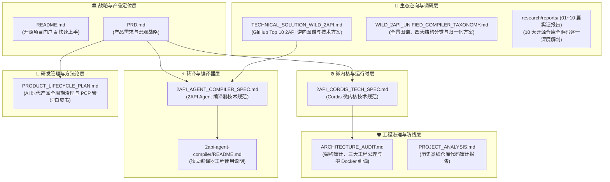

# nachuan (纳川) · 官方全景技术文档导航与总索引 (Documentation Index)

> **海纳百川，有容乃大。**  
> 本索引为 `nachuan (纳川)` 开源系统及其周边生态（微内核运行时、2API Agent 编译器、Cordis 插件集）的官方权威技术文档总入口。

---

## 🗺️ 文档分层拓扑架构 (Documentation Hierarchy)

全套技术文档体系划分为六大层次，覆盖从顶层产品定义、底层微内核契约、逆向编译器引擎到 AI 时代研发治理的全链路闭环：



---

## 📚 官方文档核心资产矩阵

| 文档名称 / 路径 | 核心定位 | 目标读者 | 核心解决问题 / 关键交付 |
|---|---|---|---|
| **[`README.md`](file://<LEGACY_WORKSPACE>/README.md)** | 开源项目门户门面 | 全体开发者、最终用户 | 个人专用定位、零 Docker 优势、极简命令行快速上手与架构图谱。 |
| **[`PRD.md`](file://<LEGACY_WORKSPACE>/PRD.md)** | 产品需求规格说明书 | 产品经理、架构师 | 确立“2API 即插件”与代码级语义编译转译模型，制定阶段实施里程碑。 |
| **[`2API_CORDIS_TECH_SPEC.md`](file://<LEGACY_WORKSPACE>/2API_CORDIS_TECH_SPEC.md)** | Cordis 微内核架构规范 | 核心系统开发者 | 详解 Context 四大注入服务契约（`ctx.server`/`pool`/`scheduler`/`panel`）与 Schema 驱动 UI。 |
| **[`2API_AGENT_COMPILER_SPEC.md`](file://<LEGACY_WORKSPACE>/2API_AGENT_COMPILER_SPEC.md)** | 2API Agent 编译器规范 | 编译器工程师、Agent 开发者 | 详解 Pass 1/2/3 语义提纯流水线、`ProtocolSpec` 统一中间表示（IR）与打桩沙箱。 |
| **[`TECHNICAL_SOLUTION_WILD_2API.md`](file://<LEGACY_WORKSPACE>/TECHNICAL_SOLUTION_WILD_2API.md)** | 热门 2API 逆向工程图谱 | 逆向研究员、协议专家 | 深度解剖 GitHub Top 10 开源 2API，确立五层通用解剖模型与四类原型收敛策略。 |
| **[`research/reports/WILD_2API_UNIFIED_COMPILER_TAXONOMY.md`](file://<LEGACY_WORKSPACE>/research/reports/WILD_2API_UNIFIED_COMPILER_TAXONOMY.md)** | 2API 归一化总纲与四大分类方案 | 架构师、逆向专家 | 详述四大结构分类、四大共性痛点与“该统一的统一，该保留的保留”实施矩阵。 |
| **[`research/reports/ (10 篇实证报告)`](file://<LEGACY_WORKSPACE>/research/reports/)** | 10 款仓库架构逐一深度解剖 | 编译器开发、逆向工程师 | 涵盖 `sub2api`, `codex2api`, `gemini`, `qwen`, `jimeng`, `grok`, `antihub`, `hellogml`, `doubao`, `q2api`。 |
| **[`ARCHITECTURE_AUDIT.md`](file://<LEGACY_WORKSPACE>/ARCHITECTURE_AUDIT.md)** | 架构审计与工程防线规范 | 核心运维、安全审计 | 剖析历史 Docker 实体膨胀与路径耦合债务，确立“零容器强加”等三大工程公理。 |
| **[`PRODUCT_LIFECYCLE_PLAN.md`](file://<LEGACY_WORKSPACE>/PRODUCT_LIFECYCLE_PLAN.md)** | AI 时代产品管理白皮书 | 技术主管、Prompt 工程师 | 提出第一性周期公式 $T = R \times (L_{ai} + L_h)$、上游协议腐烂金丝雀探针自愈与 4 层防御网。 |
| **[`PROJECT_ANALYSIS.md`](file://<LEGACY_WORKSPACE>/PROJECT_ANALYSIS.md)** | 历史基线仓库审计报告 | 历史技术追溯人员 | 2026-10-29 对原上游 `workbuddy2api-panel` 28,310 行 Go 源码的客观质量评估。 |
| **[`REPRODUCIBILITY_GUIDE.md`](file://<LEGACY_WORKSPACE>/REPRODUCIBILITY_GUIDE.md)** | 从零复现与冷启动指南 | 运维实施、新环境交付人员 | 硬件依赖基线、标准四步冷启动复现、冒烟排错表与无损备份迁移协议。 |
| **[`2api-agent-compiler/README.md`](file://<LEGACY_WORKSPACE>/2api-agent-compiler/README.md)** | 独立编译器工程使用说明 | 独立使用转译工具的用户 | 提供独立目录 `2api-agent-compiler/` 的开箱编译、测试与端到端转译指导。 |

---

## 🎯 推荐阅读路线 (Role-Based Reading Paths)

不同角色的开发者建议按以下顺序阅读，以最大化认知效率：

### 路线 1：极简自用开发者（只想本地开箱即用）
```
[README.md] (了解特性并执行 make build / make run)
     │
     ▼
[ARCHITECTURE_AUDIT.md] (理解为何无需 Docker 与本地相对路径自足机制)
     │
     ▼
[Makefile] (掌握本地原生 CLI 运维工具)
```

### 路线 2：系统架构师（需要理解微内核与扩展机制）
```
[PRD.md] (掌握“2API 即插件”与产品愿景)
     │
     ▼
[2API_CORDIS_TECH_SPEC.md] (深入 Cordis 微内核契约与插件装卸机制)
     │
     ▼
[ARCHITECTURE_AUDIT.md] (掌握三大工程公理与宿主-插件正交性)
```

### 路线 3：编译器与逆向研究员（专注接入与转译第三方 2API）
```
[TECHNICAL_SOLUTION_WILD_2API.md] (学习 GitHub 10 款代表性项目逆向图谱与五层模型)
     │
     ▼
[2API_AGENT_COMPILER_SPEC.md] (掌握 2API Agent 编译器 3-Pass 架构与 ProtocolSpec IR)
     │
     ▼
[2api-agent-compiler/README.md] (上手独立编译工具 bin/2api-compiler 并转译实际仓库)
```

### 路线 4：技术 Leader / AI 时代工程管理者（指导人机协同研发）
```
[PRODUCT_LIFECYCLE_PLAN.md] (掌握 AI 时代的注意力管理瓶颈与第一性周期公式)
     │
     ▼
[PRD.md] (统筹四个实施里程碑 M1~M4)
     │
     ▼
[ARCHITECTURE_AUDIT.md] (建立代码污染静态检查与交付防御网)
```

---

## 🔄 文档维护准则与版本规范

1. **真实性与不可篡改性**：所有技术规范与文档中的命令、代码片段，必须在无网络欺骗、真实原生环境下 100% 可复现并经自动化测试全绿验证；
2. **术语绝对一致性**：
   - **宿主网关平台**：统一命名为 **`nachuan (纳川)`**；
   - **转译与提纯引擎**：统一命名为 **`2API Agent 编译器 (2API Agent Compiler)`**；
   - **挂载业务单元**：统一命名为 **`2api 插件 (2api-plugin-*)`**；
3. **版本库追踪保障**：核心架构文档受 [`.gitignore`](file://<LEGACY_WORKSPACE>/.gitignore) 显式白名单保护，严禁遗漏提交。
