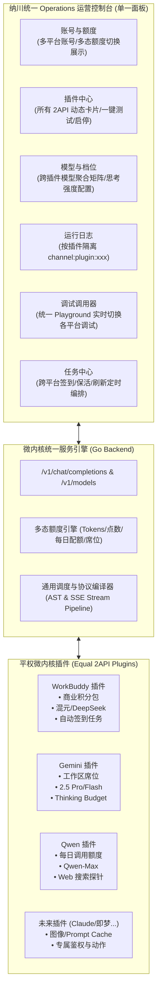

# 2API 项目接入成功标准与目标形态定义 (Definition of Done & Target State)

> **核心设计准则**：  
> **“保留其灵魂（能力不降级），改造其骨架（契约归一化），平权其地位（面板统一调用）”**。  
> 既坚决反对“削足适履”把丰富的逆向能力砍成仅剩文本问答，也坚决反对“各自为政”在系统内堆砌孤岛。

---

## 一、成功的终极全貌：接进来后长成什么样子？

当一个 2API 项目（例如 Gemini、GLM、Qwen、Claude、甚至图像生成如即梦）接入纳川统一网关后，系统展现的是**高度统一而又充满个性**的协同形态：

---

## 二、维度 1：功能保留（保留什么？保留到哪里？以何种形式保留？）

保留不是原封不动地把原有代码杂乱地塞进来，而是将平台的独特价值**结构化提取并保留**：

### 1. 模型高级能力与特色参数保留
- **保留内容**：
  - 各大平台的独有模型参数（例如 Gemini 的 `thinking_budget`、Claude 的 `prompt_caching`、WorkBuddy 的 `reasoning_effort` 档位、智谱清言的 `web_search` 联网开关、即梦的图像尺寸与提示词强度）。
- **保留形式**：
  - 插件在 `index.json` 中声明 `capabilities`（例如 `["chat", "reasoning", "web_search", "vision"]`）。
  - 网关协议编译器提供**参数透传与映射管道**：客户端通过标准 OpenAI 请求体中的额外参数（`extra_body` 或 vendor 字段）传入，插件原汁原味透传给上游。

### 2. 账号专属资产与凭证细节保留
- **保留内容**：
  - 各平台独特的鉴权材料（Gemini 需要 Refresh Token / WorkSpace ID，WorkBuddy 需要 DeviceToken / OrgID，通义千问需要 Cookie + CSRF）。
  - 资产细节（如 WorkBuddy 的各批次过期时间 `batches`、Gemini 商业工作区席位类型、通义每日剩余免费次数）。
- **保留形式**：
  - 插件定义专有的 `credential_schema`。
  - 在「账号与额度」详情弹窗中，通过动态 Form 表单录入与展示，绝不丢失任何专有字段。

### 3. 平台特色运维与动作保留 (Plugin Actions)
- **保留内容**：
  - 平台原有的自检、刷新与领额度能力（如 WorkBuddy 自动签到 `checkin`、Gemini 凭证刷新 `refresh_token`、Qwen 会话重置 `reset_session`、通用连通性测试 `test_connection`）。
- **保留形式**：
  - 转化为插件标准的 `actions` 注册在面板上，管理员在「插件中心」点击按钮即可直接触发执行。

---

## 三、维度 2：功能改造（改造成什么样子？在同一个面板上如何统一调用？）

改造的目标是**消除割裂感与平台偏见**，让所有功能在同一个面板、同一个网关端点上实现**平权、切换、统一调用**：

### 改造 1：账号与额度在同一张表中「归一化」与「自由筛选」
- **改造前**：A 项目用 SQLite 存 Cookie，B 项目读环境变量，C 项目写死本地文件；A 项目叫点数，B 项目叫 Token，C 项目是包月。
- **改造后（统一面板）**：
  - **同一个表格管理**：列表列出所有平台的账号，明确标出平台 Badge（`Gemini` / `WorkBuddy` / `Qwen` / `GLM`）。
  - **平台切换筛选器**：顶部提供快速切页按钮（`全部` / `WorkBuddy` / `Gemini` / `GLM` / `Qwen`），一键过滤特定平台账号。
  - **多态额度条可视化**：
    - WorkBuddy 账号：显示「剩余点数 / 总点数」+「即将到期批次预警」。
    - Gemini 商业账号：显示「席位正常 (Active)」+「所属工作区企业名」。
    - 免费/日限制账号：显示「今日调用剩余 85/100」。
  - **统一操作列**：每个账号均有一致的「一键测活」、「刷新额度」、「编辑凭证」、「启停禁用」按钮。

### 改造 2：模型聚合为全景能力矩阵，无缝调用
- **改造前**：用户需要换不同端口、不同网关去调用不同平台的模型。
- **改造后（统一面板）**：
  - **全局自动聚合**：进入「模型与档位」，所有已启用插件的模型统一陈列（如 `cn:deepseek-v3`、`gemini-2.5-pro`、`glm-4-plus`、`qwen-max`）。
  - **来源插件标注**：清晰标明该模型由哪个 2API 插件提供，健康状态与支持的思考档位。
  - **统一外部调用**：外部客户端（NextChat / Cherry Studio / Cursor）只需连接统一网关地址（如 `http://localhost:7865/v1`），在模型列表下拉即可随意挑选调用任何平台的模型，网关自动根据模型名路由给对应插件。

### 改造 3：控制台内置「统一调试与调用面板 (Playground)」
- **改造前**：测试某个 2API 是否正常，需要单独写 Python 脚本或敲 curl 命令行。
- **改造后（统一面板）**：
  - 面板内置统一的调用控制台：
    1. **平台与模型下拉选择**：秒级切换想调用的 2API 插件和目标模型。
    2. **动态参数区**：如果选了推理模型，自动滑出思考预算滑块；如果选了普通模型，展示 Temperature 滑块。
    3. **即时对话框**：输入问题，实时查看流式 SSE 回复，底部实时显示「响应耗时」、「输入/输出 Token」、「命中账号」以及「上游原始协议耗时」。
  - 在插件中心点击任一插件的「连接测试」，也能直接调用其探针，实时打印诊断详情。

### 改造 4：跨平台定时任务统一编排
- **改造前**：每个项目各自跑独立的死循环（`while true` / `cron`），无法监控状态，失败无感知。
- **改造后（统一面板）**：
  - 进入「任务中心」，所有 2API 的后台任务统一列表管理：
    - WorkBuddy 定时签到与积分刷新
    - Gemini Token 过期自动 Refresh
    - 通义千问/智谱清言账号探活与配额同步
  - 支持在面板上手动一键立即触发任务，并直观查看下一次调度时间和执行成功率。

### 改造 5：运行日志按插件频道精准隔离
- **改造前**：所有输出混在一个终端，出问题难以排查。
- **改造后（统一面板）**：
  - 进入「运行日志与监控」，顶部提供专属通道过滤器（`全服务日志` / `plugin:2api-plugin-gemini` / `plugin:2api-plugin-workbuddy` 等）。
  - 切换对应平台即可仅看该平台的逆向协议交互流水、状态码与错误堆栈。

---

## 四、2API 接入成功量化验收清单 (Checklist / DoD)

接入任何一个新 2API 项目时，必须严格对照以下 7 项标准验收，全部通过方可视为接入成功：

| 验收序号 | 验收维度 | 检验标准与判定条件 | 状态 |
| :---: | :--- | :--- | :---: |
| **01** | **微内核契约定义** | 插件目录具备合法 `index.json`，声明了唯一 ID、支持模型清单、多态额度类型、专属 Actions。 | 必须通过 |
| **02** | **账号无缝录入** | 能在「账号与额度」面板点击「添加账号」，选择该平台，录入其专属凭证并保存成功。 | 必须通过 |
| **03** | **额度多态展示** | 账号列表正确呈现该平台的额度形态（点数/席位/日调用数/Token），数值与上游准确对齐。 | 必须通过 |
| **04** | **模型动态挂载** | 插件启用后，无需重启网关，`/v1/models` 和「模型与档位」面板即时出现新模型及其档位标签。 | 必须通过 |
| **05** | **面板一键测试** | 在「插件中心」点击该插件的「测试连接」，能成功返回上游探针响应（延迟、账号状态）。 | 必须通过 |
| **06** | **标准 API 流式代理** | 用外部客户端或统一 Playground 请求 `/v1/chat/completions`，能够流畅输出标准 SSE Delta。 | 必须通过 |
| **07** | **隔离日志可溯** | 在「运行日志与监控」切换到该插件频道，能查到完整的请求审计记录与上游错误详情。 | 必须通过 |

---
*纳川 (Nachuan) 统一 2API 架构工程组 — 统一标准，平权共存*
